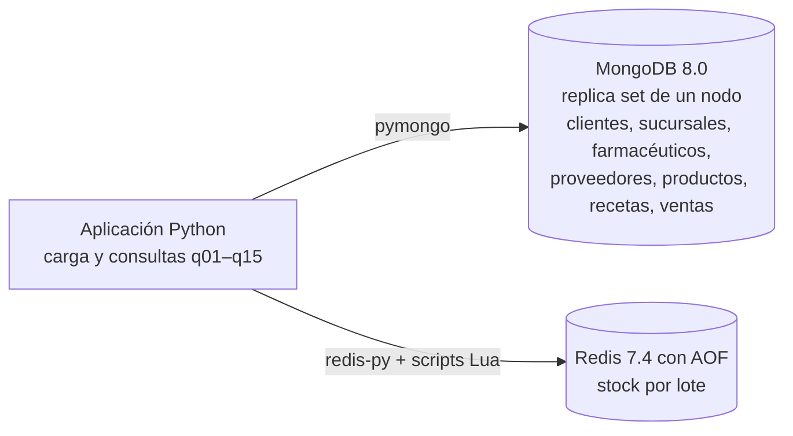
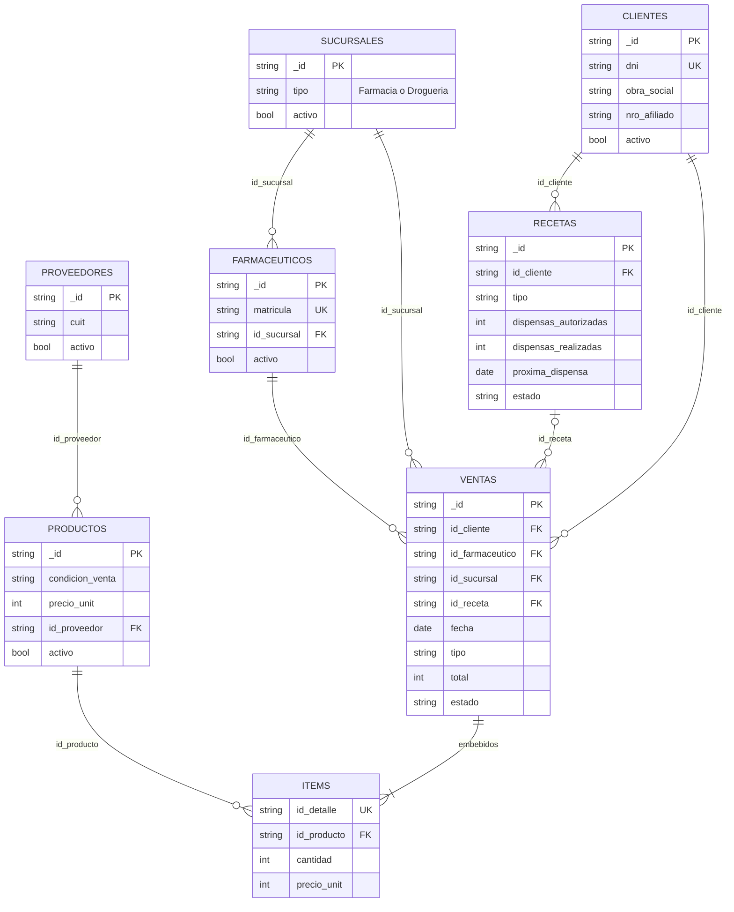
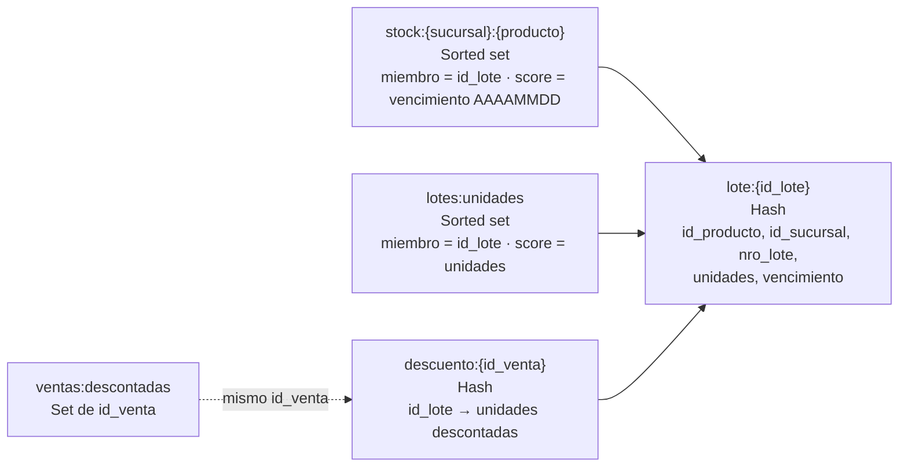
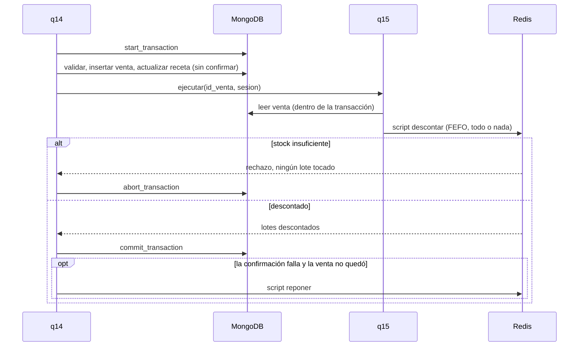

# FarmaRed — Sistema de gestión de una red de farmacias con persistencia políglota

**Bases de Datos II — ITBA — 2.º cuatrimestre de 2026**

Trabajo Práctico Obligatorio

| Integrante | Legajo | Usuario de GitHub |
|---|---|---|
| | | [@franciscocostaa](https://github.com/franciscocostaa) |
| | | [@romansalerno](https://github.com/romansalerno) |
| | | |
| | | |

**Repositorio:** https://github.com/franciscocostaa/TPO-BD2

## Contenido

1. [Arquitectura políglota](#1-arquitectura-políglota)
2. [Modelo de datos](#2-modelo-de-datos)
3. [Entorno](#3-entorno)
4. [Carga de datos y registros adicionales](#4-carga-de-datos-y-registros-adicionales)
5. [Consultas y servicios](#5-consultas-y-servicios)
6. [Consistencia e integridad](#6-consistencia-e-integridad)
7. [Limitaciones, alternativas y conclusiones](#7-limitaciones-alternativas-y-conclusiones)
8. [Fuentes](#8-fuentes)

## 1. Arquitectura políglota

**MongoDB es el sistema de registro y Redis guarda el stock por lote.** La aplicación está escrita en Python.



### 1.1 Qué hay que resolver

La consigna pide al menos dos motores NoSQL de paradigmas distintos, con una justificación técnica para cada entidad o caso de uso (Consigna, pp. 1, 5). También adelanta las características de cada dato:

| Dato | Característica |
|---|---|
| Ventas y detalle | Jerárquico (cabecera con ítems variables); consultas por cliente, farmacéutico y fecha; muchas inserciones. |
| Stock por lote | Actualizaciones frecuentes y concurrentes; nunca negativo; prioridad por vencimiento. |
| Clientes, recetas, farmacéuticos | ABM con baja lógica; relaciones que se recorren en el historial. |
| Catálogo y proveedores | Pocos cambios, muchas lecturas. |
| Reportes | Totales, rankings, conteos por período. |

(Consigna, p. 5)

El punto más delicado es el de las consultas 14 y 15: registrar una venta y descontar su stock con FEFO como una única operación. Si algún ítem no alcanza, no puede quedar nada modificado: ni la venta, ni la receta, ni los lotes (Consigna, p. 7).

### 1.2 Criterio de elección

La persistencia políglota consiste en usar la tecnología adecuada para cada necesidad. La elección pesa modelo, consistencia, durabilidad, escalabilidad, complejidad operativa y capacidades del equipo, y **cada motor agregado suma costo de integración, despliegue y mantenimiento** (Clase I, pp. 4–6).

Por eso buscamos el **mínimo de motores (dos)** que cubra bien todos los casos, con un rol para cada uno que el otro no pueda cumplir.

### 1.3 Motores evaluados

| Motor | A favor para FarmaRed | En contra para FarmaRed |
|---|---|---|
| **MongoDB** | Embeber los ítems en la venta permite leerla y escribirla en una sola operación atómica (Clase 13, pp. 3–8). `$lookup` (Clase 13, pp. 21–24), pipelines de agregación y vistas (Clase 12, pp. 50–52). | La atomicidad vista en clase es por documento, y venta y receta son dos documentos (Clase 13, p. 5). |
| **Redis** | Los scripts Lua se ejecutan de forma atómica, sin atender a otro cliente en el medio (Clase 17, p. 31). Los sorted sets ordenan por score (Clase 18, pp. 14–15): con el vencimiento como score, FEFO sale solo. Es muy rápido (Clase 18, pp. 34–35). | La clase lo desaconseja para relaciones y para transacciones de varias operaciones (Clase 17, pp. 6–7). `MULTI` no tiene rollback (Clase 17, p. 12; Clase 18, p. 7). Vive en memoria, así que hay que activar AOF (Clase 17, pp. 17–24). |
| **Neo4j** | ACID (Clase 16, pp. 15–16). Recorre relaciones sin joins (Clase 16, p. 39). `MERGE` y restricciones de unicidad (Anexo Neo4j, pp. 2–5). | Replica el grafo completo sin fragmentarlo, lo que limita el tamaño (Clase 16, pp. 39–40). Mayor curva de modelado. |
| **Cassandra** | Escrituras masivas, una tabla por consulta (Clase 15, pp. 16–19). | Sin joins ni subconsultas (Clase 15, pp. 13, 19). La clase la desaconseja para sistemas que requieren ACID (Clase 15, p. 6). Pesada para Codespaces. |
| **DynamoDB** | Clave de partición y de ordenamiento, más LSI y GSI para consultar por cliente y fecha (Clase 20, pp. 6, 17–19). | Consistencia solo a nivel de ítem, sin operaciones atómicas entre ítems (Clase 20, p. 6). Sin agregaciones; modelado y capacidad complejos (Clase 20, pp. 32–33). |

Descartamos Cassandra y DynamoDB porque fallan justo en lo que más pesa: la consistencia de 14 + 15 y los reportes. La alternativa más fuerte, Neo4j, se analiza en [7.2](#72-alternativas-evaluadas).

### 1.4 Qué guarda cada motor y por qué

| Dato | Motor | Justificación |
|---|---|---|
| Ventas con sus ítems | MongoDB | Son jerárquicas, crecen mucho y se consultan y agregan por cliente, farmacéutico y fecha. Con los ítems embebidos, cada venta se lee y se escribe en una operación atómica (Clase 13, pp. 3–8). Los reportes (4, 5, 7 y 11) son pipelines de agregación, y la consulta 11 pide una vista, que MongoDB tiene (Clase 12, pp. 50–52). |
| Clientes, recetas, farmacéuticos, sucursales | MongoDB | Tienen ABM con baja lógica y relaciones que se recorren en el historial (consultas 3 y 10). Se resuelven con referencias y `$lookup` (Clase 13, pp. 21–24). Venta y receta se actualizan juntas en una transacción (ver [6.3](#63-consultas-14-y-15-todo-o-nada-entre-dos-motores)). |
| Catálogo y proveedores | MongoDB | Datos de referencia poco volátiles y de lectura frecuente, que las consultas combinan con ventas y lotes. |
| Stock por lote | Redis | Es el dato con más escrituras concurrentes y con una invariante dura: nunca negativo y FEFO. Un script Lua evalúa todos los ítems y descuenta solo si alcanzan todos, en una operación atómica (Clase 17, p. 31). El sorted set por vencimiento resuelve FEFO sin ordenar en la aplicación (Clase 18, pp. 14–15). |

La clase advierte que las bases clave-valor no convienen para transacciones de varias operaciones (Clase 17, pp. 6–7). A Redis no le pedimos una transacción entre entidades, sino **una única operación atómica sobre el stock**, que es lo que garantiza un script Lua. La transacción entre entidades (venta y receta) la hace MongoDB.

**Reparto de las consultas:**

| Motor | Consultas |
|---|---|
| Solo MongoDB | 1, 2, 3, 4, 5, 6, 7, 9, 10, 11 (vista), 12, 13 |
| Redis + MongoDB | 8 (lotes de Redis con producto, sucursal y proveedor de MongoDB), 14 y 15 |

### 1.5 Stack

- **Python 3.12**, el lenguaje que usa la cátedra en los ejemplos (`redis-py` con pipelines en Clase 18, pp. 18–19; `boto3` en Clase 20, pp. 26–27). Librerías: `pymongo` y `redis`.
- **docker-compose + devcontainer** con MongoDB como replica set de un nodo y Redis con AOF (ver [3](#3-entorno)).
- Las consultas que dependen de la fecha toman la fecha del sistema, como exige la consigna (p. 6).

## 2. Modelo de datos

### 2.1 Convenciones

| Tema | Decisión |
|---|---|
| Identificadores | `_id` = id del CSV (`"C001"`, `"V001"`…). Las referencias usan los nombres de campo del CSV (`id_cliente`, `id_producto`…). Los registros propios siguen la misma serie (`C009`, `V017`…). |
| Nombres de campo | Los del CSV, sin cambios. |
| Booleanos | `True`/`False` del CSV → `bool`. |
| Fechas | `AAAA-MM-DD` → `Date` de MongoDB a las 00:00 UTC de ese día. Solo importa el día: para comparar con "hoy", la fecha de hoy se convierte de la misma forma. |
| Importes | Enteros en ARS. |
| Vacíos | `null` explícito: todos los documentos de una colección tienen los mismos campos. |
| "Hoy" | Fecha del sistema en hora argentina (el contenedor corre con `TZ=America/Argentina/Buenos_Aires`). Cada consulta que la usa acepta un parámetro opcional `hoy` para que las pruebas den siempre el mismo resultado. |
| Lote vencido | `vencimiento < hoy`: un lote se puede dispensar hasta el día de su vencimiento inclusive. |
| Bajas | Lógicas: `activo: false`. Nunca se borra un documento ni un lote. |

### 2.2 MongoDB

Base `farmared`: siete colecciones de datos y una de contadores. No hay colección de lotes: el stock vive solo en Redis.



Cada flecha es una referencia por id, salvo `ITEMS`, que va embebido en la venta.

#### `clientes`

```js
{ _id: "C001", nombre: "Lucía", apellido: "Fernández", dni: "31245678",
  email: "lucia.f@gmail.com", telefono: "1145112233",
  ciudad: "Buenos Aires", provincia: "Buenos Aires",
  obra_social: "OSDE", nro_afiliado: "OS-310045", activo: true }
```

- Índice **único** en `dni` (q13 valida DNI único).
- Consultas: 3, 4, 6, 10, 12, 13, 14.

#### `sucursales`

```js
{ _id: "S001", nombre: "Farmacia Palermo", tipo: "Farmacia",
  direccion: "Av. Santa Fe 3350", ciudad: "Buenos Aires", provincia: "Buenos Aires",
  telefono: "1148001001", activo: true }
```

- Consultas: 2, 8, 10, 14.

#### `farmaceuticos`

```js
{ _id: "F001", nombre: "Mariana", apellido: "Quiroga", matricula: "MN-18041",
  cargo: "Director Técnico", id_sucursal: "S001", activo: true }
```

- Colección propia con referencia a la sucursal. Se consulta por sí sola (q05, q11), así que no conviene embeberla en la sucursal.
- Índice **único** en `matricula`; índice en `id_sucursal` (q10).
- Consultas: 2, 5, 10, 11, 14.

#### `proveedores`

```js
{ _id: "PRV001", razon_social: "Laboratorios Andinos S.A.", cuit: "30-71234567-1",
  tipo: "Laboratorio", ciudad: "Buenos Aires", provincia: "Buenos Aires",
  telefono: "1143001100", activo: true }
```

- Consultas: 1, 8.

#### `productos`

```js
{ _id: "PRD001", nombre: "Paracetamol 500mg x30", principio_activo: "Paracetamol",
  categoria: "Analgésico", presentacion: "Comprimidos x30",
  condicion_venta: "Venta libre", precio_unit: 2800,
  id_proveedor: "PRV001", activo: true }
```

- Referencia al proveedor. Un proveedor tiene muchos productos y así no se repiten sus datos (Clase 13, caso editor–libros).
- Consultas: 1, 7, 8, 14.

#### `recetas`

```js
{ _id: "RC002", id_cliente: "C003", medico: "Dra. Silvia Montenegro",
  matricula_medico: "MP-39877", fecha_emision: ISODate("2026-07-15"),
  tipo: "Tratamiento prolongado", dispensas_autorizadas: 3, dispensas_realizadas: 2,
  proxima_dispensa: ISODate("2026-09-15"), estado: "Vigente" }
```

- Colección propia que referencia al cliente: un cliente acumula recetas sin límite, y referenciar desde el hijo evita un arreglo que crece (Clase 13, pp. 16–20).
- Índices: `id_cliente`; `{ tipo, estado, proxima_dispensa }` para q06.
- Consultas: 3, 4, 6, 14.

#### `ventas`

```js
{ _id: "V006", id_cliente: "C006", id_farmaceutico: "F002", id_sucursal: "S001",
  id_receta: "RC003", fecha: ISODate("2026-08-01"), tipo: "Con receta",
  medio_pago: "Obra social", total: 22100, estado: "Completada",
  items: [
    { id_detalle: "D007", id_producto: "PRD005", cantidad: 3, precio_unit: 5400 },
    { id_detalle: "D008", id_producto: "PRD009", cantidad: 1, precio_unit: 5900 } ] }
```

- `items` embebidos: es una relación "contiene" y siempre se leen y escriben con la venta. Insertar una venta con sus ítems es una sola operación atómica, y un ítem no puede existir sin su venta (Clase 13, pp. 3–8).
- `precio_unit` del ítem es el precio al momento de la venta y puede diferir del de lista.
- `id_sucursal` es la sucursal donde ocurrió la venta, copiada del farmacéutico al registrarla. q15 la usa para saber de qué lotes descontar. La q10 sigue pasando por el farmacéutico, como pide la consigna.
- Índices: `{ id_cliente, fecha }`, `{ id_farmaceutico, fecha }`, `{ fecha }`, `{ estado }` y **único** en `items.id_detalle`.
- Consultas: 2, 3, 5, 7, 9, 10, 11, 12, 14, 15.

#### `contadores`

```js
{ _id: "ventas", ultimo: 16 }
{ _id: "detalle_ventas", ultimo: 22 }
```

- Último número usado de cada serie de ids. La carga lo calcula de los CSV; q14 lo incrementa con un `$inc` atómico (ver [6.5](#65-concurrencia)).

#### Vista

- `ingresos_farmaceutico_mes` (q11): pipeline sobre `ventas` que filtra las "Completada" del mes actual y suma `total` por farmacéutico. No almacena datos: se recalcula en cada lectura, y el mes sale de `$$NOW`, la fecha del servidor al momento de la consulta. La define `farmared/consultas/q11.py`, que la crea si falta (ver [consulta 11](#consulta-11--ingresos-por-farmacéutico-en-el-mes-actual)).

### 2.3 Redis

Base 0. Cada lote es un hash, y dos sorted sets lo indexan: uno por vencimiento, para FEFO, y otro por unidades, para el reporte de stock bajo. Las otras dos claves registran qué ventas ya descontaron stock y de qué lotes.



| Clave | Tipo | Contenido | Uso |
|---|---|---|---|
| `lote:{id_lote}` | Hash | `id_producto`, `id_sucursal`, `nro_lote`, `unidades`, `vencimiento` (ISO) | Datos del lote |
| `stock:{id_sucursal}:{id_producto}` | Sorted set | miembro `id_lote`, score = vencimiento como `AAAAMMDD` | FEFO (q15) |
| `lotes:unidades` | Sorted set | miembro `id_lote`, score = unidades | Stock bajo (q08) |
| `ventas:descontadas` | Set | ventas cuyo stock ya se descontó | Evitar descontar dos veces (q15) |
| `descuento:{id_venta}` | Hash | `id_lote` → unidades descontadas de ese lote para la venta | Compensación (q14) |

```text
HSET lote:L005 id_producto PRD003 id_sucursal S001 nro_lote L-2506A unidades 40 vencimiento 2026-11-30
ZADD stock:S001:PRD003 20261120 L033 20261130 L005 20270630 L015
ZADD lotes:unidades 40 L005

# Lotes dispensables de PRD003 en S001, del que vence antes (hoy = 2026-11-14):
ZRANGEBYSCORE stock:S001:PRD003 20261114 +inf

# q08: lotes con menos de 50 unidades
ZRANGEBYSCORE lotes:unidades -inf (50
```

**Invariantes:**
- Las unidades solo cambian dentro de los scripts Lua `descontar` y `reponer` (`farmared/stock.py`), que actualizan el hash del lote y `lotes:unidades` en la misma operación atómica. La carga escribe todo en un `MULTI`.
- Las unidades nunca quedan negativas: `descontar` solo escribe si alcanzan todos los productos.
- Los lotes con 0 unidades no se borran (baja lógica): quedan en los sorted sets y el script los saltea.
- Una venta se descuenta una sola vez: `descontar` la agrega a `ventas:descontadas` y guarda `descuento:{id_venta}` en la misma operación.

### 2.4 Relaciones entre motores

| Desde (Redis) | Hacia (MongoDB) | Cómo se resuelve |
|---|---|---|
| `lote:{id}.id_producto` | `productos._id` | En la aplicación: q08 lee los lotes en Redis y trae los productos con `$in`. |
| `lote:{id}.id_sucursal`, clave `stock:{sucursal}:…` | `sucursales._id` | En la aplicación: q08 trae las sucursales; q15 arma la clave con la `id_sucursal` de la venta. |
| `ventas:descontadas`, `descuento:{id_venta}` | `ventas._id` | q15 parte de la venta de MongoDB y registra su id en Redis. |

La carga valida que cada lote apunte a un producto y una sucursal existentes (ver [6.1](#61-integridad-referencial)).

## 3. Entorno

El entorno se levanta completo en GitHub Codespaces a partir de `.devcontainer/` y `docker-compose.yml`, sin pasos manuales: al crear el Codespace quedan los motores corriendo, las dependencias instaladas y las consolas disponibles. El mismo devcontainer funciona en VS Code local con la extensión Dev Containers.

Cada motor corre en su propio contenedor, a partir de una imagen oficial con la versión fijada. Así el entorno es el mismo en cualquier máquina (Clase I, pp. 8–9).

| Servicio | Imagen | Configuración | Por qué |
|---|---|---|---|
| `app` | Python 3.12 (imagen de devcontainers) + `mongosh` + `redis-cli` | Monta el repositorio en `/workspaces/TPO-BD2`. Define `MONGO_URI`, `MONGO_DB`, `REDIS_URL` y `TZ=America/Argentina/Buenos_Aires`. Arranca cuando `mongo` y `redis` están sanos. | Es donde se trabaja y se ejecutan la carga y las consultas. La zona horaria hace que "hoy" sea el día argentino. |
| `mongo` | `mongo:8.0` | Replica set `rs0` de un nodo. | Las transacciones de varios documentos, que usan la carga y q14, requieren un replica set. |
| `redis` | `redis:7.4` | AOF con `appendfsync everysec`, más los snapshots RDB por defecto. | El stock vive solo en Redis: sin persistencia, un reinicio lo perdería. AOF + RDB es la combinación que aconseja la clase, y con fsync por segundo se pierde a lo sumo un segundo de escrituras (Clase 17, pp. 17–21). |

*Complemento (no está en las clases): `docker-compose`, el devcontainer, los volúmenes con nombre y el replica set de un nodo. Ver el [manual de transacciones de MongoDB](https://www.mongodb.com/docs/manual/core/transactions/).*

**Replica set sin pasos manuales.** Un replica set nuevo hay que iniciarlo una vez con `rs.initiate`. Lo hace el healthcheck del servicio `mongo`: si `rs.status()` falla, el nodo todavía no es parte de un replica set, así que lo inicia. El servicio recién queda sano cuando el nodo es primario y acepta escrituras, y `app` espera esa condición para arrancar. En los reinicios, el replica set ya existe y el paso no hace nada.

**Persistencia.** Los datos se guardan en tres volúmenes con nombre (`mongo-data`, `mongo-config`, `redis-data`), así que sobreviven a reinicios y a reconstrucciones del contenedor. No se publican puertos: `app` se conecta a `mongo` y `redis` por la red interna de compose.

**Verificación.** `python -m farmared.verificar` comprueba lo que necesitan la carga y las consultas:

```text
✔ MongoDB: conexión: responde
✔ MongoDB: replica set: rs0, primario mongo:27017
✔ MongoDB: transacciones: abort deshace el insert
✔ Redis: conexión: responde
✔ Redis: persistencia AOF: appendonly = yes
✔ Redis: scripts Lua: EVAL ejecuta scripts
```

La prueba de transacciones inserta un documento dentro de una transacción, la aborta y comprueba que no quedó. La de Lua ejecuta un `EVAL` sobre una clave temporal.

## 4. Carga de datos y registros adicionales

```bash
python -m farmared.carga
```

El script (`farmared/carga.py`) parte de los CSV de la cátedra (`datos/provistos/`) y de los registros propios del equipo (`datos/adicionales/`). Los adicionales tienen los mismos nombres de archivo y encabezados, así que la carga concatena las filas de ambos orígenes y procesa todo igual.

### 4.1 Pasos

1. **Lectura y conversión**, según las convenciones de la consigna:
   - Campo vacío → `null`.
   - `True`/`False` → booleano.
   - Fechas `AAAA-MM-DD` → `Date` a las 00:00 UTC.
   - Importes, unidades y dispensas → enteros.
   - El resto queda como texto, incluidos DNI y teléfonos, para no perder ceros a la izquierda.
2. **Validación** de los datos combinados, antes de escribir (ver [6.1](#61-integridad-referencial)). Si hay errores, los lista todos y termina sin tocar ninguna base.
3. **Transformación** al modelo de la [sección 2](#2-modelo-de-datos):
   - El id de cada CSV pasa a ser el `_id`.
   - Las filas de `detalle_ventas` se agrupan como `items` embebidos en su venta.
   - Cada venta recibe `id_sucursal`, la sucursal de su farmacéutico.
   - `contadores` guarda el último id de ventas y de ítems, para que q14 siga la serie.
   - `stock_lotes` va a Redis.
4. **MongoDB.** Crea los índices (únicos en `clientes.dni`, `farmaceuticos.matricula` y `ventas.items.id_detalle`, y los que usan las consultas). Después, en **una sola transacción**, vacía cada colección con `delete_many` y la vuelve a llenar con `insert_many`.
5. **Redis.** En **un solo `MULTI`**, borra las claves anteriores (`lote:*`, `stock:*`, `lotes:unidades`, `ventas:descontadas`, `descuento:*`) y escribe cada lote en sus tres claves. Además marca como descontadas las ventas "Completada" de los CSV: los lotes ya reflejan su stock, así que q15 no las tiene que descontar de nuevo.

Salida con los datos actuales:

```text
✔ clientes: 8 provistos + 12 adicionales → MongoDB clientes
✔ sucursales: 5 provistos + 10 adicionales → MongoDB sucursales
✔ farmaceuticos: 7 provistos + 11 adicionales → MongoDB farmaceuticos
✔ proveedores: 5 provistos + 10 adicionales → MongoDB proveedores
✔ productos: 13 provistos + 12 adicionales → MongoDB productos
✔ recetas: 9 provistos + 10 adicionales → MongoDB recetas
✔ ventas: 16 provistos + 0 adicionales → MongoDB ventas
✔ detalle_ventas: 22 provistos + 0 adicionales → MongoDB ventas.items
✔ stock_lotes: 18 provistos + 16 adicionales → Redis
```

### 4.2 Reproducible e idempotente

Cada ejecución deja exactamente el estado de los CSV, sin importar el estado anterior. Descarta las modificaciones de los servicios de escritura y también los documentos que agregaron, por ejemplo un cliente dado de alta con q13 o una venta registrada con q14. Por eso no se usa un upsert por documento, que dejaría esos documentos agregados.

- En MongoDB, la transacción hace que el reemplazo sea todo o nada: si algo falla a mitad de camino, las colecciones quedan como estaban. Las vistas (q11) no se tocan.
- En Redis, `MULTI` aplica el borrado y la escritura juntos, sin que otro cliente vea el stock vacío en el medio.

Lo comprobamos calculando un hash de todo el contenido de ambas bases después de dos cargas seguidas, con altas, modificaciones y bajas de q13 entre medio: el hash es idéntico.

### 4.3 Registros adicionales

La consigna pide al menos 10 registros propios por colección, elegidos para ejercitar las consultas: fechas recientes, stock bajo, lotes próximos a vencer o vencidos, recetas vencidas, clientes sin compras, ventas pendientes y casos borde (Consigna, p. 6). Cada integrante agregó los casos que ponen a prueba sus consultas.

#### Clientes (C009–C020, 12 registros)

| Caso | Registros | Ejercita |
|---|---|---|
| Sin ninguna venta | C011, C012, C014, C016, C018, C019 | q12 (clientes sin ventas en el último año), q10 |
| Con una única venta, de hace más de un año | C020 | q12 (aparece con `ultima_venta`, no con `null`) |
| Dados de baja | C016, C020 | q13 (baja ya hecha), q14 (rechazo por cliente inactivo) |
| Sin cobertura, sin número de afiliado | C012, C015 | q13 (regla de cobertura) |
| DNI de 7 dígitos | C011 | q13 (el DNI se guarda como texto) |
| Todas las obras sociales y las tres provincias de la red | Todos | q03, q04, q06 (datos del cliente) |

#### Sucursales (S006–S015, 10 registros)

| Caso | Registros | Ejercita |
|---|---|---|
| Farmacias nuevas en Buenos Aires, Santa Fe y Córdoba | S006–S013, S015 | q10 con una sucursal sin ventas (resultado vacío) |
| Farmacia dada de baja | S014 | q14 (su único farmacéutico, F016, también está dado de baja: rechazo) |

No agregamos droguerías: la consigna describe una única droguería propia (S005), y el rechazo de una venta en droguería ya se puede probar con su farmacéutico F007.

#### Farmacéuticos (F008–F018, 11 registros)

| Caso | Registros | Ejercita |
|---|---|---|
| Director técnico de cada farmacia nueva | F008–F015, F018 | q05 (activos con cero ventas en los últimos 60 días) |
| Segundo farmacéutico de una sucursal existente | F017 (S003) | q05, q10 |
| Dado de baja, en una sucursal cerrada | F016 (S014) | q05 (no aparece), q14 (rechazo por farmacéutico inactivo) |

#### Proveedores (PRV006–PRV015, 10 registros)

| Caso | Registros | Ejercita |
|---|---|---|
| Laboratorios y droguerías de distintas provincias, con CUIT de dígito verificador válido | Todos | q01, q08 |
| Dados de baja | PRV013, PRV015 | q01 y q08 con un proveedor inactivo, cuando un producto adicional lo referencia |

#### Productos (PRD014–PRD025, 12 registros)

| Caso | Registros | Ejercita |
|---|---|---|
| Las tres condiciones de venta: libre, bajo receta y bajo receta archivada | Todos | q01, q14 (exigir receta o no) |
| Activo con proveedor dado de baja | PRD023 (PRV013) | q01 (aparece, con `proveedor.activo: false`), q08 |
| Discontinuados | PRD024 (de PRV015, también dado de baja), PRD025 | q01 (no aparecen), q14 (rechazo por producto inactivo) |
| Productos de los proveedores adicionales | PRD014–PRD023 | q01, q08 (proveedor de cada lote) |

#### Lotes (L019–L034, 16 registros)

Las fechas "por vencer" y "vencido" se eligieron respecto de noviembre de 2026.

| Caso | Registros | Ejercita |
|---|---|---|
| **FEFO con un lote vencido en el medio:** PRD001 en S001 tiene L019 (vencido, 2026-08-31), L020 (2026-12-20) y L001 (2027-08-31) | L019, L020 | q15: tiene que saltear L019 y descontar primero de L020 |
| **FEFO con tres lotes vigentes:** PRD003 en S001 tiene L033 (2026-11-20), L005 (2026-11-30) y L015 (2027-06-30) | L033 | q15: una venta grande consume L033, después L005 y después L015 |
| **Solo stock vencido:** PRD017 en S001 tiene únicamente L022, vencido | L022 | q15: rechazo por falta de stock vigente, aunque haya unidades |
| Lote agotado, que no se borra | L021 (0 unidades) | q08 (aparece con 0), q15 (se saltea) |
| Stock bajo y por vencer | L026 (10 u., 2026-11-25), L028 (8 u., 2026-12-05) | q08 |
| Bordes del umbral de q08 | L030 (49 u., entra), L031 (50 u., no entra) | q08 (`< 50` estricto) |
| Vencido de un producto discontinuado | L034 | q08 (`vencido: true`) |
| Stock central en la droguería | L032 (1800 u.) | q15 (la droguería no vende: sus lotes no se tocan) |
| Lotes en farmacias adicionales | L027 (S006), L028 (S008), L029 (S007), L030 (S012), L031 (S010) | q08 |

#### Recetas (RC010–RC024, 15 registros)

RC010–RC019 van **sin dispensas realizadas**: así no hace falta inventar ventas históricas que las respalden, y `dispensas_realizadas` sigue coincidiendo con las ventas "Completada" de cada receta. RC020–RC024 sí tienen dispensas, y las ventas adicionales que las respaldan están más abajo.

| Caso | Registros | Ejercita |
|---|---|---|
| Simple vigente | RC010 (C009), RC014 (C014), RC018 (C012, sin cobertura) | q14 (venta exitosa; receta de otro cliente; obra social sin cobertura) |
| Archivada vigente | RC011 (C010) | q14 + q15 (PRD017 solo tiene un lote vencido en S001: rechazo por stock) |
| Tratamiento prolongado sin dispensas | RC012 (C011, 3 autorizadas), RC015 (C017, 6 autorizadas) | q14 (la primera dispensa fija la próxima a 30 días) |
| Vencidas | RC013 (C013, simple), RC017 (C019, archivada) | q14 (rechazo por receta no vigente), q03 |
| Simple vigente para un producto archivado | RC016 (C018) | q14 (rechazo: el producto exige receta archivada) |
| Vigente de un cliente dado de baja | RC019 (C016) | q14 (rechazo por cliente inactivo) |
| Simple ya completada, con su venta | RC020 (C009, 1 de 1, por V017) | q04 (segunda receta de C009), q03 |
| Prolongada con una dispensa hecha y la próxima en el futuro | RC021 (C013, 1 de 6, próxima 2026-12-07), RC023 (C003, 1 de 3, próxima 2026-12-11) | q04, q06 (**no** aparecen: la próxima dispensa todavía no venció) |
| Simple vigente con la venta todavía pendiente | RC022 (C010, 0 de 1, por V022) | q04, q02 (venta pendiente con receta) |
| Vencida y nunca dispensada | RC024 (C003, simple) | q04 (lleva a C003 a tres recetas) |

#### Ventas (V017–V029, 13 registros) y sus ítems (D023–D039, 17 registros)

Los ítems usan el precio de lista de cada producto, y `total` es la suma de `cantidad × precio_unit`, que la carga verifica. Las fechas se eligieron respecto de **noviembre de 2026**.

| Caso | Registros | Ejercita |
|---|---|---|
| **Ventas del mes actual** | V017, V018, V019, V020, V021, V024, V025, V027, V029 (noviembre de 2026) | q11: sin ventas del mes la vista devuelve cero filas y no se puede mostrar ningún ejemplo |
| Venta del mes anterior, dentro de la ventana de 60 días | V026 (28/10/2026) | q05 (cuenta) y q11 (no cuenta): es lo que distingue las dos consultas |
| Venta de hoy | V029 (14/11/2026) | q05 (borde superior de la ventana, inclusive) |
| **Venta de hace más de un año** | V028 (20/05/2025, de C020, dado de baja) | q12 (aparece con `ultima_venta` vieja, no `null`) |
| Venta "Pendiente" | V022 | q02, q05 (se cuenta: solo se excluyen las anuladas) |
| Venta "Anulada", única del año de su cliente | V023 (C015) | q05 (no se cuenta), q11 (no suma), q12 (es el caso que distingue las dos lecturas de "venta registrada") |
| Clientes nuevos con varias ventas | C009 (V017, V021), C010 (V018, V022), C017 (V020, V029) | q10, q03 |
| Segundo farmacéutico de una sucursal ya existente | V023 y V024, de F017 (S003) | q10 (S003 devuelve los clientes de F005 y de F017 juntos) |
| Ventas en las farmacias adicionales | V017 y V021 (S006), V018 y V022 (S008), V019 y V027 (S011) | q05, q10, q11 |
| Volumen para el ranking, con empates a propósito | V020, V025, V026 (PRD001 y PRD011 quedan 10 a 10); V021, V027 (PRD015); V018, V025 (PRD022, empata con PRD004 en el quinto puesto) | q07 (desempate por id, arriba y en el corte) |

Los **clientes sin compras** que necesita q12 no hacen falta agregarlos: de los doce clientes adicionales, siete quedan sin ninguna venta (C011, C012, C014, C016, C018, C019 y, con una venta vieja, C020).

## 5. Consultas y servicios

Cada consulta es un módulo de `farmared/consultas/` (`q01.py` a `q15.py`) con una función `ejecutar(...)` y un docstring con propósito, parámetros, retorno y motor. Los parámetros se reciben como argumentos, y las que dependen de la fecha toman la del sistema, con un parámetro `hoy` opcional para las pruebas. Cada módulo también se ejecuta desde la terminal del contenedor `app`, después de la carga:

```bash
python -m farmared.consultas.qNN [argumentos]
```

| # | Tipo | Motor | Relación resuelta por |
|---|---|---|---|
| 1 | Lectura | MongoDB | `$lookup` producto → proveedor |
| 2 | Lectura | MongoDB | `$lookup` venta → farmacéutico → sucursal |
| 3 | Lectura | MongoDB | `$unionWith` ventas + recetas del cliente |
| 4 | Agregación | MongoDB | `$group` de recetas por cliente + `$lookup` cliente |
| 5 | Agregación | MongoDB | `$lookup` farmacéutico → ventas, con `pipeline` propio |
| 6 | Lectura | MongoDB | `$lookup` receta → cliente |
| 7 | Agregación | MongoDB | `$unwind` de los ítems embebidos + `$lookup` producto |
| 8 | Lectura | Redis + MongoDB | Combinación en la aplicación |
| 9 | Lectura | MongoDB | Una sola colección |
| 10 | Lectura | MongoDB | `$lookup` farmacéutico → ventas → cliente |
| 11 | Agregación (vista) | MongoDB | `$group` de ventas por farmacéutico + `$lookup` farmacéutico |
| 12 | Lectura | MongoDB | Anti-unión: `$lookup` cliente → ventas y `$size: 0` |
| 13 | Servicio | MongoDB | Una sola colección |
| 14 | Servicio | MongoDB + Redis | Validación de cada referencia en la aplicación; ítems embebidos |
| 15 | Servicio | MongoDB + Redis | Venta de MongoDB → lotes de Redis por la clave `stock:{sucursal}:{producto}` |

### Consulta 1 — Productos activos con su proveedor

**Enunciado:** productos activos con todos los datos de su proveedor.

**Motor:** MongoDB, colecciones `productos` y `proveedores`.

**Código:** `farmared/consultas/q01.py`, función `ejecutar()`.

| Función | Parámetros | Retorno |
|---|---|---|
| `ejecutar()` | Ninguno. | Lista de productos con `activo: true`, ordenada por id. Cada uno trae el documento completo de su proveedor en `proveedor`, en lugar de `id_proveedor`. |

#### Cómo se resuelve la relación

El producto **referencia** a su proveedor (`id_proveedor`) en lugar de embeberlo: un proveedor abastece muchos productos, y embeberlo repetiría sus datos en cada producto. Si cambiara, por ejemplo, el teléfono del proveedor, habría que actualizar todos sus productos (Clase 13, pp. 16–20).

La relación se combina en la base con `$lookup`, que funciona como un *left outer join* (Clase 13, pp. 21–24). El catálogo y los proveedores cambian poco y se leen mucho, así que no hace falta desnormalizar para leer más rápido.

#### Sentencia

```python
db.productos.aggregate([
    {"$match": {"activo": True}},
    {"$lookup": {
        "from": "proveedores",
        "localField": "id_proveedor",
        "foreignField": "_id",
        "as": "proveedor",
    }},
    {"$set": {"proveedor": {"$ifNull": [{"$first": "$proveedor"}, None]}}},
    {"$unset": "id_proveedor"},
    {"$sort": {"_id": 1}},
])
```

- `$match` va primero, así el `$lookup` solo se hace sobre los productos activos.
- `$lookup` devuelve un arreglo. Como cada producto tiene un único proveedor, `$first` lo convierte en un subdocumento.
- Si la referencia no existiera, el producto aparece igual con `proveedor: null` en lugar de desaparecer del resultado. La carga ya valida que todas las referencias existan, así que no debería pasar.
- `foreignField` es `_id`, que siempre tiene índice. No hace falta crear otro.

#### Decisiones

- **Proveedor dado de baja:** el producto se lista igual, porque la consulta pide productos activos y el producto sigue en el catálogo. El campo `proveedor.activo` muestra el estado del proveedor. Es el caso del producto adicional PRD023, cuyo proveedor PRV013 está dado de baja.

#### Ejemplo

Desde la terminal del contenedor `app`, después de `python -m farmared.carga`:

```text
$ python -m farmared.consultas.q01
```

Devuelve 21 productos: PRD001–PRD011 de los provistos y PRD014–PRD023 de los adicionales. Quedan afuera los discontinuados PRD012, PRD013, PRD024 y PRD025. PRD023 aparece con `"proveedor": {"_id": "PRV013", ..., "activo": false}`. El primero:

```json
{
  "_id": "PRD001",
  "nombre": "Paracetamol 500mg x30",
  "principio_activo": "Paracetamol",
  "categoria": "Analgésico",
  "presentacion": "Comprimidos x30",
  "condicion_venta": "Venta libre",
  "precio_unit": 2800,
  "activo": true,
  "proveedor": {
    "_id": "PRV001",
    "razon_social": "Laboratorios Andinos S.A.",
    "cuit": "30-71234567-1",
    "tipo": "Laboratorio",
    "ciudad": "Buenos Aires",
    "provincia": "Buenos Aires",
    "telefono": "1143001100",
    "activo": true
  }
}
```

### Consulta 2 — Ventas pendientes con su farmacéutico

**Enunciado:** ventas en estado "Pendiente" con el farmacéutico asignado (nombre, matrícula y sucursal) y el total.

**Motor:** MongoDB, colecciones `ventas`, `farmaceuticos` y `sucursales`.

**Código:** `farmared/consultas/q02.py`, función `ejecutar()`.

| Función | Parámetros | Retorno |
|---|---|---|
| `ejecutar()` | Ninguno. | Ventas pendientes ordenadas por fecha, con `_id`, `fecha`, `id_cliente`, `total` y `farmaceutico` (`_id`, `nombre`, `apellido`, `matricula` y `sucursal`). |

#### Cómo se resuelve la relación

Venta → farmacéutico → sucursal son dos relaciones N:1 guardadas como **referencias**. El farmacéutico tiene colección propia porque se consulta por sí solo (q05, q11), y la sucursal también (Clase 13, pp. 16–20).

Las dos se combinan en la base con dos `$lookup` encadenados: el segundo usa el campo `id_sucursal` del farmacéutico que trajo el primero (Clase 13, pp. 21–24).

La sucursal que se informa es la **del farmacéutico**, como pide la consigna. Coincide con `ventas.id_sucursal`, que la carga copia del farmacéutico, pero leerla del farmacéutico deja la relación explícita.

#### Sentencia

```python
db.ventas.aggregate([
    {"$match": {"estado": "Pendiente"}},
    {"$lookup": {"from": "farmaceuticos", "localField": "id_farmaceutico",
                 "foreignField": "_id", "as": "farmaceutico"}},
    {"$set": {"farmaceutico": {"$first": "$farmaceutico"}}},
    {"$lookup": {"from": "sucursales", "localField": "farmaceutico.id_sucursal",
                 "foreignField": "_id", "as": "sucursal"}},
    {"$project": {
        "fecha": 1, "id_cliente": 1, "total": 1,
        "farmaceutico": {
            "_id": "$farmaceutico._id", "nombre": "$farmaceutico.nombre",
            "apellido": "$farmaceutico.apellido", "matricula": "$farmaceutico.matricula",
            "sucursal": ...,   # _id, nombre, ciudad y provincia de la sucursal
        },
    }},
    {"$sort": {"fecha": 1, "_id": 1}},
])
```

- `$match` va primero y usa el índice sobre `ventas.estado` que crea la carga.
- Los dos `$lookup` buscan por `_id`, que siempre tiene índice.
- `$project` deja solo los datos que pide la consigna.

#### Ejemplo

```text
$ python -m farmared.consultas.q02
```

```json
[
  {
    "_id": "V012",
    "id_cliente": "C002",
    "fecha": "2026-10-11",
    "total": 9200,
    "farmaceutico": {
      "_id": "F005",
      "nombre": "Natalia",
      "apellido": "Giménez",
      "matricula": "MN-18289",
      "sucursal": {"_id": "S003", "nombre": "Farmacia Rosario Centro", "ciudad": "Rosario", "provincia": "Santa Fe"}
    }
  },
  {
    "_id": "V011",
    "id_cliente": "C007",
    "fecha": "2026-10-12",
    "total": 4800,
    "farmaceutico": {
      "_id": "F006",
      "nombre": "Matías",
      "apellido": "Sandoval",
      "matricula": "MN-18340",
      "sucursal": {"_id": "S004", "nombre": "Farmacia Nueva Córdoba", "ciudad": "Córdoba", "provincia": "Córdoba"}
    }
  },
  {
    "_id": "V022",
    "id_cliente": "C010",
    "fecha": "2026-11-13",
    "total": 8700,
    "farmaceutico": {
      "_id": "F010",
      "nombre": "Martina",
      "apellido": "Correa",
      "matricula": "MN-18533",
      "sucursal": {"_id": "S008", "nombre": "Farmacia La Plata", "ciudad": "La Plata", "provincia": "Buenos Aires"}
    }
  }
]
```

Son tres: V012 y V011 de los datos provistos y V022 de los adicionales.

### Consulta 3 — Historial de un cliente

**Enunciado:** historial completo de un cliente (dado su id): ventas y recetas ordenadas cronológicamente por fecha.

**Motor:** MongoDB, colecciones `clientes`, `ventas` y `recetas`.

**Código:** `farmared/consultas/q03.py`, función `ejecutar(id_cliente)`.

| Función | Parámetros | Retorno |
|---|---|---|
| `ejecutar(id_cliente)` | Id del cliente, por ejemplo `"C001"`. | `{"cliente": ..., "historial": [...]}`. Cada elemento del historial es una venta o una receta con `registro` (`"venta"` o `"receta"`) y `fecha`. Lanza `ErrorDeValidacion` si el cliente no existe. |

#### Cómo se resuelve la relación

Ventas y recetas tienen colección propia y **referencian al cliente** (`id_cliente`). Un cliente acumula ventas y recetas sin límite, así que embeberlas en el cliente haría crecer un arreglo sin tope (Clase 13, pp. 16–20).

Para armar una sola línea de tiempo, el pipeline parte de las ventas del cliente y les suma sus recetas con `$unionWith`. Después ordena todo junto en la base. *Complemento (no está en las clases): `$unionWith` agrega al resultado los documentos de otra colección, como un `UNION ALL` de SQL. Ver el [manual de `$unionWith`](https://www.mongodb.com/docs/manual/reference/operator/aggregation/unionWith/).*

Las ventas no traen un join con productos: sus ítems están embebidos, así que el historial ya incluye qué se compró.

#### Sentencia

```python
db.clientes.find_one({"_id": id_cliente})          # valida que exista

db.ventas.aggregate([
    {"$match": {"id_cliente": id_cliente}},
    {"$set": {"registro": "venta"}},
    {"$unionWith": {
        "coll": "recetas",
        "pipeline": [
            {"$match": {"id_cliente": id_cliente}},
            {"$set": {"registro": "receta", "fecha": "$fecha_emision"}},
            {"$unset": "fecha_emision"},
        ],
    }},
    {"$unset": "id_cliente"},
    {"$sort": {"fecha": 1, "registro": 1, "_id": 1}},
])
```

- Los dos `$match` usan los índices `ventas {id_cliente, fecha}` y `recetas {id_cliente}` que crea la carga.
- Las recetas pasan su `fecha_emision` a `fecha`, así las dos colecciones se ordenan por el mismo campo.

#### Decisiones

- **Mismo día:** si una venta y una receta tienen la misma fecha, la receta va primero, porque se emite antes de dispensarse. Se logra ordenando por `registro`, ya que `"receta"` < `"venta"`.
- **Todos los estados:** el historial incluye ventas pendientes y anuladas, y recetas en cualquier estado. Es el historial completo.
- **Clientes dados de baja:** se muestran igual, con `cliente.activo: false`. La baja es lógica y el historial se conserva.
- **Cliente inexistente:** se informa el error en lugar de devolver un historial vacío, para distinguirlo de un cliente sin movimientos.

#### Ejemplo

```text
$ python -m farmared.consultas.q03 C001
```

Lucía Fernández (C001) tiene 7 registros:

| Fecha | Registro | Id | Estado | Total |
|---|---|---|---|---|
| 2026-09-10 | receta | RC001 | Completada | |
| 2026-09-10 | venta | V003 | Completada | 9800 |
| 2026-09-25 | venta | V015 | Anulada | 3500 |
| 2026-10-02 | venta | V013 | Completada | 4400 |
| 2026-10-08 | receta | RC008 | Completada | |
| 2026-10-08 | venta | V010 | Completada | 7100 |
| 2026-11-02 | venta | V025 | Completada | 8700 |

Los dos primeros elementos del historial:

```json
[
  {
    "_id": "RC001",
    "medico": "Dr. Alejandro Vidal",
    "matricula_medico": "MP-45210",
    "tipo": "Simple",
    "dispensas_autorizadas": 1,
    "dispensas_realizadas": 1,
    "proxima_dispensa": null,
    "estado": "Completada",
    "registro": "receta",
    "fecha": "2026-09-10"
  },
  {
    "_id": "V003",
    "id_farmaceutico": "F001",
    "id_sucursal": "S001",
    "id_receta": "RC001",
    "fecha": "2026-09-10",
    "tipo": "Con receta",
    "medio_pago": "Obra social",
    "total": 9800,
    "estado": "Completada",
    "items": [
      {"id_detalle": "D004", "id_producto": "PRD003", "cantidad": 1, "precio_unit": 9800}
    ],
    "registro": "venta"
  }
]
```

Casos borde:

```text
$ python -m farmared.consultas.q03 C008      # dado de baja y sin movimientos
{"cliente": {"_id": "C008", ..., "activo": false}, "historial": []}

$ python -m farmared.consultas.q03 C016      # dado de baja, con una receta y sin ventas
{"cliente": {"_id": "C016", ..., "activo": false},
 "historial": [{"_id": "RC019", ..., "registro": "receta", "fecha": "2026-10-30"}]}

$ python -m farmared.consultas.q03 C099
✘ no existe el cliente C099
```

### Consulta 4 — Clientes con más de una receta

**Enunciado:** clientes con más de una receta registrada, indicando la cantidad.

**Motor:** MongoDB, colecciones `recetas` y `clientes`.

**Código:** `farmared/consultas/q04.py`, función `ejecutar(minimo=2)`.

| Función | Parámetros | Retorno |
|---|---|---|
| `ejecutar(minimo=2)` | Cantidad mínima de recetas, inclusive. Con el valor por defecto, "más de una". | Lista ordenada por cantidad de recetas (de mayor a menor) y por id. Cada elemento trae `_id` (el id del cliente), `cantidad_recetas` y `cliente` con el documento completo. |

#### Cómo se resuelve la relación

La receta **referencia** al cliente (`id_cliente`): un cliente acumula recetas sin límite y embeberlas haría crecer su documento sin techo (Clase 13, pp. 16–20).

El orden de las etapas es la decisión de diseño de esta consulta. El pipeline arranca en `recetas` y agrupa **antes** de unir: así el `$lookup` con `clientes` recibe un documento por cliente que cumple, no uno por receta. Al revés (arrancar en `clientes`, traer todas sus recetas y contarlas) se leerían todos los clientes, incluidos los que no tienen ninguna.

#### Sentencia

```python
db.recetas.aggregate([
    {"$group": {"_id": "$id_cliente", "cantidad_recetas": {"$sum": 1}}},
    {"$match": {"cantidad_recetas": {"$gte": 2}}},
    {"$lookup": {
        "from": "clientes",
        "localField": "_id",
        "foreignField": "_id",
        "as": "cliente",
    }},
    {"$set": {"cliente": {"$ifNull": [{"$first": "$cliente"}, None]}}},
    {"$sort": {"cantidad_recetas": -1, "_id": 1}},
])
```

- `$group` con `$sum: 1` cuenta: `_id` del grupo es el id del cliente, que después sirve de `localField` del `$lookup` sin ninguna conversión.
- `$match` va **después** del `$group`, porque el filtro es sobre el resultado del conteo, no sobre las recetas.
- `$sort` desempata por `_id` para que dos clientes con la misma cantidad salgan siempre en el mismo orden.

#### Decisiones

- **Estado de la receta:** cuentan todas, en cualquier estado ("Vigente", "Completada", "Vencida"). La consulta pide recetas *registradas*, y una receta vencida o ya completada también quedó registrada a nombre del cliente. Si se contaran solo las vigentes, la consulta dejaría de responder "cuántas recetas tiene este cliente" y pasaría a responder "cuántas puede usar", que es otra cosa.
- **Clientes dados de baja:** se listan igual. La baja es lógica y su historial se conserva; `cliente.activo` muestra el estado.
- **Umbral como parámetro:** la consigna pide "más de una", que es el valor por defecto. Queda parametrizado porque el mismo pipeline responde "con más de dos", "más de tres", etc.

#### Ejemplo

```text
$ python -m farmared.consultas.q04
```

Devuelve 7 clientes:

| Cliente | | Recetas |
|---|---|---|
| C003 | Carla Ruiz | 3 |
| C001 | Lucía Fernández | 2 |
| C002 | Martín Gómez | 2 |
| C006 | Ricardo Paz | 2 |
| C009 | Valentina Ríos | 2 |
| C010 | Diego Ferreyra | 2 |
| C013 | Agustina Molina | 2 |

C003 encabeza con RC002 (prolongada, vigente), RC023 (prolongada, vigente) y RC024 (simple, vencida y nunca dispensada): las tres cuentan. El primero completo:

```json
{
  "_id": "C003",
  "cantidad_recetas": 3,
  "cliente": {
    "_id": "C003",
    "nombre": "Carla",
    "apellido": "Ruiz",
    "dni": "40123456",
    "email": "carla.r@gmail.com",
    "telefono": "3515334455",
    "ciudad": "Córdoba",
    "provincia": "Córdoba",
    "obra_social": "PAMI",
    "nro_afiliado": "PA-771203",
    "activo": true
  }
}
```

Con `--minimo 3` queda solo C003.

### Consulta 5 — Ventas de los últimos 60 días por farmacéutico

**Enunciado:** farmacéuticos activos y cantidad de ventas registradas en los últimos 60 días (excluyendo anuladas). Deben aparecer también los que tienen cero.

**Motor:** MongoDB, colecciones `farmaceuticos` y `ventas`.

**Código:** `farmared/consultas/q05.py`, función `ejecutar(hoy=None, dias=60)`.

| Función | Parámetros | Retorno |
|---|---|---|
| `ejecutar(hoy=None, dias=60)` | Fecha de referencia; por defecto, la del sistema. Largo de la ventana en días. | Lista de farmacéuticos activos ordenada por cantidad de ventas (de mayor a menor) y por id. Cada uno trae sus campos más `ventas` con la cantidad. |

#### Cómo se resuelve la relación

La frase que define el diseño es **"deben aparecer también los que tienen cero"**. Agrupar `ventas` por `id_farmaceutico` es el camino natural y es el equivocado: una agregación sobre `ventas` solo puede devolver farmacéuticos que vendieron algo. El que no vendió nada no tiene ningún documento que lo represente en esa colección.

Por eso el pipeline arranca en `farmaceuticos` y va a buscar las ventas con `$lookup`, que funciona como un *left outer join* (Clase 13, pp. 21–24): el farmacéutico sin ventas queda con el arreglo vacío y `$size` le da 0, en lugar de desaparecer del resultado.

El `$lookup` lleva un `pipeline` propio, que se ejecuta del lado de `ventas`: filtra por fecha y estado **antes** de traer nada. Sin eso se traerían todas las ventas históricas de cada farmacéutico para después descartarlas. El filtro usa el índice `ventas {id_farmaceutico, fecha}`, y el `$project` deja solo el `_id`, porque las ventas no se muestran: solo se cuentan.

#### Sentencia

```python
db.farmaceuticos.aggregate([
    {"$match": {"activo": True}},
    {"$lookup": {
        "from": "ventas",
        "localField": "_id",
        "foreignField": "id_farmaceutico",
        "as": "recientes",
        "pipeline": [
            {"$match": {"estado": {"$ne": "Anulada"},
                        "fecha": {"$gte": desde, "$lte": hasta}}},
            {"$project": {"_id": 1}},
        ],
    }},
    {"$set": {"ventas": {"$size": "$recientes"}}},
    {"$unset": "recientes"},
    {"$sort": {"ventas": -1, "_id": 1}},
])
```

- `desde` y `hasta` los calcula Python: `hoy - 60 días` y `hoy`, convertidos con `fechas.a_mongo` a las 00:00 de ese día, igual que los guarda la carga.
- `$ne: "Anulada"` en lugar de `$in: ["Completada", "Pendiente"]`: si mañana apareciera otro estado, se contaría, que es lo que pide "excluyendo anuladas".

#### Decisiones

- **Ventas "Pendiente":** se cuentan. La consulta excluye explícitamente las anuladas y nada más; una venta pendiente está registrada y puede concretarse.
- **Ventana:** `[hoy - 60, hoy]`, inclusive en los dos extremos. Una venta de hoy cuenta.
- **Farmacéuticos dados de baja:** no aparecen, porque la consulta pide los activos. Son F004 y F016. Es la diferencia con la consulta 10, que sí los incluye porque ahí interesa la venta histórica y no quién está en funciones.
- **Sin sucursal:** la consulta pide farmacéuticos y cantidad, así que no se une con `sucursales`. El `id_sucursal` del farmacéutico queda en el resultado para quien lo necesite.

#### Ejemplo

```text
$ python -m farmared.consultas.q05 --hoy 2026-11-14      # ventana 2026-09-15 … 2026-11-14
```

Devuelve los 16 farmacéuticos activos; quedan afuera F004 y F016, que están dados de baja:

| Farmacéutico | | Sucursal | Ventas |
|---|---|---|---|
| F001 | Mariana Quiroga | S001 | 3 |
| F005 | Natalia Giménez | S003 | 3 |
| F008 | Lucas Moreno | S006 | 3 |
| F002 | Sebastián Ledesma | S001 | 2 |
| F003 | Carolina Benítez | S002 | 2 |
| F010 | Martina Correa | S008 | 2 |
| F013 | Ignacio Luna | S011 | 2 |
| F006 | Matías Sandoval | S004 | 1 |
| F017 | Bruno Peralta | S003 | 1 |
| F007, F009, F011, F012, F014, F015, F018 | | | 0 |

Casos borde: **siete farmacéuticos con cero**, que son el punto de la consulta. F002 cuenta 2 (V008 y V016) y no 3, porque V015 está anulada. F005 cuenta 3 incluyendo V012, que está "Pendiente". V003, del 10/09, queda afuera por un día. V029, de hoy, cuenta.

El primero y el último:

```json
{
  "_id": "F001",
  "nombre": "Mariana",
  "apellido": "Quiroga",
  "matricula": "MN-18041",
  "cargo": "Director Técnico",
  "id_sucursal": "S001",
  "activo": true,
  "ventas": 3
}
{
  "_id": "F018",
  "nombre": "Andrea",
  "apellido": "Toledo",
  "matricula": "MN-18823",
  "cargo": "Director Técnico",
  "id_sucursal": "S015",
  "activo": true,
  "ventas": 0
}
```

### Consulta 6 — Recetas prolongadas con la dispensa atrasada

**Enunciado:** recetas de tratamiento prolongado en estado "Vigente" cuya próxima dispensa es anterior a hoy, con los datos del cliente.

**Motor:** MongoDB, colecciones `recetas` y `clientes`.

**Código:** `farmared/consultas/q06.py`, función `ejecutar(hoy=None)`.

| Función | Parámetros | Retorno |
|---|---|---|
| `ejecutar(hoy=None)` | Fecha de referencia. Por defecto, la fecha del sistema. | Recetas ordenadas de la más atrasada a la menos atrasada, con `dias_de_atraso` y el documento del cliente en `cliente`, en lugar de `id_cliente`. |

#### Cómo se resuelve la relación

La receta **referencia al cliente** (`id_cliente`): un cliente acumula recetas sin límite, así que conviene que el hijo apunte al padre y no un arreglo que crece en el cliente (Clase 13, pp. 16–20). Los datos del cliente se combinan con `$lookup` (Clase 13, pp. 21–24).

#### "Hoy"

La consigna exige usar la fecha del sistema (§3.3). `farmared/fechas.py` la toma con `date.today()`, que da la fecha argentina porque el contenedor corre con `TZ=America/Argentina/Buenos_Aires`. Después la convierte a las 00:00 UTC, que es como la carga guarda las fechas del CSV, así la comparación es día contra día.

La función acepta un `hoy` opcional para que las pruebas y el informe den siempre el mismo resultado. En el código no hay fechas fijas.

#### Sentencia

```python
hoy = datetime(2026, 11, 10)        # fechas.a_mongo(fechas.hoy())

db.recetas.aggregate([
    {"$match": {
        "tipo": "Tratamiento prolongado",
        "estado": "Vigente",
        "proxima_dispensa": {"$lt": hoy},
    }},
    {"$lookup": {"from": "clientes", "localField": "id_cliente",
                 "foreignField": "_id", "as": "cliente"}},
    {"$set": {
        "cliente": {"$ifNull": [{"$first": "$cliente"}, None]},
        "dias_de_atraso": {"$dateDiff": {"startDate": "$proxima_dispensa",
                                          "endDate": hoy, "unit": "day"}},
    }},
    {"$unset": "id_cliente"},
    {"$sort": {"proxima_dispensa": 1, "_id": 1}},
])
```

- El `$match` usa el índice `recetas {tipo, estado, proxima_dispensa}` que crea la carga: dos igualdades y un rango, en ese orden.
- `dias_de_atraso` no lo pide la consigna, pero muestra cuánto se atrasó cada paciente. *Complemento (no está en las clases): `$dateDiff` cuenta los días entre dos fechas ([manual](https://www.mongodb.com/docs/manual/reference/operator/aggregation/dateDiff/)).*

#### Decisiones

- **Estrictamente anterior:** si la próxima dispensa es hoy, la receta no está atrasada y no aparece.
- **Cliente dado de baja:** la receta aparece igual, con `cliente.activo: false`. La consulta filtra recetas, no clientes.

#### Ejemplo

```text
$ python -m farmared.consultas.q06          # hoy = 2026-11-10
```

| Receta | Próxima dispensa | Días de atraso | Cliente |
|---|---|---|---|
| RC002 | 2026-09-15 | 56 | C003 Carla Ruiz |
| RC003 | 2026-10-01 | 40 | C006 Ricardo Paz |
| RC004 | 2026-10-20 | 21 | C006 Ricardo Paz |

El primero completo:

```json
{
  "_id": "RC002",
  "medico": "Dra. Silvia Montenegro",
  "matricula_medico": "MP-39877",
  "fecha_emision": "2026-07-15",
  "tipo": "Tratamiento prolongado",
  "dispensas_autorizadas": 3,
  "dispensas_realizadas": 2,
  "proxima_dispensa": "2026-09-15",
  "estado": "Vigente",
  "cliente": {
    "_id": "C003",
    "nombre": "Carla",
    "apellido": "Ruiz",
    "dni": "40123456",
    "email": "carla.r@gmail.com",
    "telefono": "3515334455",
    "ciudad": "Córdoba",
    "provincia": "Córdoba",
    "obra_social": "PAMI",
    "nro_afiliado": "PA-771203",
    "activo": true
  },
  "dias_de_atraso": 56
}
```

Con otras fechas de referencia:

```text
$ python -m farmared.consultas.q06 --hoy 2026-10-13   # fecha de referencia de los datos
RC002 (28 días), RC003 (12 días)

$ python -m farmared.consultas.q06 --hoy 2026-10-20   # RC004 vence ese día: todavía no está atrasada
RC002 (35 días), RC003 (19 días)
```

### Consulta 7 — Top 5 de productos más vendidos

**Enunciado:** top 5 productos más vendidos (unidades), considerando solo ventas "Completada".

**Motor:** MongoDB, colecciones `ventas` y `productos`.

**Código:** `farmared/consultas/q07.py`, función `ejecutar(limite=5)`.

| Función | Parámetros | Retorno |
|---|---|---|
| `ejecutar(limite=5)` | Cuántos productos devolver. | Lista ordenada por unidades (de mayor a menor) y por id. Cada elemento trae `_id` (el id del producto), `unidades`, `ventas` (en cuántas ventas distintas apareció) y `producto` con el documento completo. |

#### Cómo se resuelve la relación

Los ítems están **embebidos** en la venta: es una relación "contiene", y siempre se leen y escriben con ella (Clase 13, pp. 16–20). Para esta consulta eso es una ventaja: las unidades vendidas salen de una sola colección, sin unir nada. `$unwind` abre un documento por ítem y `$group` suma las cantidades por producto.

El `$lookup` con `productos` va **después** de `$sort` y `$limit`, no antes. Así la unión se hace sobre cinco documentos en lugar de sobre todo el catálogo de productos vendidos. Es el mismo criterio que en la consulta 1, donde el `$match` va antes del `$lookup`: filtrar o recortar primero, unir después.

#### Sentencia

```python
db.ventas.aggregate([
    {"$match": {"estado": "Completada"}},
    {"$unwind": "$items"},
    {"$group": {
        "_id": "$items.id_producto",
        "unidades": {"$sum": "$items.cantidad"},
        "ventas": {"$addToSet": "$_id"},
    }},
    {"$set": {"ventas": {"$size": "$ventas"}}},
    {"$sort": {"unidades": -1, "_id": 1}},
    {"$limit": 5},
    {"$lookup": {
        "from": "productos",
        "localField": "_id",
        "foreignField": "_id",
        "as": "producto",
    }},
    {"$set": {"producto": {"$ifNull": [{"$first": "$producto"}, None]}}},
])
```

- `$match` sobre `estado` usa el índice `ventas {estado}` y descarta las pendientes y anuladas antes de abrir los ítems.
- `$addToSet` con el `_id` de la venta y después `$size` cuenta **ventas distintas**: si una venta repitiera el mismo producto en dos ítems, se cuenta una sola vez. `$sum: 1` habría contado ítems, no ventas.
- `$sort` desempata por `_id`. Sin ese desempate, dos productos con las mismas unidades podrían entrar y salir del top 5 entre dos ejecuciones idénticas, porque MongoDB no garantiza un orden estable para los empates.

#### Decisiones

- **Solo "Completada":** lo pide la consulta. Una venta "Pendiente" todavía puede no concretarse y una "Anulada" no se vendió.
- **Unidades, no importe:** el ranking es por `cantidad`, como dice el enunciado, no por `cantidad × precio_unit`. Son rankings distintos: un producto caro factura más vendiendo menos unidades.
- **Productos discontinuados:** entran si se vendieron. El ranking es histórico y una baja posterior no borra las ventas; `producto.activo` muestra el estado actual.
- **Empates en el corte:** se resuelven por id, que es arbitrario pero reproducible. Queda registrado en el ejemplo, donde hay un empate justo en el quinto puesto.

#### Ejemplo

```text
$ python -m farmared.consultas.q07
```

| # | Producto | | Unidades | Ventas |
|---|---|---|---|---|
| 1 | PRD001 | Paracetamol 500mg x30 | 10 | 6 |
| 2 | PRD011 | Loratadina 10mg x10 | 10 | 5 |
| 3 | PRD005 | Metformina 850mg x60 | 8 | 3 |
| 4 | PRD015 | Cetirizina 10mg x10 | 5 | 2 |
| 5 | PRD004 | Losartán 50mg x30 | 3 | 2 |

Dos empates muestran para qué sirve el desempate por id:

- **En la punta:** PRD001 y PRD011 tienen 10 unidades cada uno. PRD001 sale primero por id, aunque aparezca en 6 ventas contra 5.
- **En el corte:** PRD004 y PRD022 (Vitamina C) tienen 3 unidades cada uno. Entra PRD004 y queda afuera PRD022. Con `--limite 7` se ve el corte completo: PRD004 (3), PRD022 (3), PRD003 (2).

El primero:

```json
{
  "_id": "PRD001",
  "unidades": 10,
  "ventas": 6,
  "producto": {
    "_id": "PRD001",
    "nombre": "Paracetamol 500mg x30",
    "principio_activo": "Paracetamol",
    "categoria": "Analgésico",
    "presentacion": "Comprimidos x30",
    "condicion_venta": "Venta libre",
    "precio_unit": 2800,
    "id_proveedor": "PRV001",
    "activo": true
  }
}
```

### Consulta 8 — Lotes con stock bajo

**Enunciado:** lotes con menos de 50 unidades, indicando producto, sucursal y proveedor.

**Motor:** Redis (stock) + MongoDB (producto, sucursal y proveedor). Es la única consulta de lectura que cruza motores.

**Código:** `farmared/consultas/q08.py`, función `ejecutar(umbral=50, hoy=None)`.

| Función | Parámetros | Retorno |
|---|---|---|
| `ejecutar(umbral=50, hoy=None)` | Umbral de unidades, estrictamente menor. Fecha de referencia para `vencido`; por defecto, la del sistema. | Lotes ordenados por unidades, con `_id`, `nro_lote`, `unidades`, `vencimiento`, `vencido`, `producto`, `sucursal` y `proveedor`. |

#### Cómo se resuelve la relación

El stock vive en Redis y el resto en MongoDB (ver [1.4](#14-qué-guarda-cada-motor-y-por-qué)). La relación lote → producto → proveedor y lote → sucursal cruza los dos motores, así que se resuelve **en la aplicación**, en tres pasos:

1. **Redis, qué lotes:** el sorted set `lotes:unidades` tiene todos los lotes con score = unidades. `ZRANGEBYSCORE` devuelve directamente los que están por debajo del umbral, ordenados, sin recorrer todos los lotes (Clase 18, pp. 14–15).
2. **Redis, datos de cada lote:** los hashes `lote:{id}` se leen en un solo viaje con un pipeline (Clase 18, pp. 18–19).
3. **MongoDB, producto, proveedor y sucursal:** un `$lookup` trae los productos de esos lotes con su proveedor, y un `find` trae las sucursales. Cada uno usa un `$in` con los ids que salieron de Redis, así que son dos consultas en total, no una por lote.

La aplicación combina los resultados por id.

#### Sentencias

```text
ZRANGEBYSCORE lotes:unidades -inf (50          # "(" = estrictamente menor
HGETALL lote:L010                              # una por lote, en un pipeline
HGETALL lote:L018
...
```

```python
db.productos.aggregate([
    {"$match": {"_id": {"$in": ["PRD001", "PRD003", ...]}}},
    {"$lookup": {"from": "proveedores", "localField": "id_proveedor",
                 "foreignField": "_id", "as": "proveedor"}},
    {"$project": {"nombre": 1, "presentacion": 1, "proveedor": ...}},  # _id, razon_social, cuit, telefono
])
db.sucursales.find({"_id": {"$in": ["S001", "S002", ...]}}, {"nombre": 1, "tipo": 1, "ciudad": 1})
```

#### Decisiones

- **Vencidos y en cero:** se listan. La consulta pide lotes con menos de 50 unidades sin excluir ninguno, y un lote vencido también es un faltante para reponer. `vencido` (`vencimiento < hoy`) indica cuáles ya no se pueden dispensar. Los lotes con 0 unidades no se borran (baja lógica), así que también aparecen.
- **Droguería:** sus lotes entran igual que los de las farmacias, porque la consigna no la excluye. Con los datos provistos, ninguno está por debajo del umbral.
- **Consistencia de la lectura:** el sorted set y los hashes se leen en dos pasos, no en una operación atómica. Si una venta descuenta stock entre los dos, las unidades que se muestran son las del hash, que es el dato más reciente. Para un reporte de reposición alcanza. Las escrituras sí mantienen el hash y el sorted set alineados (ver [2.3](#23-redis)).

#### Ejemplo

```text
$ python -m farmared.consultas.q08          # hoy = 2026-11-10
```

Devuelve 20 lotes: 9 provistos y 11 adicionales.

| Lote | Unidades | Vence | Vencido | Producto | Sucursal | Proveedor |
|---|---|---|---|---|---|---|
| L021 | 0 | 2027-05-31 | | Loratadina 10mg x10 | Farmacia Belgrano | Laboratorios Andinos S.A. |
| L028 | 8 | 2026-12-05 | | Insulina glargina 100 UI/ml | Farmacia La Plata | Tala Salud S.R.L. |
| L026 | 10 | 2026-11-25 | | Azitromicina 500mg x3 | Farmacia Rosario Centro | Laboratorios Ñandubay S.A. |
| L010 | 12 | 2027-01-31 | | Alprazolam 0,5mg x30 | Farmacia Rosario Centro | Distribuidora Sur Salud S.A. |
| L034 | 12 | 2026-07-31 | sí | Diazepam 10mg x20 | Farmacia Nueva Córdoba | Algarrobo Biofarma S.A. |
| L018 | 15 | 2026-09-30 | sí | Alcohol en gel 250ml | Farmacia Belgrano | DroguMed S.R.L. |
| L033 | 15 | 2026-11-20 | | Amoxicilina 500mg x21 | Farmacia Palermo | FarmaLitoral S.A. |
| L003 | 18 | 2026-12-15 | | Paracetamol 500mg x30 | Farmacia Rosario Centro | Laboratorios Andinos S.A. |
| L022 | 20 | 2026-10-15 | sí | Clonazepam 2mg x30 | Farmacia Palermo | Laboratorio Quebracho S.A. |
| L007 | 22 | 2027-02-28 | | Losartán 50mg x30 | Farmacia Nueva Córdoba | DroguMed S.R.L. |
| L019 | 25 | 2026-08-31 | sí | Paracetamol 500mg x30 | Farmacia Palermo | Laboratorios Andinos S.A. |
| L012 | 30 | 2026-10-31 | sí | Salbutamol aerosol 100mcg | Farmacia Belgrano | Laboratorios Andinos S.A. |
| L020 | 30 | 2026-12-20 | | Paracetamol 500mg x30 | Farmacia Palermo | Laboratorios Andinos S.A. |
| L002 | 35 | 2027-08-31 | | Paracetamol 500mg x30 | Farmacia Belgrano | Laboratorios Andinos S.A. |
| L027 | 35 | 2027-01-31 | | Protector solar FPS50 200ml | Farmacia Caballito | Droguería Médanos S.A. |
| L005 | 40 | 2026-11-30 | | Amoxicilina 500mg x21 | Farmacia Palermo | FarmaLitoral S.A. |
| L014 | 45 | 2027-04-30 | | Omeprazol 20mg x28 | Farmacia Nueva Córdoba | Distribuidora Sur Salud S.A. |
| L024 | 45 | 2027-03-31 | | Cetirizina 10mg x10 | Farmacia Belgrano | Ceibo Farma S.A. |
| L011 | 48 | 2027-10-31 | | Levotiroxina 100mcg x50 | Farmacia Belgrano | FarmaLitoral S.A. |
| L030 | 49 | 2027-04-30 | | Clotrimazol crema 1% 20g | Farmacia Cerro de las Rosas | Droguería Jacarandá S.R.L. |

Casos borde: L021 aparece con 0 unidades, porque los lotes agotados no se borran. L030 (49 unidades) entra y L031 (50) no, porque el umbral es estricto.

El primero completo:

```json
{
  "_id": "L021",
  "nro_lote": "L-2512H",
  "unidades": 0,
  "vencimiento": "2027-05-31",
  "vencido": false,
  "producto": {"_id": "PRD011", "nombre": "Loratadina 10mg x10", "presentacion": "Comprimidos x10"},
  "sucursal": {"_id": "S002", "nombre": "Farmacia Belgrano", "tipo": "Farmacia", "ciudad": "Buenos Aires"},
  "proveedor": {"_id": "PRV001", "razon_social": "Laboratorios Andinos S.A.", "cuit": "30-71234567-1", "telefono": "1143001100"}
}
```

### Consulta 9 — Ventas libres de menos de $5.000

**Enunciado:** ventas de tipo "Venta libre" con total menor a $5.000 (excluyendo anuladas).

**Motor:** MongoDB, colección `ventas`.

**Código:** `farmared/consultas/q09.py`, función `ejecutar(tope=5000)`.

| Función | Parámetros | Retorno |
|---|---|---|
| `ejecutar(tope=5000)` | Tope del total, estrictamente menor. Por defecto, el de la consigna. | Ventas completas, con sus ítems, ordenadas por fecha y por id. |

#### Cómo se resuelve

Es un filtro sobre una sola colección. Los ítems están **embebidos** en la venta, así que cada resultado ya trae su detalle y no hace falta combinar con otra colección (Clase 13, pp. 3–8).

#### Sentencia

```python
db.ventas.find({
    "tipo": "Venta libre",
    "total": {"$lt": 5000},
    "estado": {"$ne": "Anulada"},
}).sort([("fecha", 1), ("_id", 1)])
```

#### Decisiones

- **Pendientes:** se incluyen. La consigna solo excluye las anuladas, y una venta pendiente es una venta registrada aunque todavía no compute ingresos.
- **Tope estricto:** una venta de exactamente $5.000 no entra ("menor a").

#### Ejemplo

```text
$ python -m farmared.consultas.q09
```

Devuelve tres ventas, en orden cronológico: V028 ($2.800, de los adicionales, del 20/05/2025), V013 ($4.400) y V014 ($4.600). V015 ($3.500) y V023 ($3.500) quedan afuera porque están anuladas, y V002 ($5.750) porque supera el tope.

```json
[
  {
    "_id": "V028",
    "id_cliente": "C020",
    "id_farmaceutico": "F003",
    "id_sucursal": "S002",
    "id_receta": null,
    "fecha": "2025-05-20",
    "tipo": "Venta libre",
    "medio_pago": "Efectivo",
    "total": 2800,
    "estado": "Completada",
    "items": [
      {"id_detalle": "D038", "id_producto": "PRD001", "cantidad": 1, "precio_unit": 2800}
    ]
  },
  {
    "_id": "V013",
    "id_cliente": "C001",
    "id_farmaceutico": "F001",
    "id_sucursal": "S001",
    "id_receta": null,
    "fecha": "2026-10-02",
    "tipo": "Venta libre",
    "medio_pago": "Efectivo",
    "total": 4400,
    "estado": "Completada",
    "items": [
      {"id_detalle": "D017", "id_producto": "PRD011", "cantidad": 2, "precio_unit": 2200}
    ]
  },
  {
    "_id": "V014",
    "id_cliente": "C005",
    "id_farmaceutico": "F005",
    "id_sucursal": "S003",
    "id_receta": null,
    "fecha": "2026-10-05",
    "tipo": "Venta libre",
    "medio_pago": "Efectivo",
    "total": 4600,
    "estado": "Completada",
    "items": [
      {"id_detalle": "D018", "id_producto": "PRD001", "cantidad": 1, "precio_unit": 2800},
      {"id_detalle": "D019", "id_producto": "PRD012", "cantidad": 1, "precio_unit": 1800}
    ]
  }
]
```

### Consulta 10 — Clientes atendidos en una sucursal

**Enunciado:** todos los clientes atendidos en una sucursal determinada (a través del farmacéutico que registró la venta, esté activo o no).

**Motor:** MongoDB, colecciones `farmaceuticos`, `ventas` y `clientes`.

**Código:** `farmared/consultas/q10.py`, función `ejecutar(id_sucursal)`.

| Función | Parámetros | Retorno |
|---|---|---|
| `ejecutar(id_sucursal)` | Id de la sucursal, por ejemplo `"S001"`. | `{"sucursal": <documento>, "clientes": [...]}`, ordenado por id de cliente. Cada cliente trae `ventas` (cuántas le registraron en esa sucursal), `ultima_compra`, `farmaceuticos` (quiénes lo atendieron) y `cliente` con el documento completo. Lanza `ErrorDeValidacion` si la sucursal no existe. |

#### Cómo se resuelve la relación

Son **dos saltos de referencia**: sucursal → farmacéuticos → ventas → cliente. El pipeline arranca en `farmaceuticos` filtrando por `id_sucursal` (índice que crea la carga), salta a las ventas de cada uno con `$lookup` y recién después agrupa por cliente, así cada uno aparece una sola vez aunque lo hayan atendido varios farmacéuticos de la misma sucursal.

El recorrido **no usa `ventas.id_sucursal`**, que la venta guarda copiada del farmacéutico al registrarla (sección 2.2). Esa copia existe para que la consulta 15 sepa de qué lotes descontar, y para esta consulta daría el mismo resultado hoy; pero la consulta pide explícitamente pasar por "el farmacéutico que registró la venta", y por el camino largo el resultado se mantiene aunque un farmacéutico cambie de sucursal.

#### Sentencia

```python
db.farmaceuticos.aggregate([
    {"$match": {"id_sucursal": id_sucursal}},
    {"$lookup": {
        "from": "ventas",
        "localField": "_id",
        "foreignField": "id_farmaceutico",
        "as": "ventas",
        "pipeline": [{"$project": {"id_cliente": 1, "fecha": 1, "estado": 1}}],
    }},
    {"$unwind": "$ventas"},
    {"$group": {
        "_id": "$ventas.id_cliente",
        "ventas": {"$sum": 1},
        "ultima_compra": {"$max": "$ventas.fecha"},
        "farmaceuticos": {"$addToSet": "$_id"},
    }},
    {"$set": {"farmaceuticos": {"$sortArray": {"input": "$farmaceuticos", "sortBy": 1}}}},
    {"$lookup": {"from": "clientes", "localField": "_id",
                 "foreignField": "_id", "as": "cliente"}},
    {"$set": {"cliente": {"$ifNull": [{"$first": "$cliente"}, None]}}},
    {"$sort": {"_id": 1}},
])
```

- El `$match` inicial **no filtra por `activo`**: incluye a los farmacéuticos dados de baja, como pide la consulta.
- `$unwind` sobre `ventas` descarta a los farmacéuticos que no vendieron nada, que es correcto: no aportan clientes. Es lo contrario de la consulta 5, donde el farmacéutico sin ventas tiene que aparecer igual.
- `$group` por `id_cliente` deduplica: `$addToSet` junta a los farmacéuticos que lo atendieron y `$sortArray` deja ese arreglo en orden fijo, para que dos ejecuciones devuelvan lo mismo.
- La existencia de la sucursal se valida antes, con un `find_one`: así "no existe S099" se distingue de "S099 no atendió a nadie", que devuelve la sucursal con la lista vacía.

#### Decisiones

- **Farmacéuticos dados de baja:** se incluyen, porque lo dice la consulta. La venta ocurrió en esa sucursal aunque quien la registró ya no trabaje ahí.
- **Estado de la venta:** cuentan todas. Un cliente con una venta "Pendiente" o "Anulada" igual fue atendido en el mostrador, que es lo que la consulta pregunta.
- **Droguerías:** la consulta acepta cualquier sucursal, también las de tipo "Droguería". S005 no tiene ventas y devuelve la lista vacía.

#### Ejemplo

```text
$ python -m farmared.consultas.q10 S001
```

S001 (Farmacia Palermo) tiene dos farmacéuticos, F001 y F002, y entre los dos atendieron a 3 clientes:

| Cliente | | Ventas | Última compra | Atendido por |
|---|---|---|---|---|
| C001 | Lucía Fernández | 3 | 2026-10-02 | F001, F002 |
| C006 | Ricardo Paz | 5 | 2026-10-28 | F001, F002 |
| C017 | Paula Domínguez | 1 | 2026-11-10 | F001 |

C001 y C006 muestran la deduplicación: los atendieron los dos farmacéuticos y aparecen una sola vez, con el total sumado. El primero:

```json
{
  "_id": "C001",
  "ventas": 3,
  "ultima_compra": "2026-10-02",
  "farmaceuticos": ["F001", "F002"],
  "cliente": {
    "_id": "C001",
    "nombre": "Lucía",
    "apellido": "Fernández",
    "dni": "31245678",
    "email": "lucia.f@gmail.com",
    "telefono": "1145112233",
    "ciudad": "Buenos Aires",
    "provincia": "Buenos Aires",
    "obra_social": "OSDE",
    "nro_afiliado": "OS-310045",
    "activo": true
  }
}
```

El caso del farmacéutico dado de baja está en S002 (Farmacia Belgrano), que devuelve 3 clientes: C001 y C016 atendidos por F003, y **C004 atendido por F004, que está dado de baja**. Si el `$match` filtrara por `activo`, C004 desaparecería y la respuesta sería incompleta.

S005 (Droguería Central) no registró ventas y devuelve la sucursal con la lista vacía. Una sucursal que no existe se distingue de ese caso:

```text
$ python -m farmared.consultas.q10 S099
✘ no existe la sucursal S099
```

### Consulta 11 — Ingresos por farmacéutico en el mes actual

**Enunciado:** vista agregada: ingresos totales por farmacéutico en el mes actual (solo ventas "Completada").

**Motor:** MongoDB, vista `ingresos_farmaceutico_mes` sobre `ventas`, más `farmaceuticos`.

**Código:** `farmared/consultas/q11.py`, función `ejecutar(hoy=None, recrear=False)`.

| Función | Parámetros | Retorno |
|---|---|---|
| `ejecutar(hoy=None, recrear=False)` | Mes de referencia; sin este parámetro se lee la vista. `recrear` reescribe la definición de la vista. | Lista ordenada por ingresos (de mayor a menor) y por id. Cada elemento trae `_id` (el id del farmacéutico), `ingresos`, `ventas` y `farmaceutico` con el documento completo. |
| `crear_vista(recrear=False)` | — | Crea la vista si falta. Devuelve `True` si la tocó. |

#### Cómo se resuelve la relación

Una **vista** en MongoDB es un pipeline guardado sobre una colección: no almacena datos y se ejecuta en cada lectura (Clase 13). Eso es exactamente lo que hace falta acá, porque el resultado tiene que cambiar solo cuando cambia el mes, y porque así la definición del cálculo vive en la base y no repetida en cada cliente que quiera el reporte.

El problema de diseño es que **una vista no recibe parámetros**. "El mes actual" no se puede pasar desde afuera, así que se calcula adentro, con `$$NOW`: la fecha del servidor en el momento de la consulta. `$dateTrunc` la lleva al primer día del mes y `$dateAdd` suma un mes para el límite superior. Si en lugar de eso la vista se definiera con fechas fijas, quedaría congelada en el mes en que se creó.

La relación con `farmaceuticos` se resuelve con `$lookup` dentro de la vista, después del `$group`: se agrupa primero y se unen los datos de los pocos farmacéuticos que facturaron, no de todos.

#### Sentencia

Definición de la vista:

```python
db.create_collection(
    "ingresos_farmaceutico_mes",
    viewOn="ventas",
    pipeline=[
        {"$match": {"estado": "Completada", "$expr": {"$and": [
            {"$gte": ["$fecha", {"$dateTrunc": {"date": "$$NOW", "unit": "month"}}]},
            {"$lt": ["$fecha", {"$dateAdd": {
                "startDate": {"$dateTrunc": {"date": "$$NOW", "unit": "month"}},
                "unit": "month", "amount": 1}}]},
        ]}}},
        {"$group": {"_id": "$id_farmaceutico",
                    "ingresos": {"$sum": "$total"},
                    "ventas": {"$sum": 1}}},
        {"$lookup": {"from": "farmaceuticos", "localField": "_id",
                     "foreignField": "_id", "as": "farmaceutico"}},
        {"$set": {"farmaceutico": {"$ifNull": [{"$first": "$farmaceutico"}, None]}}},
        {"$sort": {"ingresos": -1, "_id": 1}},
    ],
)
```

Y la lectura, que es la de una colección cualquiera:

```python
db.ingresos_farmaceutico_mes.find()
```

- `$$NOW` obliga a usar `$expr` en el `$match`, porque el valor no es una constante sino una expresión. El costo es que ese filtro **no usa el índice** `ventas {fecha}`: con este volumen no importa, y es el precio de que la vista no quede congelada.
- El límite superior es `$lt` del primer día del mes siguiente, no `$lte` del último día del mes: así no hay que saber si el mes tiene 28, 30 o 31 días.
- `crear_vista()` es idempotente: si la vista ya existe, `create_collection` falla con `CollectionInvalid` y la función no hace nada. Con `--recrear` usa `collMod`, que reescribe la definición de una vista existente. Por eso la carga no necesita conocerla: `ejecutar()` la crea la primera vez que corre.

#### Decisiones

- **Zona horaria.** `$$NOW` viene en UTC y la carga guarda cada fecha a las 00:00 UTC del día (sección 2.1), así que los dos lados de la comparación están en la misma referencia y el mes se corta bien. El borde se desplaza tres horas: entre las 21:00 y las 00:00 del último día del mes en hora argentina, el servidor ya considera el mes siguiente. Se podría pasar `timezone` a `$dateTrunc`, pero entonces el límite quedaría a las 03:00 UTC del día 1 y se perderían las ventas de ese día, que están guardadas a las 00:00. Queda documentado como limitación.
- **Pruebas reproducibles.** `ejecutar(hoy=...)` **no** lee la vista: corre el mismo pipeline con el mes fijo y un `$match` de rango común, que sí usa el índice. Las dos variantes comparten las etapas de agregación en una única función, así que no pueden quedar desalineadas. Se verificó que con `--hoy 2026-11-14` el resultado es idéntico al de la vista.
- **Farmacéuticos sin ventas:** no aparecen. La consulta pide ingresos por farmacéutico, y un farmacéutico que no facturó no tiene ingresos que informar. Es lo contrario de la consulta 5, que pide explícitamente los ceros. Si se quisieran, habría que invertir el pipeline y arrancar en `farmaceuticos`, como ahí.
- **Solo "Completada":** lo pide la consulta. Una venta pendiente todavía no es un ingreso.

#### Ejemplo

```text
$ python -m farmared.consultas.q11                  # mes actual: noviembre de 2026
```

| Farmacéutico | | Ingresos | Ventas |
|---|---|---|---|
| F013 | Ignacio Luna | $40.400 | 2 |
| F008 | Lucas Moreno | $32.700 | 3 |
| F010 | Martina Correa | $18.700 | 1 |
| F001 | Mariana Quiroga | $12.800 | 1 |
| F017 | Bruno Peralta | $10.800 | 1 |
| F003 | Carolina Benítez | $8.700 | 1 |

De las ventas de noviembre quedan afuera V022 (Pendiente) y V023 (Anulada). V026, del 28/10, tampoco entra: está dentro de la ventana de la consulta 5 pero no en el mes actual, que es la diferencia entre las dos.

El primero:

```json
{
  "_id": "F013",
  "ingresos": 40400,
  "ventas": 2,
  "farmaceutico": {
    "_id": "F013",
    "nombre": "Ignacio",
    "apellido": "Luna",
    "matricula": "MN-18664",
    "cargo": "Director Técnico",
    "id_sucursal": "S011",
    "activo": true
  }
}
```

Que la vista no quede congelada se comprueba leyendo su definición guardada en la base, que tiene `$$NOW` y no una fecha:

```text
$ mongosh --quiet mongodb://mongo:27017/farmared --eval \
    'JSON.stringify(db.getCollectionInfos({name:"ingresos_farmaceutico_mes"})[0].options.pipeline[0])'
{"$match":{"estado":"Completada","$expr":{"$and":[
  {"$gte":["$fecha",{"$dateTrunc":{"date":"$$NOW","unit":"month"}}]},
  {"$lt":["$fecha",{"$dateAdd":{"startDate":{"$dateTrunc":{"date":"$$NOW","unit":"month"}},
                                "unit":"month","amount":1}}]}]}}}
```

Y el mismo cálculo sobre otro mes, con el pipeline parametrizado, da las ventas de octubre: `--hoy 2026-10-31` devuelve F001 $11.000, F002 $7.800, F003 $7.100 y F005 $4.600.

### Consulta 12 — Clientes sin ventas en el último año

**Enunciado:** clientes sin ventas registradas en el último año.

**Motor:** MongoDB, colecciones `clientes` y `ventas`.

**Código:** `farmared/consultas/q12.py`, función `ejecutar(hoy=None, dias=365)`.

| Función | Parámetros | Retorno |
|---|---|---|
| `ejecutar(hoy=None, dias=365)` | Fecha de referencia; por defecto, la del sistema. Largo de la ventana en días. | Lista de clientes ordenada por id, con sus campos más `ultima_venta`, que es `null` si nunca compró. |

#### Cómo se resuelve la relación

Es una **anti-unión**: no se piden los clientes que cumplen algo, se piden los que **no** tienen nada. Por eso el pipeline arranca en `clientes` y no en `ventas`: una agregación sobre `ventas` no puede devolver a un cliente que no compró, porque no tiene ningún documento ahí. Es el mismo razonamiento que en la consulta 5, aplicado al revés: ahí interesaban los ceros junto con el resto, acá interesan **solo** los ceros.

`$lookup` funciona como un *left outer join* (Clase 13, pp. 21–24), así que el cliente sin ventas en la ventana queda con el arreglo vacío, y `$size: 0` se queda justamente con esos.

El `$lookup` lleva un `pipeline` propio que filtra por fecha del lado de `ventas` y corta en `$limit: 1`: solo hace falta saber **si existe** al menos una venta, no traerlas todas. Un segundo `$lookup`, ya sobre los pocos clientes que cumplen, trae la fecha de su última venta de cualquier época, que es lo que distingue al que nunca compró del que compró hace mucho.

#### Sentencia

```python
db.clientes.aggregate([
    {"$lookup": {
        "from": "ventas",
        "localField": "_id",
        "foreignField": "id_cliente",
        "as": "del_anio",
        "pipeline": [
            {"$match": {"fecha": {"$gte": desde, "$lte": hasta}}},
            {"$limit": 1},
            {"$project": {"_id": 1}},
        ],
    }},
    {"$match": {"del_anio": {"$size": 0}}},
    {"$unset": "del_anio"},
    {"$lookup": {
        "from": "ventas",
        "localField": "_id",
        "foreignField": "id_cliente",
        "as": "ultima",
        "pipeline": [{"$sort": {"fecha": -1}}, {"$limit": 1}, {"$project": {"fecha": 1}}],
    }},
    {"$set": {"ultima_venta": {"$ifNull": [{"$first": "$ultima.fecha"}, None]}}},
    {"$unset": "ultima"},
    {"$sort": {"_id": 1}},
])
```

- `$size: 0` es el filtro de la anti-unión: "no encontró ninguna".
- El segundo `$lookup` va **después** del `$match`, así se ejecuta solo sobre los clientes que ya cumplen y no sobre todos.
- `"$ultima.fecha"` sobre un arreglo de documentos devuelve el arreglo de sus `fecha`; `$first` toma la única, y `$ifNull` la deja en `null` cuando el cliente nunca compró.
- Los dos `$lookup` usan el índice `ventas {id_cliente, fecha}` que crea la carga.

#### Decisiones

- **Estado de la venta: cuentan todas.** Una venta "Pendiente" o "Anulada" igual quedó registrada a nombre del cliente, que es lo que la consulta pregunta. **Es una de las dudas para la cátedra** (ver `docs/division.md`), y con estos datos la respuesta cambia: si las anuladas no contaran, aparecería también C015, cuya única venta del año es V023, anulada. El cambio es una línea: agregar `"estado": {"$ne": "Anulada"}` al `$match` del primer `$lookup`.
- **Clientes dados de baja:** se listan. Un cliente inactivo sin compras hace más de un año es justamente el caso que la consulta busca; `activo` muestra el estado. Son C008, C016 y C020.
- **Ventana:** `[hoy - 365, hoy]`. Se usan 365 días corridos en lugar de "el mismo día del año pasado" para no tener que decidir qué pasa con el 29 de febrero.
- **`ultima_venta` no la pide la consulta,** pero se agrega porque es lo que hace verificable el resultado: muestra si el cliente nunca compró o si compró antes de la ventana.

#### Ejemplo

```text
$ python -m farmared.consultas.q12 --hoy 2026-11-14     # ventana 2025-11-14 … 2026-11-14
```

Devuelve 9 clientes:

| Cliente | | Activo | Última venta |
|---|---|---|---|
| C004 | Federico Navarro | sí | 2025-09-18 |
| C008 | Hugo Mansilla | no | — |
| C011 | Elena Sosa | sí | — |
| C012 | Tomás Aguirre | sí | — |
| C014 | Gabriel Herrera | sí | — |
| C016 | Jorge Castro | no | — |
| C018 | Nicolás Vega | sí | — |
| C019 | Lorena Medina | sí | — |
| C020 | Ramiro Ortiz | no | 2025-05-20 |

Los dos casos que la consulta tiene que cubrir están los dos presentes:

- **Compró, pero hace más de un año:** C004 (V001, del 18/09/2025) y C020 (V028, del 20/05/2025), a dos y a seis meses del borde de la ventana. C020 además está dado de baja.
- **Nunca compró:** los otros siete, con `ultima_venta: null`.

Un cliente, C004:

```json
{
  "_id": "C004",
  "nombre": "Federico",
  "apellido": "Navarro",
  "dni": "33987654",
  "email": "fede.n@gmail.com",
  "telefono": "1156445566",
  "ciudad": "Vicente López",
  "provincia": "Buenos Aires",
  "obra_social": "IOMA",
  "nro_afiliado": "IO-450912",
  "activo": true,
  "ultima_venta": "2025-09-18"
}
```

Y uno que nunca compró, C008, que además está dado de baja:

```json
{
  "_id": "C008",
  "nombre": "Hugo",
  "apellido": "Mansilla",
  "dni": "25678901",
  "email": "hugo.m@gmail.com",
  "telefono": "1178889900",
  "ciudad": "Buenos Aires",
  "provincia": "Buenos Aires",
  "obra_social": "Sin cobertura",
  "nro_afiliado": null,
  "activo": false,
  "ultima_venta": null
}
```

### Consulta 13 — ABM de clientes

**Enunciado:** ABM completo de clientes: alta (validando DNI único), modificación de datos de contacto y cobertura, y baja lógica.

**Motor:** MongoDB, colección `clientes`.

**Código:** `farmared/consultas/q13.py`, con una función por operación:

| Función | Parámetros | Retorno |
|---|---|---|
| `alta(nombre, apellido, dni, email, telefono, ciudad, provincia, obra_social, nro_afiliado=None)` | Los campos de `clientes.csv`, salvo `id_cliente` y `activo`. | Documento insertado, con el siguiente id de la serie y `activo: true`. |
| `modificar(id_cliente, **cambios)` | Uno o más de `email`, `telefono`, `ciudad`, `provincia`, `obra_social`, `nro_afiliado`. | Documento modificado. |
| `baja(id_cliente)` | Id del cliente. | Documento con `activo: false`. |

Si el pedido viola una regla, las tres lanzan `ErrorDeValidacion` sin modificar nada.

#### Reglas

- **DNI único:** de 7 u 8 dígitos y sin repetir, tampoco con un cliente dado de baja, porque el DNI identifica a la persona.
- **Cobertura:** la obra social es una de las de la consigna. Con "Sin cobertura" no hay número de afiliado; con cualquier otra, es obligatorio.
- **Contacto:** email con formato válido y teléfono solo con dígitos.
- **Modificación:** solo datos de contacto (`email`, `telefono`, `ciudad`, `provincia`) y de cobertura (`obra_social`, `nro_afiliado`). Nombre, apellido y DNI no se modifican.
- **Cliente activo:** solo se modifica o da de baja un cliente existente y activo. Nunca se borra un documento: la baja es lógica, y las ventas y recetas del cliente no cambian.

#### Sentencias

La unicidad del DNI no se valida con una búsqueda previa, que dejaría una ventana entre la búsqueda y el insert. La garantiza el índice único que crea la carga: si el insert falla por `dni`, se rechaza el alta. Si falla por `_id`, otra alta tomó el mismo id al mismo tiempo, y se reintenta con el siguiente.

```python
clientes.create_index("dni", unique=True)          # en la carga
clientes.insert_one({"_id": "C021", ..., "activo": True})
```

La modificación y la baja filtran por `activo: true` en la misma operación que actualiza. Así no se puede modificar un cliente que otra operación acaba de dar de baja:

```python
clientes.find_one_and_update(
    {"_id": id_cliente, "activo": True},
    {"$set": cambios},              # baja: {"$set": {"activo": False}}
    return_document=ReturnDocument.AFTER,
)
```

Probamos la concurrencia lanzando 8 altas simultáneas:
- Con DNI distintos, recibieron ids distintos (C022–C029).
- Con el mismo DNI, quedó registrada una sola y las otras 7 se rechazaron.

#### Ejemplos

Desde la terminal del contenedor `app`, después de `python -m farmared.carga`.

##### Alta

**Antes:** no hay ningún cliente con DNI 40111222, y el último id es C020.

```text
$ python -m farmared.consultas.q13 alta --nombre Ana --apellido Paz --dni 40111222 \
    --email ana.paz@example.com --telefono 1140001111 --ciudad "Buenos Aires" \
    --provincia "Buenos Aires" --obra-social OSDE --nro-afiliado OS-500100
```

**Después:**

```json
{
  "_id": "C021",
  "nombre": "Ana",
  "apellido": "Paz",
  "dni": "40111222",
  "email": "ana.paz@example.com",
  "telefono": "1140001111",
  "ciudad": "Buenos Aires",
  "provincia": "Buenos Aires",
  "obra_social": "OSDE",
  "nro_afiliado": "OS-500100",
  "activo": true
}
```

##### Modificación

**Antes:** el documento anterior, con OSDE y teléfono 1140001111. La clienta deja la obra social y cambia de teléfono:

```text
$ python -m farmared.consultas.q13 modificar C021 --telefono 1140002222 \
    --obra-social "Sin cobertura" --nro-afiliado ""
```

**Después:**

```json
{
  "_id": "C021",
  "nombre": "Ana",
  "apellido": "Paz",
  "dni": "40111222",
  "email": "ana.paz@example.com",
  "telefono": "1140002222",
  "ciudad": "Buenos Aires",
  "provincia": "Buenos Aires",
  "obra_social": "Sin cobertura",
  "nro_afiliado": null,
  "activo": true
}
```

##### Baja

**Antes:** el documento anterior, con `activo: true`.

```text
$ python -m farmared.consultas.q13 baja C021
```

**Después:** el mismo documento con `"activo": false`. Sigue en la colección.

##### Rechazos

En ninguno de estos casos cambia el documento.

```text
$ python -m farmared.consultas.q13 alta --nombre Otra --apellido Persona --dni 31245678 ...
✘ Rechazado: el DNI 31245678 ya está registrado (C001, activo)

$ python -m farmared.consultas.q13 alta --nombre Otra --apellido Persona --dni 25678901 ...
✘ Rechazado: el DNI 25678901 ya está registrado (C008, dado de baja)

$ python -m farmared.consultas.q13 alta ... --obra-social Medicus --nro-afiliado X
✘ Rechazado: obra social inválida: 'Medicus'; opciones: Galeno, IOMA, OSDE, PAMI, Sin cobertura, Swiss Medical

$ python -m farmared.consultas.q13 modificar C021 --telefono 1140002222 --obra-social "Sin cobertura"
✘ Rechazado: un cliente sin cobertura no lleva número de afiliado

$ python -m farmared.consultas.q13 modificar C021 --obra-social Galeno
✘ Rechazado: falta el número de afiliado de Galeno

$ python -m farmared.consultas.q13 baja C021          # segunda vez
✘ Rechazado: el cliente C021 está dado de baja

$ python -m farmared.consultas.q13 modificar C021 --telefono 1140003333
✘ Rechazado: el cliente C021 está dado de baja

$ python -m farmared.consultas.q13 modificar C099 --telefono 1140003333
✘ Rechazado: no existe el cliente C099
```

Desde Python, un campo no modificable también se rechaza:

```python
>>> q13.modificar("C001", dni="1")
ErrorDeValidacion: no se pueden modificar: dni
```

### Consulta 14 — Registro de una venta "Completada"

**Enunciado:** registro de una nueva venta "Completada" (cabecera e ítems) con validación de: cliente existente y activo; farmacéutico existente, activo y de una sucursal tipo "Farmacia"; productos existentes y activos; y, para productos bajo receta, receta existente, vigente y del mismo cliente. El total se calcula a partir de los ítems y se actualiza la receta según las reglas de negocio.

**Motor:** MongoDB (validaciones, venta y receta, en una transacción) + Redis (stock, a través de q15).

**Código:** `farmared/consultas/q14.py`.

| Función | Parámetros | Retorno |
|---|---|---|
| `ejecutar(id_cliente, id_farmaceutico, items, medio_pago, id_receta=None, hoy=None)` | `items`: lista de `(id_producto, cantidad)`. `hoy`: fecha de la venta y referencia para los vencimientos; por defecto, la del sistema. | `venta` (documento insertado), `receta` (`antes` y `despues`, o `None` si no usa receta) y `stock` (resultado de q15, con las unidades antes y después de cada lote). |

Si el pedido viola una regla o el stock no alcanza, lanza `ErrorDeValidacion` sin modificar nada. La estrategia para que venta, receta y stock queden todos o ninguno está en [6.3](#63-consultas-14-y-15-todo-o-nada-entre-dos-motores).

#### Cómo se resuelven las relaciones

- **Referencias** (cliente, farmacéutico, sucursal, productos y receta): se validan en la aplicación, leyendo cada documento por `_id` dentro de la transacción. La sucursal se obtiene a través del farmacéutico, y los productos con un único `find` con `$in`.
- **Ítems:** van embebidos en la venta, así que cabecera e ítems se insertan en una sola operación.
- **Stock:** q15 lo descuenta en Redis a partir del id de la venta.

#### Validaciones

| Regla | Origen |
|---|---|
| Cliente existente y activo | Consigna |
| Farmacéutico existente y activo, de una sucursal de tipo "Farmacia" | Consigna |
| Productos existentes y activos | Consigna |
| Si algún producto es "Bajo receta" o "Bajo receta archivada": receta existente, "Vigente", del mismo cliente y con dispensas disponibles | Consigna |
| Si algún producto es "Bajo receta archivada": la receta tiene que ser de tipo "Archivada" | Supuesto nuestro (ver [6.6](#66-reglas-de-negocio-y-supuestos)) |
| Si ningún producto exige receta, no se acepta una receta | Supuesto nuestro |
| Cantidad entera mayor a 0, medio de pago entre los del CSV, "Obra social" solo para clientes con cobertura | Validaciones extra |

El precio de cada ítem es el de lista vigente y el total, la suma de cantidad × precio. El tipo de la venta se deriva: "Con receta" si usa receta, "Venta libre" si no. La venta es una dispensa: suma 1 a `dispensas_realizadas`; si llega a las autorizadas, la receta pasa a "Completada" y `proxima_dispensa` queda vacía; si no, `proxima_dispensa` pasa a 30 días después de la venta (Consigna, p. 5).

#### Sentencias

Simplificado; el código completo maneja además los reintentos y la compensación (ver [6.3](#63-consultas-14-y-15-todo-o-nada-entre-dos-motores)).

```python
with client.start_session() as sesion:
    sesion.start_transaction()

    # Validaciones: cada lectura dentro de la transacción.
    cliente = db.clientes.find_one({"_id": id_cliente}, session=sesion)
    farmaceutico = db.farmaceuticos.find_one({"_id": id_farmaceutico}, session=sesion)
    sucursal = db.sucursales.find_one({"_id": farmaceutico["id_sucursal"]}, session=sesion)
    productos = db.productos.find({"_id": {"$in": ids_productos}}, session=sesion)
    receta = db.recetas.find_one({"_id": id_receta}, session=sesion)

    # Ids de la serie: $inc atómico, fuera de la transacción.
    db.contadores.find_one_and_update({"_id": "ventas"}, {"$inc": {"ultimo": 1}},
                                      return_document=ReturnDocument.AFTER)

    db.ventas.insert_one({"_id": "V030", ..., "estado": "Completada", "items": [...]},
                         session=sesion)
    db.recetas.find_one_and_update(
        {"_id": id_receta, "estado": "Vigente", "dispensas_realizadas": n},
        {"$set": {"dispensas_realizadas": n + 1, "proxima_dispensa": hoy + 30 días}},
        session=sesion)           # o estado "Completada" y proxima_dispensa null

    q15.ejecutar("V030", hoy, sesion)   # script Lua en Redis: descuenta o rechaza
    sesion.commit_transaction()         # si falla y la venta no quedó: stock.reponer("V030")
```

#### Ejemplos

Desde la terminal del contenedor `app`, después de `python -m farmared.carga`, el 14/11/2026. Los resultados dependen de la fecha: L033 vence el 20/11/2026.

Los ids de las ventas nuevas salen del contador, que arranca en el último id de los CSV. Con los datos cargados (29 ventas, V001–V029) la primera venta registrada es **V030**; si cambiaran los registros adicionales, los ids de estos ejemplos se corren.

**Venta exitosa con FEFO, un lote vencido y una receta prolongada.** Una venta de 20 unidades de PRD003 (bajo receta) y 35 de PRD001 (venta libre) en S001, con la primera dispensa de una receta de tratamiento prolongado.

*Antes:*

```text
$ redis-cli -h redis ZRANGE stock:S001:PRD003 0 -1 WITHSCORES      # lote, vencimiento
L033  20261120    (15 unidades)
L005  20261130    (40 unidades)
L015  20270630    (100 unidades)

$ redis-cli -h redis ZRANGE stock:S001:PRD001 0 -1 WITHSCORES
L019  20260831    (25 unidades, vencido)
L020  20261220    (30 unidades)
L001  20270831    (120 unidades)
```

RC012 es de C011, de tratamiento prolongado, con 0 de 3 dispensas y "Vigente".

```text
$ python -m farmared.consultas.q14 --cliente C011 --farmaceutico F001 \
    --item PRD003:20 --item PRD001:35 --medio-pago "Obra social" --receta RC012
```

*Después* (salida de q14):

```json
{
  "venta": {
    "_id": "V030",
    "id_cliente": "C011",
    "id_farmaceutico": "F001",
    "id_sucursal": "S001",
    "id_receta": "RC012",
    "fecha": "2026-11-14",
    "tipo": "Con receta",
    "medio_pago": "Obra social",
    "total": 294000,
    "estado": "Completada",
    "items": [
      { "id_detalle": "D040", "id_producto": "PRD003", "cantidad": 20, "precio_unit": 9800 },
      { "id_detalle": "D041", "id_producto": "PRD001", "cantidad": 35, "precio_unit": 2800 }
    ]
  },
  "receta": {
    "antes":   { "_id": "RC012", "tipo": "Tratamiento prolongado", "dispensas_autorizadas": 3,
                 "dispensas_realizadas": 0, "proxima_dispensa": null, "estado": "Vigente", "...": "..." },
    "despues": { "_id": "RC012", "tipo": "Tratamiento prolongado", "dispensas_autorizadas": 3,
                 "dispensas_realizadas": 1, "proxima_dispensa": "2026-12-14", "estado": "Vigente", "...": "..." }
  },
  "stock": {
    "id_venta": "V030",
    "id_sucursal": "S001",
    "lotes": [
      { "_id": "L033", "id_producto": "PRD003", "vencimiento": "2026-11-20", "antes": 15,  "descontadas": 15, "despues": 0 },
      { "_id": "L005", "id_producto": "PRD003", "vencimiento": "2026-11-30", "antes": 40,  "descontadas": 5,  "despues": 35 },
      { "_id": "L020", "id_producto": "PRD001", "vencimiento": "2026-12-20", "antes": 30,  "descontadas": 30, "despues": 0 },
      { "_id": "L001", "id_producto": "PRD001", "vencimiento": "2027-08-31", "antes": 120, "descontadas": 5,  "despues": 115 }
    ]
  }
}
```

- El total es 20 × 9.800 + 35 × 2.800 = 294.000, con los precios de lista.
- PRD003 consume primero L033, que vence antes, y completa con L005. L015 no se toca.
- PRD001 saltea L019, que está vencido, y consume L020 y después L001.
- La receta suma una dispensa y su próxima dispensa pasa a 30 días después de la venta.

**Última dispensa: la receta se completa.** RC002 (C003) tiene 2 de 3 dispensas.

```text
$ python -m farmared.consultas.q14 --cliente C003 --farmaceutico F006 \
    --item PRD004:2 --medio-pago "Obra social" --receta RC002
```

Después: V031 por $12.400; RC002 queda con 3 de 3 dispensas, `proxima_dispensa: null` y estado "Completada"; L007 pasa de 22 a 20 unidades. Una nueva venta con RC002 se rechaza:

```text
✘ Rechazado: la receta RC002 no está vigente (Completada)
```

**Rechazos por validación.** En ninguno cambia la base: la transacción se aborta antes de llegar a Redis.

```text
$ python -m farmared.consultas.q14 --cliente C016 --farmaceutico F001 --item PRD003:1 --medio-pago Efectivo --receta RC019
✘ Rechazado: el cliente C016 está dado de baja

$ python -m farmared.consultas.q14 --cliente C099 --farmaceutico F001 --item PRD001:1 --medio-pago Efectivo
✘ Rechazado: no existe el cliente C099

$ python -m farmared.consultas.q14 --cliente C014 --farmaceutico F004 --item PRD001:1 --medio-pago Efectivo
✘ Rechazado: el farmacéutico F004 está dado de baja

$ python -m farmared.consultas.q14 --cliente C014 --farmaceutico F007 --item PRD001:1 --medio-pago Efectivo
✘ Rechazado: S005 (Droguería Central) es Droguería: solo se vende en farmacias

$ python -m farmared.consultas.q14 --cliente C014 --farmaceutico F001 --item PRD012:1 --medio-pago Efectivo
✘ Rechazado: producto discontinuado: PRD012

$ python -m farmared.consultas.q14 --cliente C014 --farmaceutico F001 --item PRD999:1 --medio-pago Efectivo
✘ Rechazado: no existe el producto PRD999

$ python -m farmared.consultas.q14 --cliente C014 --farmaceutico F001 --item PRD003:1 --medio-pago Efectivo
✘ Rechazado: PRD003 requiere receta

$ python -m farmared.consultas.q14 --cliente C009 --farmaceutico F001 --item PRD003:1 --medio-pago Efectivo --receta RC014
✘ Rechazado: la receta RC014 es de otro cliente (C014)

$ python -m farmared.consultas.q14 --cliente C013 --farmaceutico F001 --item PRD003:1 --medio-pago Efectivo --receta RC013
✘ Rechazado: la receta RC013 no está vigente (Vencida)

$ python -m farmared.consultas.q14 --cliente C018 --farmaceutico F001 --item PRD017:1 --medio-pago Efectivo --receta RC016
✘ Rechazado: PRD017 requiere receta archivada; RC016 es Simple

$ python -m farmared.consultas.q14 --cliente C014 --farmaceutico F001 --item PRD001:1 --medio-pago Efectivo --receta RC014
✘ Rechazado: ningún producto de la venta requiere receta; no se informa RC014

$ python -m farmared.consultas.q14 --cliente C012 --farmaceutico F001 --item PRD003:1 --medio-pago "Obra social" --receta RC018
✘ Rechazado: el cliente C012 no tiene cobertura: no puede pagar con obra social

$ python -m farmared.consultas.q14 --cliente C014 --farmaceutico F001 --item PRD001:0 --medio-pago Efectivo
✘ Rechazado: cantidad inválida para PRD001: 0; tiene que ser un entero mayor a 0

$ python -m farmared.consultas.q14 --cliente C014 --farmaceutico F001 --item PRD001:1 --medio-pago Bitcoin
✘ Rechazado: medio de pago inválido: 'Bitcoin'; opciones: Crédito, Débito, Efectivo, Obra social, Transferencia
```

Los rechazos por falta de stock se muestran en la consulta 15.

### Consulta 15 — Descuento de stock FEFO de una venta

**Enunciado:** actualización masiva del stock: dada una venta registrada, decrementar las unidades de cada producto del detalle en los lotes de la sucursal del farmacéutico, aplicando FEFO y omitiendo lotes vencidos. Si el stock vigente no alcanza para algún ítem, la operación completa se rechaza sin modificar ningún lote.

**Motor:** MongoDB (lee la venta) + Redis (descuenta el stock con un script Lua).

**Código:** `farmared/consultas/q15.py` y los scripts de `farmared/stock.py`.

| Función | Parámetros | Retorno |
|---|---|---|
| `q15.ejecutar(id_venta, hoy=None, sesion=None)` | `hoy`: para decidir qué lotes están vencidos; por defecto, la fecha del sistema. `sesion`: la sesión de MongoDB de q14, si se llama desde ahí. | `id_venta`, `id_sucursal` y `lotes`: cada lote tocado con `_id`, `id_producto`, `vencimiento` y unidades `antes`, `descontadas` y `despues`, en el orden en que se consumieron. |
| `stock.descontar(id_venta, id_sucursal, cantidades, hoy)` | `cantidades`: id_producto → unidades. | Lotes descontados. |
| `stock.reponer(id_venta)` | | Cantidad de lotes repuestos. Es la compensación de q14. |

Lanza `ErrorDeValidacion` sin modificar nada si la venta no existe, no está "Completada", ya se descontó o el stock vigente no alcanza.

#### Cómo se resuelve

1. **MongoDB:** lee la venta. Con la sesión de q14, la lee dentro de su transacción, donde ya está insertada aunque no confirmada. Así la misma función sirve integrada en q14 y sola.
2. **Aplicación:** suma las cantidades por producto, por si un producto aparece en más de un ítem. Si no se sumaran, cada ítem vería el mismo stock.
3. **Redis:** el script `descontar` recibe una clave `stock:{sucursal}:{producto}` por producto, con la sucursal de la venta. `ZRANGEBYSCORE` desde hoy devuelve solo los lotes vigentes, ya ordenados por vencimiento: eso es FEFO sin ordenar en la aplicación (Clase 18, pp. 14–15).

El script trabaja en dos pasadas. Primero arma el plan de todos los productos sin escribir nada; si alguno no alcanza, devuelve los faltantes. Si alcanzan todos, aplica el plan y marca la venta como descontada. Como Redis no atiende a otro cliente mientras corre el script, nadie puede consumir el mismo stock entre la verificación y el descuento (Clase 17, p. 31).

#### Sentencia

```lua
-- KEYS: ventas:descontadas, descuento:{id_venta}, lotes:unidades, stock:{sucursal}:{producto}...
-- ARGV: id_venta, hoy (AAAAMMDD), cantidad pedida de cada producto, en el orden de KEYS[4..]
local descontadas, descuento, por_unidades = KEYS[1], KEYS[2], KEYS[3]
local id_venta, hoy = ARGV[1], ARGV[2]

if redis.call('SISMEMBER', descontadas, id_venta) == 1 then
  return cjson.encode({estado = 'ya_descontada'})
end

-- Primera pasada: plan FEFO de todos los productos, sin escribir.
local plan, faltantes = {}, {}
for i = 4, #KEYS do
  local pedido = tonumber(ARGV[i - 1])
  local restante = pedido
  for _, id_lote in ipairs(redis.call('ZRANGEBYSCORE', KEYS[i], hoy, '+inf')) do
    if restante == 0 then break end
    local lote = redis.call('HMGET', 'lote:' .. id_lote, 'unidades', 'id_producto', 'vencimiento')
    local unidades = tonumber(lote[1])
    local toma = math.min(unidades, restante)
    if toma > 0 then
      table.insert(plan, {id_lote = id_lote, id_producto = lote[2], vencimiento = lote[3],
                          antes = unidades, descontadas = toma})
      restante = restante - toma
    end
  end
  if restante > 0 then
    table.insert(faltantes, {stock = KEYS[i], pedido = pedido, disponible = pedido - restante})
  end
end

if #faltantes > 0 then
  return cjson.encode({estado = 'insuficiente', faltantes = faltantes})
end

-- Segunda pasada: aplica el plan y registra la venta.
for _, paso in ipairs(plan) do
  paso.despues = redis.call('HINCRBY', 'lote:' .. paso.id_lote, 'unidades', -paso.descontadas)
  redis.call('ZADD', por_unidades, paso.despues, paso.id_lote)
  redis.call('HSET', descuento, paso.id_lote, paso.descontadas)
end
redis.call('SADD', descontadas, id_venta)
return cjson.encode({estado = 'ok', lotes = plan})
```

`reponer` recorre `descuento:{id_venta}`, devuelve a cada lote sus unidades con `HINCRBY`, actualiza `lotes:unidades` y borra la marca, también en una sola operación.

#### Ejemplos

La venta exitosa de la consulta 14 muestra el descuento por FEFO lote por lote. Acá, los rechazos.

**Rechazo por stock: no queda nada.**

*Antes:* 29 ventas (V001–V029). RC011 (C010, archivada) y RC014 (C014) con 0 dispensas y "Vigente". En S001, el único lote de PRD017 es L022, con 20 unidades pero vencido el 15/10/2026. PRD006 tiene 60 unidades en L009.

```text
$ python -m farmared.consultas.q14 --cliente C010 --farmaceutico F001 \
    --item PRD017:1 --medio-pago Transferencia --receta RC011
✘ Rechazado: stock vigente insuficiente en S001 (PRD017: pide 1, hay 0)

$ python -m farmared.consultas.q14 --cliente C014 --farmaceutico F001 \
    --item PRD003:5 --item PRD006:500 --medio-pago "Obra social" --receta RC014
✘ Rechazado: stock vigente insuficiente en S001 (PRD006: pide 500, hay 60)
```

*Después:* siguen siendo 29 ventas; RC011 y RC014 siguen con 0 dispensas y "Vigente"; L022 sigue con 20 unidades, L009 con 60 y los lotes de PRD003 sin cambios. En el segundo caso PRD003 sí alcanzaba, pero como PRD006 no, el script no descontó ninguno de los dos. No hay ningún `descuento:*` nuevo.

**q15 sola:**

```text
$ python -m farmared.consultas.q15 V030        # ya descontada por q14
✘ Rechazado: el stock de la venta V030 ya se descontó

$ python -m farmared.consultas.q15 V003        # venta de los CSV: su stock ya está en los lotes
✘ Rechazado: el stock de la venta V003 ya se descontó

$ python -m farmared.consultas.q15 V011
✘ Rechazado: la venta V011 está Pendiente: solo una venta Completada descuenta stock
```

## 6. Consistencia e integridad

### 6.1 Integridad referencial

MongoDB y Redis no garantizan integridad referencial (Consigna, p. 6), así que la resolvemos en tres frentes:

**En la carga**, para los datos de los CSV. Antes de escribir, el script valida los datos combinados de ambos orígenes:
- Solo pueden estar vacíos `nro_afiliado`, `proxima_dispensa` e `id_receta`, que la consigna permite vacíos.
- No hay ids repetidos, tampoco entre provistos y adicionales, ni DNI ni matrículas repetidos.
- Cada referencia de la consigna (§2.10) apunta a un id existente: sucursal del farmacéutico, proveedor del producto, producto y sucursal del lote, cliente de la receta, cliente, farmacéutico y receta de la venta, y venta y producto de cada ítem.
- Cada venta tiene al menos un ítem y su total es la suma de cantidad × precio de sus ítems.
- La receta de una venta, si tiene, es del mismo cliente.
- Ningún lote tiene unidades negativas.

Las validaciones corren por etapas: formato de cada fila, después vacíos y unicidad, después referencias y por último ventas y lotes. Cada etapa supone que la anterior pasó, así que si una falla se informan sus errores y no se sigue. Ejemplos reales de cargas rechazadas, con filas agregadas a propósito en `adicionales/`:

```text
✘ Carga abortada; no se modificó ninguna base:
  - adicionales/clientes.csv, línea 15: activo: booleano inválido 'Si'
```

```text
✘ Carga abortada; no se modificó ninguna base:
  - clientes: id_cliente C020 repetido
  - clientes: dni 31245678 repetido
```

```text
✘ Carga abortada; no se modificó ninguna base:
  - farmaceuticos F019: id_sucursal S099 no existe en sucursales
```

**En los servicios de escritura** (q13, q14 y q15), para los datos nuevos: cada servicio valida que existan y estén activas las entidades que referencia, dentro de la misma transacción en la que escribe.

**En el modelo:**
- Los índices únicos de MongoDB garantizan DNI, matrícula e id de ítem únicos aun ante escrituras concurrentes.
- El embebido elimina la referencia venta–ítem: un ítem no puede existir sin su venta.
- Las bajas son lógicas, así que una referencia nunca queda apuntando a un documento borrado.

### 6.2 Garantías de cada motor

| Motor | Garantía | Dónde la usamos |
|---|---|---|
| MongoDB | Una escritura sobre un documento es atómica (Clase 13, p. 5). | Venta con sus ítems; ABM de clientes (q13). |
| MongoDB | Transacciones de varios documentos con replica set. *Complemento (no está en las clases), ver el [manual](https://www.mongodb.com/docs/manual/core/transactions/).* | Carga; venta + receta en q14. |
| MongoDB | Índices únicos. | DNI, matrícula, id de ítem. |
| Redis | Un script Lua se ejecuta de forma atómica, sin atender a otro cliente en el medio (Clase 17, p. 31). | Descuento y reposición de stock (q14, q15). |
| Redis | `MULTI` ejecuta los comandos juntos, pero no tiene rollback (Clase 17, p. 12; Clase 18, p. 7). | Solo en la carga, donde no hay que decidir según lo leído. |
| Redis | AOF con fsync por segundo: se pierde a lo sumo un segundo ante una caída (Clase 17, pp. 17–21). | Durabilidad del stock. |

No existe una transacción que abarque los dos motores.

### 6.3 Consultas 14 y 15: todo o nada entre dos motores

La consigna pide que, si el descuento de stock falla, no queden una venta ni una receta modificadas, y que el informe explique la estrategia según las garantías de cada motor (p. 7). Como no hay una transacción común, **el todo o nada sale del orden de las operaciones, con compensación solo para la última falla posible**:



| Dónde falla | Venta y receta | Stock |
|---|---|---|
| Validación | Transacción abortada | Sin tocar |
| Stock insuficiente | Transacción abortada | Sin tocar: el script verifica todos los productos antes de escribir |
| Error después del script, antes de confirmar | Transacción abortada | Repuesto con `reponer` |
| Confirmación rechazada | No registradas | Repuesto con `reponer` |
| Confirmación aplicada con error de red | Registradas | Descontado (correcto) |

Si la confirmación falla, q14 primero mira si la venta quedó registrada, porque una confirmación con resultado incierto puede haberse aplicado. Solo compensa si no quedó.

**Por qué Redis va segundo.** El rechazo más frecuente es la falta de stock. Con este orden se resuelve abortando la transacción de MongoDB, sin compensar. Si Redis fuera primero, cada rechazo de una validación de MongoDB obligaría a devolver stock.

**Por qué un script Lua y no `MULTI`.** `MULTI` encola comandos sin poder decidir según lo que lee, así que no puede comprobar que alcance el stock antes de descontar, y no tiene rollback (Clase 17, p. 12; Clase 18, p. 7). El script verifica y descuenta en una sola operación atómica.

**Por qué no `with_transaction` de pymongo.** Ante un error transitorio vuelve a ejecutar toda la función, y con ella el descuento en Redis. q14 maneja la transacción a mano y reintenta solo la parte de MongoDB, que es anterior al script.

**Por qué q15 recibe el id de la venta.** La consigna presenta a q15 como un servicio propio que parte de "una venta registrada". q15 lee la venta de MongoDB, y con la sesión de q14 la ve antes de que se confirme.

### 6.4 Una venta no se descuenta dos veces

En la misma operación atómica en que descuenta, el script agrega la venta a `ventas:descontadas` y guarda en `descuento:{id_venta}` cuánto tomó de cada lote.

- Rechaza una venta que ya figura como descontada: un reintento o una llamada manual a q15 no duplican el descuento.
- Los lotes de los CSV ya reflejan las ventas históricas, así que la carga marca como descontadas las ventas "Completada" de los CSV. Sin eso, `q15 V003` descontaría de nuevo.
- `descuento:{id_venta}` le dice a la compensación exactamente qué devolver.
- La marca y el descuento se escriben juntos: no puede quedar uno sin el otro.

### 6.5 Concurrencia

| Recurso | Riesgo | Cómo se resuelve |
|---|---|---|
| Stock | Dos ventas descuentan las mismas unidades o dejan un lote negativo. | El script Lua es atómico: la segunda venta ve el stock que dejó la primera. |
| Receta | Dos ventas usan la última dispensa de la misma receta. | La actualización filtra por `estado: "Vigente"` y por las `dispensas_realizadas` leídas. MongoDB aborta una de las dos transacciones por conflicto de escritura y q14 la reintenta desde cero; al volver a validar, la receta ya está "Completada". |
| Ids de venta e ítem | Dos ventas eligen el mismo id. | Los ids salen de `contadores` con un `$inc` atómico fuera de la transacción. Calcular el máximo + 1 dentro de la transacción hacía que las ventas simultáneas eligieran el mismo id y chocaran una y otra vez: con 25 a la vez se agotaban los reintentos. A cambio, una venta rechazada por stock deja su número sin usar, como una secuencia de una base relacional. |
| DNI (q13) | Dos altas con el mismo DNI. | Índice único: la segunda falla y se rechaza. |

### 6.6 Reglas de negocio y supuestos

| Tema | Decisión | Fundamento |
|---|---|---|
| Producto "Bajo receta archivada" | Exige una receta de tipo "Archivada". | La consigna no lo dice, pero los datos son coherentes: V009 vende PRD008 con RC005, que es Archivada. |
| Receta sin productos | La receta no indica qué productos cubre, así que se valida cliente, estado, dispensas disponibles y tipo. | El CSV de recetas no tiene esa relación; no la inventamos. |
| Venta con productos de venta libre y bajo receta | Se permite. La venta es "Con receta" si algún producto la exige; el tipo se deriva, no se recibe. | La receta cubre los productos que la necesitan; los de venta libre no la requieren. |
| Receta informada sin producto que la exija | Se rechaza. | Consumiría una dispensa sin motivo. |
| Unidad de dispensa | Una venta es una dispensa, aunque tenga varios productos bajo receta. | Así vienen los datos: `dispensas_realizadas` coincide con las ventas "Completada" de cada receta. |
| Próxima dispensa | Fecha de la venta + 30 días. | Regla de la consigna (p. 5). RC002 no la cumple en los datos provistos (31 días); se carga como viene. |
| Dispensa adelantada | No se bloquea una receta prolongada cuya próxima dispensa todavía no llegó. | La consigna enumera las validaciones de q14 y esta no está. |
| Estado "Vencida" de una receta | Es un dato almacenado; no se calcula por fecha. | La consigna no da un plazo de validez. |
| Precio | El de lista vigente al vender; no se recibe como parámetro. | Regla de precios (Consigna, p. 5). |
| Sucursal de la venta | La del farmacéutico, copiada en `ventas.id_sucursal`. | Consigna, p. 6. |
| Datos históricos | La carga no aplica las validaciones de alta de q14: V001 es de un farmacéutico hoy inactivo y V014 de un producto hoy discontinuado. | Eran válidas cuando se registraron. |
| Validaciones extra | Cantidad entera mayor a 0; medio de pago entre los del CSV; "Obra social" solo para clientes con cobertura. | Evitan ventas sin sentido. |

### 6.7 Pruebas

Las fallas de infraestructura no se pueden provocar desde la terminal, así que las simulamos en Python reemplazando una función. Después de cada caso comparamos el estado completo (ventas, receta, unidades de todos los lotes y claves `descuento:*`) con el de antes.

| Caso | Resultado |
|---|---|
| La confirmación de MongoDB falla después del script | Sin venta ni cambio en la receta; todos los lotes con sus unidades de antes. |
| La confirmación se aplica pero la respuesta se pierde | Venta registrada y stock descontado; no se compensa. |
| Falla entre el script y la confirmación | Transacción abortada y stock repuesto. |
| 8 ventas simultáneas sobre la última dispensa de RC002 | Se registra una; las otras 7 se rechazan con "la receta RC002 no está vigente (Completada)". |
| 25 ventas simultáneas de 10 unidades sobre un lote de 200 | Se registran 20 y el lote queda en 0, nunca en negativo; los 20 ids de venta y los 42 de ítem son únicos. |
| 8 altas simultáneas de q13 | Con DNI distintos reciben ids distintos; con el mismo DNI queda registrada una sola. |

## 7. Limitaciones, alternativas y conclusiones

### 7.1 Limitaciones

- **Caída del proceso entre el script y la confirmación.** Si el proceso de q14 muere justo ahí, el stock queda descontado sin venta. El descuento queda registrado en `descuento:{id_venta}`, así que se detecta comparando `ventas:descontadas` con las ventas de MongoDB y se devuelve con `stock.reponer(id_venta)`. No lo automatizamos.
- **Durabilidad de Redis.** Con fsync por segundo, una caída de Redis puede perder hasta un segundo de descuentos ya confirmados en MongoDB (Clase 17, p. 21). *Complemento (no está en las clases): `appendfsync always` lo evitaría a costa de un fsync por cada escritura.*
- **Alta disponibilidad.** El replica set de un nodo habilita las transacciones, pero si se cae el nodo, se cae la base.
- **Reglas que la consigna no define.** No validamos que una receta prolongada respete su próxima dispensa ni qué productos cubre una receta, y no modelamos descuentos de obra social: el precio del ítem es el de lista.
- **Fecha de referencia.** Los datos provistos se describen respecto del 13/10/2026 y su venta más reciente es del 12/10/2026, pero las consultas tienen que calcular la fecha del sistema y no fijarla en el código (Consigna, p. 6). Las dos cosas no pueden ser verdad por mucho tiempo: la consulta 11 ("mes actual") devolvía **cero filas** y la consulta 5 ("últimos 60 días") se vacía sola con el paso de los días. Los registros adicionales de `datos/adicionales/ventas.csv` están fechados en noviembre de 2026 para que las dos tengan datos, pero son **fechas fijas**: ejecutadas en un mes posterior, la 11 vuelve a dar cero y la 5 se va vaciando. Las dos aceptan un parámetro `--hoy` que permite reproducir los ejemplos de este informe en cualquier momento, y las consultas 6 y 12 no tienen el problema porque sus ventanas son largas. La alternativa era fechar los registros adicionales en relación al momento de la carga ("hoy menos 3 días"), pero eso rompe la idempotencia que pide la consigna: dos cargas en días distintos dejarían estados distintos.
- *Complemento (no está en las clases):* el script Lua lee los hashes `lote:{id}` sin declararlos como claves del script. Funciona en un Redis de un solo nodo, como el nuestro. En Redis Cluster habría que ubicar las claves de una sucursal en el mismo nodo con *hash tags*.

### 7.2 Alternativas evaluadas

**Neo4j como núcleo + MongoDB para el catálogo.** Fue la segunda candidata y la más fuerte. Además, la cátedra cita como ejemplo un caso real de MongoDB + Neo4j (Clase I, p. 6).

- **Diseño:** Neo4j guarda clientes, recetas, farmacéuticos, sucursales, ventas y lotes como un grafo; MongoDB guarda productos y proveedores.
- **A favor:** 14 + 15 serían una sola transacción ACID de Neo4j, sin compensación (Clase 16, pp. 15–16). El historial (consultas 3 y 10) es un recorrido natural (Clase 16, p. 39).
- **En contra:**
  - Las ventas, jerárquicas y de alto volumen, quedarían en el motor que menos escala para eso (Clase 16, pp. 39–40).
  - MongoDB quedaría solo con el catálogo, un rol difícil de justificar como necesario.
  - Neo4j no tiene vistas, que pide la consulta 11.
  - El producto quedaría duplicado entre los dos motores.
  - Es más pesado de levantar y el grupo tiene menos práctica.

**Tres motores** (el esquema del libro: sistema de registro + Neo4j + Redis; Seven Databases, pp. 289, 293). La descartamos porque la consigna pide dos como mínimo y cada motor extra suma costo de integración (Clase I, p. 6).

**Cassandra o DynamoDB** en lugar de MongoDB: ver [1.3](#13-motores-evaluados).

**Alternativas de implementación para 14 y 15:**

| Alternativa | Por qué no |
|---|---|
| Stock en MongoDB, todo en una transacción | Evita la compensación, pero deja a Redis sin un rol que justifique el segundo motor, y el stock es justamente el dato de escrituras concurrentes en el que Redis es más fuerte. |
| Descontar en Redis primero y después escribir en MongoDB | Cada rechazo de validación obligaría a compensar. |
| `MULTI`/`WATCH` en lugar de un script Lua | `MULTI` no puede decidir según lo leído y no tiene rollback; `WATCH` obliga a reintentar ante cualquier cambio de los lotes. |
| q15 recibe los ítems en lugar del id de la venta | Más simple, pero deja de partir de "una venta registrada". |
| Ids por máximo + 1 | Ventas simultáneas chocan por el mismo id (ver [6.5](#65-concurrencia)). |

### 7.3 Conclusiones

*Pendiente: se escriben entre todos.*

## 8. Fuentes

| Cita | Material |
|---|---|
| Consigna | Cátedra de Bases de Datos II, *TPO FarmaRed*, 2.º cuatrimestre de 2026 |
| Clase I | BDD II - Clase I (persistencia políglota y Docker) |
| Clase 12 | BD2_Clase 12 - Introducción a NoSQL |
| Clase 13 | BD2_Clase 13 - NoSQL - Embebidos vs. normalizado |
| Clase 15 | BD2_Clase 15 - Introducción a Cassandra |
| Clase 16 | BD2_Clase 16 - Neo4j |
| Anexo Neo4j | Neo4j_anexo (MERGE, Causal Clustering y Raft) |
| Clase 17 | BD2_Clase 17 - Bases de clave-valor (generalidades) |
| Clase 18 | BD2_Clase 18 - Bases de clave-valor (hands-on) |
| Clase 20 | BD2_Clase 20 - Amazon DynamoDB |
| Seven Databases | Perkins, Redmond y Wilson, *Seven Databases in Seven Weeks*, 2.ª ed. |

Lo marcado como *Complemento* no está en el material de la cátedra y remite a la documentación oficial del motor.
