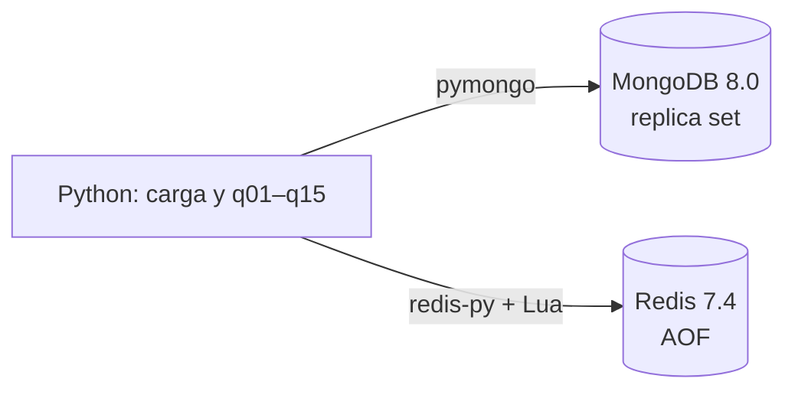
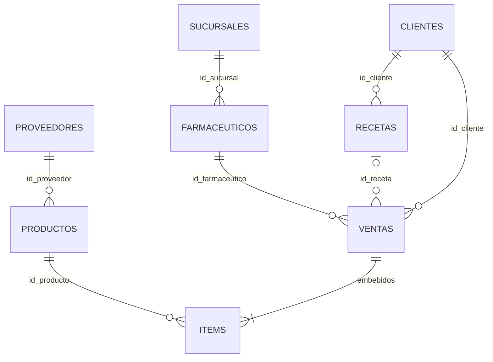

# FarmaRed — Persistencia políglota con MongoDB y Redis

**Bases de Datos II — ITBA — 2.º cuatrimestre de 2026 — Trabajo Práctico Obligatorio**

| Integrante | Legajo |
|---|---|
| | |
| | |
| | |
| | |

**Repositorio:** https://github.com/franciscocostaa/TPO-BD2

## 1. Arquitectura políglota

**MongoDB es el sistema de registro y Redis guarda el stock por lote**, con Python como lenguaje. Buscamos el mínimo de motores que cubra todos los casos, porque cada motor agregado suma costo de integración y mantenimiento (Clase I, pp. 4–6).



| Dato | Motor | Por qué |
|---|---|---|
| Ventas con sus ítems | MongoDB | Jerárquicas y de alto volumen. Con los ítems embebidos, cada venta se lee y se escribe en una operación atómica (Clase 13, pp. 3–8). Los reportes son pipelines de agregación y la q11 pide una vista (Clase 12, pp. 50–52). |
| Clientes, recetas, farmacéuticos, sucursales, catálogo | MongoDB | ABM con baja lógica y relaciones que se recorren con referencias y `$lookup` (Clase 13, pp. 21–24). Venta y receta se actualizan juntas en una transacción. |
| Stock por lote | Redis | El dato con más escrituras concurrentes, que nunca puede quedar negativo. Un script Lua verifica y descuenta de forma atómica (Clase 17, p. 31), y un sorted set con el vencimiento como score da el orden FEFO (Clase 18, pp. 14–15). |

La clase desaconseja Redis para transacciones de varias operaciones (Clase 17, pp. 6–7). No se las pedimos: la transacción entre entidades la hace MongoDB, y a Redis solo le pedimos una operación atómica sobre el stock.

**Descartados:**
- **Cassandra:** sin joins y desaconsejada para ACID (Clase 15, pp. 6, 13).
- **DynamoDB:** atomicidad solo por ítem y sin agregaciones (Clase 20, pp. 6, 32–33).
- **Neo4j:** ver [7.2](#72-alternativas-evaluadas).

## 2. Modelo de datos

**Convenciones:** el `_id` es el id del CSV y los registros propios siguen la serie. Las fechas son `Date` a las 00:00 UTC y los importes, enteros. "Hoy" es la fecha del sistema en hora argentina, con un parámetro `hoy` opcional para las pruebas. Un lote está vencido si `vencimiento < hoy`. Las bajas son lógicas (`activo: false`).

### 2.1 MongoDB



| Colección | Modelo | Índices |
|---|---|---|
| `ventas` | Ítems **embebidos**: siempre se leen y escriben con la venta. `id_sucursal` se copia del farmacéutico. | `{id_cliente, fecha}`, `{id_farmaceutico, fecha}`, `fecha`, `estado`, único en `items.id_detalle` |
| `recetas` | Colección propia que **referencia** al cliente, para no tener un arreglo que crece sin límite (Clase 13, pp. 16–20). | `id_cliente`, `{tipo, estado, proxima_dispensa}` |
| `productos` | Referencia al proveedor, que abastece muchos productos. | — |
| `clientes`, `farmaceuticos`, `sucursales`, `proveedores` | Documentos con baja lógica. | Único en `clientes.dni` y en `farmaceuticos.matricula` |
| `contadores` | Último id usado de ventas y de ítems (q14). | — |

```js
{ _id: "V006", id_cliente: "C006", id_farmaceutico: "F002", id_sucursal: "S001",
  id_receta: "RC003", fecha: ISODate("2026-08-01"), tipo: "Con receta",
  medio_pago: "Obra social", total: 22100, estado: "Completada",
  items: [ { id_detalle: "D007", id_producto: "PRD005", cantidad: 3, precio_unit: 5400 },
           { id_detalle: "D008", id_producto: "PRD009", cantidad: 1, precio_unit: 5900 } ] }
```

### 2.2 Redis

| Clave | Tipo | Contenido |
|---|---|---|
| `lote:{id_lote}` | Hash | `id_producto`, `id_sucursal`, `nro_lote`, `unidades`, `vencimiento` |
| `stock:{sucursal}:{producto}` | Sorted set | Lotes con score = vencimiento `AAAAMMDD`. Da el orden FEFO (q15). |
| `lotes:unidades` | Sorted set | Lotes con score = unidades. Sirve para el stock bajo (q08). |
| `ventas:descontadas` | Set | Ventas cuyo stock ya se descontó. |
| `descuento:{id_venta}` | Hash | `id_lote` → unidades descontadas a la venta, para compensar. |

Las unidades solo cambian dentro de dos scripts Lua, `descontar` y `reponer`. Cada uno actualiza el hash del lote y `lotes:unidades` en la misma operación atómica. Los lotes con 0 unidades no se borran. Las referencias de Redis a MongoDB (producto y sucursal del lote, id de la venta) se resuelven en la aplicación.

## 3. Entorno

`docker-compose.yml` y `.devcontainer/` levantan todo en Codespaces sin pasos manuales:

| Servicio | Configuración | Por qué |
|---|---|---|
| `app` | Python 3.12 con `mongosh` y `redis-cli`, y `TZ=America/Argentina/Buenos_Aires`. | Ahí se trabaja. La zona horaria define "hoy". |
| `mongo` | `mongo:8.0`, replica set de un nodo que inicia el propio healthcheck. | Las transacciones de varios documentos requieren replica set (*complemento: no está en las clases*). |
| `redis` | `redis:7.4` con AOF y fsync por segundo. | Se pierde a lo sumo un segundo ante una caída (Clase 17, pp. 17–21). |

`python -m farmared.verificar` comprueba la conexión, el replica set, las transacciones, el AOF y los scripts Lua.

## 4. Carga de datos y registros adicionales

`python -m farmared.carga` lee los CSV de `datos/provistos/` y `datos/adicionales/` y hace cuatro cosas:

1. **Valida** los datos combinados (ver [6.1](#61-integridad-referencial)). Si hay errores, los informa todos y no toca ninguna base.
2. **Transforma** los datos: embebe los ítems en su venta, copia la sucursal del farmacéutico y calcula los contadores de ids.
3. **Escribe en MongoDB** en una única transacción: vacía cada colección con `delete_many` y la llena con `insert_many`.
4. **Escribe en Redis** en un único `MULTI`: los lotes y la marca de descontadas de las ventas "Completada" de los CSV, cuyo stock ya está reflejado en los lotes.

Es **idempotente**: cada ejecución deja exactamente el estado de los CSV y descarta lo que hayan hecho los servicios de escritura. Lo verificamos con un hash del contenido de ambas bases después de dos cargas seguidas.

**Registros adicionales** (al menos 10 por archivo), elegidos para ejercitar las consultas:

| Archivo | Ids | Casos que cubren |
|---|---|---|
| Clientes | C009–C020 | Sin compras (q12), dados de baja, sin cobertura, DNI de 7 dígitos |
| Sucursales | S006–S015 | Farmacias sin ventas (q10), una dada de baja |
| Farmacéuticos | F008–F018 | Activos sin ventas (q05), uno dado de baja |
| Proveedores | PRV006–PRV015 | Dos dados de baja (q01) |
| Productos | PRD014–PRD025 | Las tres condiciones de venta, discontinuados, proveedor dado de baja |
| Lotes | L019–L034 | FEFO con un lote vencido en el medio (PRD001 en S001), un producto con solo stock vencido (PRD017), un lote en 0, los bordes de 49 y 50 unidades (q08) |
| Recetas | RC010–RC019 | Vigentes de cada tipo, vencidas, una simple para un producto archivado y una de un cliente dado de baja (q14) |
| Ventas | — | *Pendiente (integrante 3)* |

## 5. Consultas y servicios

Cada consulta es un módulo `farmared/consultas/qNN.py` con una función `ejecutar(...)` documentada (propósito, parámetros, retorno y motor). Se ejecuta desde la terminal con `python -m farmared.consultas.qNN [argumentos]`.

### Consulta 1 — Productos activos con su proveedor

**Motor:** MongoDB. El producto referencia al proveedor y se combinan con `$lookup`.

```python
db.productos.aggregate([
    {"$match": {"activo": True}},
    {"$lookup": {"from": "proveedores", "localField": "id_proveedor", "foreignField": "_id", "as": "proveedor"}},
    {"$set": {"proveedor": {"$first": "$proveedor"}}},
])
```

**Resultado:** 21 productos. Un producto con el proveedor dado de baja aparece igual, con `proveedor.activo: false`.

### Consulta 2 — Ventas pendientes con su farmacéutico

**Motor:** MongoDB. Dos `$lookup` encadenados: venta → farmacéutico → sucursal.

```python
db.ventas.aggregate([
    {"$match": {"estado": "Pendiente"}},
    {"$lookup": {"from": "farmaceuticos", "localField": "id_farmaceutico", "foreignField": "_id", "as": "farmaceutico"}},
    {"$set": {"farmaceutico": {"$first": "$farmaceutico"}}},
    {"$lookup": {"from": "sucursales", "localField": "farmaceutico.id_sucursal", "foreignField": "_id", "as": "sucursal"}},
    {"$project": {"fecha": 1, "total": 1, "farmaceutico": ...}},   # nombre, matrícula y sucursal
])
```

**Resultado:** V012 ($9.200, Giménez, Farmacia Rosario Centro) y V011 ($4.800, Sandoval, Farmacia Nueva Córdoba).

### Consulta 3 — Historial de un cliente

**Motor:** MongoDB. `$unionWith` une las ventas y las recetas del cliente, y se ordenan juntas por fecha.

```python
db.ventas.aggregate([
    {"$match": {"id_cliente": id_cliente}}, {"$set": {"registro": "venta"}},
    {"$unionWith": {"coll": "recetas", "pipeline": [
        {"$match": {"id_cliente": id_cliente}},
        {"$set": {"registro": "receta", "fecha": "$fecha_emision"}}]}},
    {"$sort": {"fecha": 1, "registro": 1, "_id": 1}},
])
```

**Resultado para C001:** RC001, V003, V015, V013, RC008 y V010, en orden cronológico.

### Consulta 4 — Clientes con más de una receta

*Pendiente (integrante 3).*

### Consulta 5 — Ventas de los últimos 60 días por farmacéutico

*Pendiente (integrante 3).*

### Consulta 6 — Recetas prolongadas con la dispensa atrasada

**Motor:** MongoDB. `$lookup` receta → cliente, con "hoy" calculado por la aplicación.

```python
db.recetas.aggregate([
    {"$match": {"tipo": "Tratamiento prolongado", "estado": "Vigente", "proxima_dispensa": {"$lt": hoy}}},
    {"$lookup": {"from": "clientes", "localField": "id_cliente", "foreignField": "_id", "as": "cliente"}},
    {"$set": {"cliente": {"$first": "$cliente"}}},
])
```

**Resultado al 14/11/2026:** RC002 (60 días de atraso), RC003 (44) y RC004 (25).

### Consulta 7 — Top 5 de productos más vendidos

*Pendiente (integrante 3).*

### Consulta 8 — Lotes con menos de 50 unidades

**Motor:** Redis + MongoDB, combinados en la aplicación:
1. Redis devuelve los lotes con menos de 50 unidades con `ZRANGEBYSCORE lotes:unidades -inf (50` y lee sus hashes en un pipeline.
2. MongoDB trae los productos con su proveedor (`$lookup`) y las sucursales, con `$in`.

**Resultado:** 20 lotes, incluidos los vencidos (`vencido: true`) y los que están en 0. El primero es L021 (0 unidades, Loratadina, Farmacia Belgrano).

### Consulta 9 — Ventas libres de menos de $5.000

**Motor:** MongoDB, una sola colección (los ítems vienen embebidos).

```python
db.ventas.find({"tipo": "Venta libre", "total": {"$lt": 5000}, "estado": {"$ne": "Anulada"}})
```

**Resultado:** V013 ($4.400) y V014 ($4.600).

### Consulta 10 — Clientes atendidos en una sucursal

*Pendiente (integrante 3).*

### Consulta 11 — Ingresos por farmacéutico en el mes actual (vista)

*Pendiente (integrante 3).*

### Consulta 12 — Clientes sin ventas en el último año

*Pendiente (integrante 3).*

### Consulta 13 — ABM de clientes

**Motor:** MongoDB, `clientes`. Funciones `alta(...)`, `modificar(id_cliente, **cambios)` y `baja(id_cliente)`.

- **Alta:** el DNI único lo garantiza el índice único. Si dos altas usan el mismo DNI al mismo tiempo, una sola queda registrada.
- **Modificación:** solo contacto y cobertura. Con "Sin cobertura" no hay número de afiliado; con cualquier otra obra social, es obligatorio.
- **Baja:** lógica, con `find_one_and_update({"_id": id, "activo": True}, {"$set": {"activo": False}})`.


### Consulta 14 — Registro de una venta "Completada"

**Motor:** MongoDB (validaciones, venta y receta, en una transacción) + Redis (stock, a través de q15). Recibe `ejecutar(id_cliente, id_farmaceutico, items, medio_pago, id_receta=None, hoy=None)`.

**Validaciones:**
- **Las que pide la consigna:** cliente activo; farmacéutico activo de una sucursal "Farmacia"; productos activos; para productos bajo receta, receta vigente del mismo cliente y con dispensas disponibles.
- **Supuestos nuestros** (ver [6.4](#64-supuestos)): un producto archivado exige receta "Archivada"; no se acepta una receta que ningún producto necesita; la cantidad es un entero positivo; el medio de pago es uno de los del CSV; "Obra social" solo para clientes con cobertura.

El precio sale del catálogo y el total es la suma de los ítems. La receta suma una dispensa: si llega a las autorizadas pasa a "Completada"; si no, la próxima dispensa queda a 30 días.

```python
sesion.start_transaction()
# validaciones: find_one de cliente, farmacéutico, sucursal, productos y receta, con session=sesion
db.ventas.insert_one(venta, session=sesion)
db.recetas.find_one_and_update(
    {"_id": id_receta, "estado": "Vigente", "dispensas_realizadas": n},
    {"$set": {"dispensas_realizadas": n + 1, "proxima_dispensa": hoy + 30 días}}, session=sesion)
q15.ejecutar(id_venta, hoy, sesion)   # Redis: descuenta todo o rechaza sin tocar nada
sesion.commit_transaction()           # si falla y la venta no quedó registrada: stock.reponer(id_venta)
```

**Venta exitosa:** 20 unidades de PRD003 y 35 de PRD001 en S001, con la primera dispensa de la receta prolongada RC012. PRD001 saltea el lote vencido L019 y consume L020 y después L001. La receta pasa a 1 de 3 dispensas, con la próxima a 30 días.


### Consulta 15 — Descuento de stock FEFO

**Motor:** MongoDB (lee la venta) + Redis. Recibe `ejecutar(id_venta, hoy=None, sesion=None)`; con la sesión de q14 ve la venta todavía sin confirmar.

El script Lua `descontar` recibe una clave `stock:{sucursal}:{producto}` por producto. `ZRANGEBYSCORE` desde hoy devuelve solo los lotes vigentes, ya ordenados por vencimiento. El script trabaja en dos pasadas:

```lua
for i = 4, #KEYS do                                    -- primera pasada: plan FEFO, sin escribir
  for _, id_lote in ipairs(redis.call('ZRANGEBYSCORE', KEYS[i], hoy, '+inf')) do
    -- toma min(unidades del lote, lo que falta) y lo anota en el plan
  end
  if restante > 0 then table.insert(faltantes, ...) end
end
if #faltantes > 0 then return cjson.encode({estado = 'insuficiente', faltantes = faltantes}) end
for _, paso in ipairs(plan) do                         -- segunda pasada: aplica el plan
  paso.despues = redis.call('HINCRBY', 'lote:' .. paso.id_lote, 'unidades', -paso.descontadas)
  redis.call('ZADD', 'lotes:unidades', paso.despues, paso.id_lote)
  redis.call('HSET', descuento, paso.id_lote, paso.descontadas)
end
redis.call('SADD', 'ventas:descontadas', id_venta)
```

**Rechazo por stock:** PRD017 solo tiene en S001 el lote L022, con 20 unidades pero vencido. La venta se rechaza y antes y después quedan iguales la receta RC011 (0 dispensas, "Vigente") y el lote L022 (20 unidades).


## 6. Consistencia e integridad

### 6.1 Integridad referencial

Los motores no la garantizan, así que la resolvemos así:
- **En la carga:**
  - cada referencia de la consigna apunta a un id existente;
  - no hay ids, DNI ni matrículas repetidos;
  - el total de cada venta es la suma de sus ítems;
  - la receta de cada venta es del mismo cliente;
  - ningún lote es negativo.
- **En los servicios de escritura:** validan las entidades que referencian, dentro de la misma transacción en la que escriben.
- **En el modelo:** índices únicos; ítems embebidos, que no pueden existir sin su venta; bajas lógicas, así que ninguna referencia apunta a un documento borrado.

### 6.2 Consultas 14 y 15: todo o nada entre dos motores

No hay una transacción que abarque MongoDB y Redis. El todo o nada sale del **orden de las operaciones**, con una compensación para la única falla que queda después de descontar el stock:

| Paso | Si falla |
|---|---|
| 1. MongoDB: transacción abierta; validar, insertar la venta y actualizar la receta sin confirmar | Se aborta. Redis no se tocó. |
| 2. Redis: script `descontar`, todo o nada | Rechaza sin tocar ningún lote y se aborta la transacción. Es el caso de falta de stock. |
| 3. MongoDB: confirmar | Si la venta no quedó registrada, el script `reponer` devuelve a cada lote lo anotado en `descuento:{id_venta}`. |

- **Redis va segundo** porque así el rechazo más común, la falta de stock, se resuelve abortando, sin compensar.
- **Un script Lua y no `MULTI`:** `MULTI` no puede decidir según lo que lee y no tiene rollback (Clase 17, p. 12; Clase 18, p. 7). El script verifica y descuenta sin que otro cliente se intercale (Clase 17, p. 31).
- **Sin `with_transaction` de pymongo:** ante un error transitorio repetiría la función entera, Lua incluido. q14 reintenta solo el paso 1.
- **Una venta no se descuenta dos veces:** el script la registra en `ventas:descontadas`, y la carga marca las ventas históricas, cuyo stock ya está en los lotes.

### 6.3 Concurrencia

| Riesgo | Solución |
|---|---|
| Dos ventas consumen las mismas unidades | El script es atómico: nunca queda stock negativo. |
| Dos ventas usan la última dispensa | La receta se actualiza filtrando por las dispensas leídas. MongoDB aborta una por conflicto y q14 la reintenta, y al volver a validar se rechaza. |
| Dos ventas toman el mismo id | Los ids salen de `contadores` con un `$inc` atómico, fuera de la transacción. |

**Pruebas** (simulando las fallas en Python):
- Falla la confirmación: no queda venta y el stock se repone.
- La confirmación se aplica pero se pierde la respuesta: no se compensa.
- 8 ventas simultáneas sobre la última dispensa: se registra una.
- 25 ventas de 10 unidades sobre un lote de 200: se registran 20 y el lote queda en 0.

### 6.4 Supuestos

| Tema | Decisión |
|---|---|
| Producto "Bajo receta archivada" | Exige receta "Archivada", como en los datos (V009 vende PRD008 con RC005). |
| Productos de la receta | El CSV no los indica, así que no se validan. |
| Venta con productos libres y bajo receta | Se permite. El tipo de venta se deriva de los productos. |
| Dispensa | Una por venta, como en los datos provistos. Se completa a los 30 días. |
| Dispensa adelantada | No se bloquea: la consigna no la incluye entre las validaciones. |
| Ventas históricas | La carga no les aplica las validaciones de q14 (V001 es de un farmacéutico hoy inactivo). |

## 7. Limitaciones, alternativas y conclusiones

### 7.1 Limitaciones

- Si el proceso de q14 se cae entre el script y la confirmación, queda stock descontado sin venta. Se detecta con `descuento:*` y se devuelve con `stock.reponer`, pero no está automatizado.
- Con fsync por segundo, una caída de Redis puede perder hasta un segundo de descuentos (Clase 17, p. 21).
- El replica set de un nodo da transacciones, pero no alta disponibilidad.
- Las consultas que dependen de "hoy" cambian según el día en que se ejecuten.

### 7.2 Alternativas evaluadas

| Alternativa | Por qué no |
|---|---|
| Neo4j como núcleo + MongoDB para el catálogo | 14 + 15 serían una transacción ACID (Clase 16, pp. 15–16). Pero las ventas, jerárquicas y de alto volumen, quedarían en el motor que menos escala (Clase 16, pp. 39–40), Neo4j no tiene vistas (q11) y MongoDB quedaría con un rol menor. |
| Tres motores | Cada motor extra suma costo de integración (Clase I, p. 6). |
| Stock en MongoDB | Evita compensar, pero deja a Redis sin un rol que justifique el segundo motor. |
| Descontar en Redis primero | Cada rechazo de validación obligaría a compensar. |
| Ids calculados como máximo + 1 | Con 25 ventas simultáneas chocaban hasta agotar los reintentos. |

### 7.3 Conclusiones

*Pendiente: se escriben entre todos.*

## 8. Fuentes

Clase I (persistencia políglota y Docker), Clase 12 (introducción a NoSQL), Clase 13 (embebidos vs. normalizado), Clase 15 (Cassandra), Clase 16 (Neo4j), Clase 17 y 18 (bases clave-valor), Clase 20 (DynamoDB) y la consigna del TPO. Lo marcado como *complemento* no está en el material de la cátedra.
