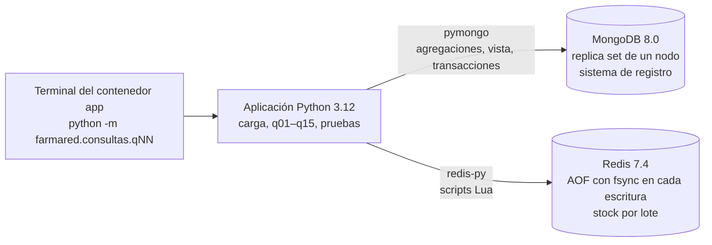
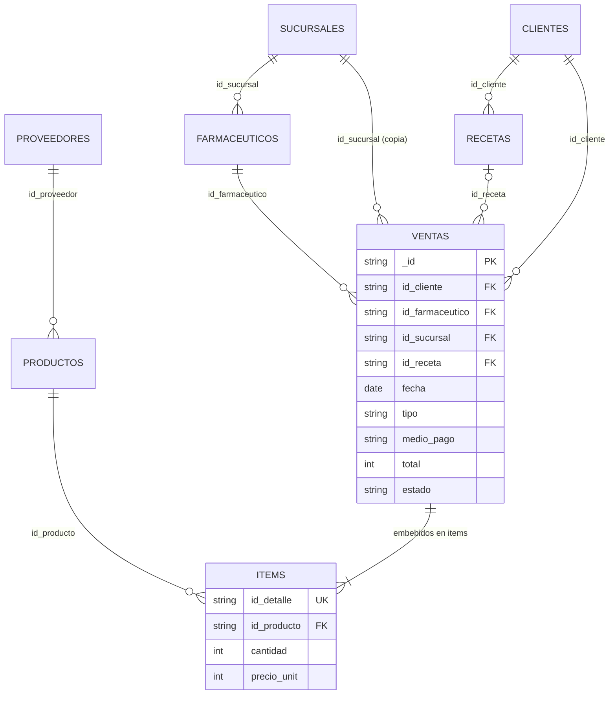
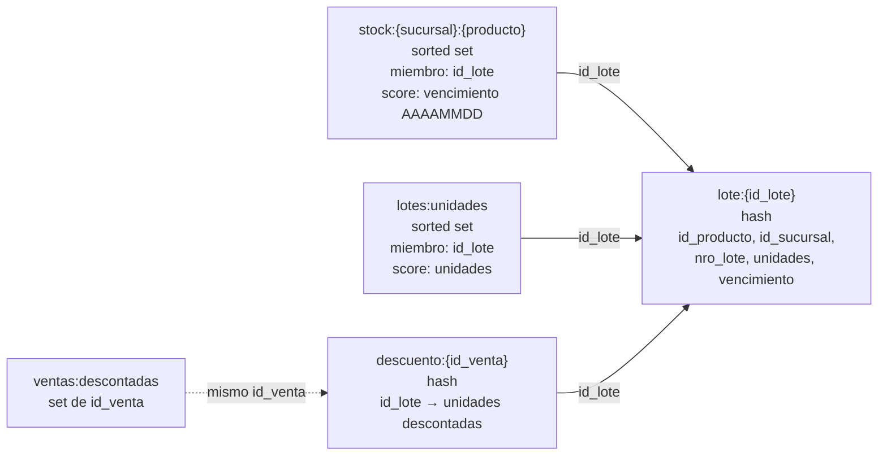
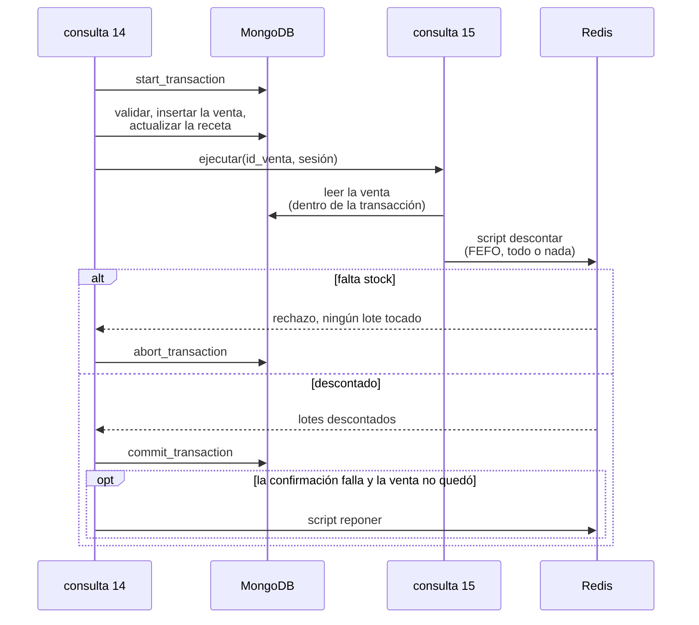

<div class="caratula" align="center">

<p class="materia"><strong>Base de Datos II</strong></p>
<p class="subtitulo">Trabajo Práctico Obligatorio</p>
<p class="subtitulo">Instituto Tecnológico de Buenos Aires</p>
<p></p>
<p class="subtitulo">FarmaRed: sistema de gestión de una red de farmacias<br>con persistencia políglota</p>
<p>Grupo 9</p>

</div>

<div class="integrantes">

**Integrantes:**

- Branda, Franco (65506)
- Salerno, Román (65145)
- Migliaro, Eugenio (65508)
- Costa, Francisco (65202)

**Repositorio:** <https://github.com/franciscocostaa/TPO-BD2>

2.º cuatrimestre de 2026

</div>

<div class="salto"></div>

## Contenido

- [Resumen](#resumen)
- [1. Arquitectura políglota](#1-arquitectura-políglota)
- [2. Modelo de datos](#2-modelo-de-datos)
- [3. Entorno](#3-entorno)
- [4. Carga de datos](#4-carga-de-datos)
- [5. Consultas y servicios](#5-consultas-y-servicios)
- [6. Consistencia e integridad](#6-consistencia-e-integridad)
- [7. Limitaciones, alternativas y conclusiones](#7-limitaciones-alternativas-y-conclusiones)
- [8. Fuentes](#8-fuentes)

## Resumen

FarmaRed guarda sus datos en dos motores NoSQL de paradigmas distintos. **MongoDB**, una base de documentos, es el sistema de registro: clientes, sucursales, farmacéuticos, proveedores, productos, recetas y ventas. **Redis**, una base clave-valor en memoria, guarda solo el stock por lote, que es el dato con más escrituras concurrentes y con la regla más estricta: FEFO y nunca negativo. Una aplicación en Python 3.12 carga los datos y resuelve las 15 consultas y servicios.

El repositorio se levanta en GitHub Codespaces sin pasos manuales. La carga es idempotente, y `python -m farmared.pruebas` reproduce las pruebas de consistencia de la sección 6. Los comandos de cada consulta están en el README.

Todos los ejemplos son reales: se obtuvieron después de `python -m farmared.carga`, el 15/11/2026. Las consultas que dependen de la fecha se muestran con `--hoy 2026-11-15`, para que den lo mismo cualquier día.

## 1. Arquitectura políglota

### 1.1 Qué guarda cada motor y por qué

La clase plantea que la persistencia políglota consiste en usar, para cada necesidad, el motor que mejor se adapta, y enumera los factores de la elección: tipo de base, durabilidad, disponibilidad, consistencia, escalabilidad y seguridad (Clase I, pp. 5–6). Partimos de cómo describe la consigna cada dato (§3.2). Con esos factores, dos motores alcanzan, cada uno con un rol que el otro no cumple bien. Cada motor que se suma agrega integración y operación (complemento: no está en las clases), así que no agregamos un tercero sin un dato que lo necesite.

| Dato, según la consigna | Motor | Por qué |
|---|---|---|
| **Ventas y su detalle:** cabecera con ítems variables, consultas por cliente, farmacéutico y fechas, muchas inserciones. | MongoDB | Una venta y sus ítems siempre se leen y se escriben juntos: es la relación "contiene" que la clase recomienda embeber, y así la venta completa se escribe en una sola operación atómica (Clase 13, p. 5). Los accesos por cliente, farmacéutico y fecha se cubren con índices (Clase 14, pp. 28–29). |
| **Reportes:** totales por farmacéutico, rankings, conteos por período. | MongoDB | Se resuelven con el pipeline de agregación (Clase 14, pp. 31–34), y la consulta 11 pide una vista, que MongoDB ofrece (Clase 12, pp. 50–52). |
| **Clientes, recetas y farmacéuticos:** ABM con baja lógica y relaciones que recorre el historial. | MongoDB | Documentos con atributos propios, relacionados por referencias que se combinan con `$lookup`, un *left outer join* (Clase 13, pp. 16–23). La venta y la receta se actualizan juntas en una transacción de MongoDB (sección 6.2). |
| **Catálogo y proveedores:** pocos cambios, muchas lecturas. | MongoDB | Son datos de referencia que las consultas combinan con ventas y lotes. Separarlos en otro motor solo agregaría cruces en la aplicación. |
| **Stock por lote:** escrituras concurrentes, nunca negativo, prioridad por vencimiento. | Redis | Es un almacén en memoria (Clase 17, p. 9) que ejecuta cada script Lua de forma atómica, sin atender a otro cliente mientras corre (Clase 17, p. 31). Un script verifica que alcance el stock de todos los ítems y recién entonces descuenta. Los *sorted sets* mantienen los lotes ordenados por vencimiento, así que FEFO es un `ZRANGEBYSCORE` desde hoy (Clase 18, pp. 14–15). |

La clase desaconseja las bases clave-valor para transacciones de varias operaciones y para operaciones que abarcan distintos conjuntos de datos (Clase 17, p. 7). Por eso Redis queda acotado a **un único conjunto de datos**, el stock, y la única operación de varios pasos que se le pide, descontar los lotes de una venta, corre dentro de un script atómico. La transacción entre entidades (venta y receta) la hace MongoDB.

### 1.2 Motores descartados

| Motor | Por qué no |
|---|---|
| Cassandra | No tiene joins ni subconsultas (Clase 15, p. 13), las agregaciones se hacen del lado del cliente y no conviene cuando se requieren transacciones ACID (Clase 15, p. 6). Las consultas 3, 10 y 14 cruzan entidades, y la 14 actualiza venta y receta juntas. |
| DynamoDB | La consistencia es por ítem, sin operaciones atómicas entre ítems (Clase 20, p. 6); es un servicio pago de la nube y el modelo tiene que ajustarse a su particionamiento (Clase 20, pp. 32–33). |
| Neo4j | Fue la alternativa más fuerte; se compara en la sección 7.2. |

### 1.3 Vista general



Las consultas 8, 14 y 15 usan los dos motores; las demás, solo MongoDB.

## 2. Modelo de datos

### 2.1 Convenciones

- **Identificadores:** el `_id` de cada documento es el id del CSV (`C001`, `V001`…). Los registros propios siguen la misma serie.
- **Fechas:** `Date` de MongoDB a las 00:00 UTC del día del CSV. "Hoy" es la fecha del sistema en hora argentina (el contenedor corre con `TZ=America/Argentina/Buenos_Aires`) y se convierte igual antes de comparar. Las consultas que dependen de la fecha aceptan `--hoy` para reproducir resultados.
- **Importes** enteros, en pesos. **Vacíos** como `null` explícito. **Bajas** lógicas (`activo: false`): nada se borra, ni siquiera los lotes en cero.

### 2.2 MongoDB

Base `farmared`, con siete colecciones de datos, una de contadores y una vista.



El diagrama detalla la venta y sus ítems, que es donde está el embebido. Las demás colecciones tienen los campos de su CSV, con el id como `_id`.

| Colección | Embebido o referencia | Índices |
|---|---|---|
| `ventas` | Los ítems van **embebidos** en `items`: no existen fuera de su venta, siempre se leen con ella y así la venta entera se escribe de forma atómica (Clase 13, p. 5). Cliente, farmacéutico y receta son **referencias**, porque tienen vida propia. `id_sucursal` copia la sucursal del farmacéutico al momento de la venta: el stock se descuenta ahí. | `{id_cliente, fecha}`, `{id_farmaceutico, fecha}`, `{fecha}`, `{estado}`, único en `items.id_detalle` |
| `recetas` | Colección propia que **referencia** al cliente. Embeberlas crearía un arreglo que crece sin límite, que es lo que la clase recomienda evitar (Clase 13, pp. 18–20). | `{id_cliente}`, `{tipo, estado, proxima_dispensa}` |
| `productos` | **Referencia** al proveedor: un proveedor abastece muchos productos, y embeberlo repetiría sus datos en cada uno (Clase 13, pp. 16–18). | — |
| `clientes`, `farmaceuticos`, `sucursales`, `proveedores` | Documentos independientes con baja lógica. | Únicos en `clientes.dni` y `farmaceuticos.matricula`; `farmaceuticos.id_sucursal` |
| `contadores` | Último número usado de ventas y de ítems, para los ids nuevos de la consulta 14. | — |
| `ingresos_farmaceutico_mes` | Vista de la consulta 11. | — |

```js
{ _id: "V006", id_cliente: "C006", id_farmaceutico: "F002", id_sucursal: "S001",
  id_receta: "RC003", fecha: ISODate("2026-08-01"), tipo: "Con receta",
  medio_pago: "Obra social", total: 22100, estado: "Completada",
  items: [ { id_detalle: "D007", id_producto: "PRD005", cantidad: 3, precio_unit: 5400 },
           { id_detalle: "D008", id_producto: "PRD009", cantidad: 1, precio_unit: 5900 } ] }
```

Una venta no crece después de registrarse, así que el límite de 16 MB por documento no es una restricción (Clase 13, p. 6).

### 2.3 Redis

Cada lote es un hash, y dos *sorted sets* lo indexan: uno por sucursal y producto con el vencimiento como score, para FEFO, y otro con todos los lotes y las unidades como score, para el stock bajo. Dos claves más registran qué ventas ya descontaron stock y de qué lotes.



| Clave | Tipo | Uso |
|---|---|---|
| `lote:{id_lote}` | Hash | Datos y unidades del lote. |
| `stock:{id_sucursal}:{id_producto}` | Sorted set, score = vencimiento como entero `AAAAMMDD` | FEFO (consulta 15): los lotes vigentes, del que vence antes al que vence después. |
| `lotes:unidades` | Sorted set, score = unidades | Lotes por debajo de un umbral (consulta 8). |
| `ventas:descontadas` | Set | Ventas cuyo stock ya se descontó, para no descontarlas dos veces. |
| `descuento:{id_venta}` | Hash | Cuántas unidades se tomaron de cada lote, para poder devolverlas. |

```text
HSET lote:L005 id_producto PRD003 id_sucursal S001 nro_lote L-2506A unidades 40 vencimiento 2026-11-30
ZADD stock:S001:PRD003 20261120 L033 20261130 L005 20270630 L015
ZRANGEBYSCORE stock:S001:PRD003 20261115 +inf    # lotes vigentes de PRD003 en S001, FEFO
ZRANGEBYSCORE lotes:unidades -inf (50              # lotes con menos de 50 unidades
```

Las unidades solo cambian dentro de dos scripts Lua, `descontar` y `reponer`, que actualizan el hash y `lotes:unidades` en la misma operación atómica. Nunca quedan negativas, y un lote en cero no se borra. Las referencias de Redis a MongoDB (producto y sucursal del lote, id de la venta) se resuelven en la aplicación, y la carga valida que cada lote apunte a un producto y una sucursal existentes.

## 3. Entorno

`docker-compose.yml` y `.devcontainer/` levantan todo en GitHub Codespaces o en VS Code con Dev Containers, sin pasos manuales:

| Servicio | Configuración | Por qué |
|---|---|---|
| `app` | Python 3.12 con `mongosh` y `redis-cli`, `TZ=America/Argentina/Buenos_Aires`; instala `pymongo` y `redis`. | Es donde se trabaja. La zona horaria define "hoy". |
| `mongo` | `mongo:8.0` como replica set de un nodo (`rs0`), que el healthcheck inicia la primera vez. | Las transacciones de varios documentos requieren un replica set (complemento: manual de MongoDB, *Transactions*; la clase muestra cómo armarlo en Clase 14, pp. 40–43). |
| `redis` | `redis:7.4` con AOF y `appendfsync always`. | El stock vive solo en Redis. De las políticas de fsync del AOF (Clase 17, p. 21), "por segundo" puede perder hasta un segundo de escrituras. Con `always`, Redis responde a cada escritura después de pasarla a disco (complemento: documentación de Redis, *Persistence*), así que un descuento ya informado no se pierde. Es más lento (Clase 17, p. 23), pero aceptable para el volumen de una red de farmacias. |

```text
$ python -m farmared.verificar
✔ MongoDB: conexión: responde
✔ MongoDB: replica set: rs0, primario mongo:27017
✔ MongoDB: transacciones: abort deshace el insert
✔ Redis: conexión: responde
✔ Redis: persistencia AOF: appendonly = yes, appendfsync = always
✔ Redis: scripts Lua: EVAL ejecuta scripts
```

## 4. Carga de datos

### 4.1 Estrategia

`python -m farmared.carga` combina los CSV de la cátedra (`datos/provistos/`) con los registros propios (`datos/adicionales/`), que tienen los mismos archivos y encabezados:

1. **Lee y convierte** según las convenciones de la consigna (§2): vacío → `null`, `True`/`False` → booleano, fechas ISO → `Date`.
2. **Valida** todo antes de escribir (sección 4.2). Si hay errores, los lista y termina sin tocar ninguna base.
3. **Transforma:** embebe los ítems en su venta, copia en cada venta la sucursal del farmacéutico y calcula los contadores de ids.
4. **MongoDB:** crea los índices y, **en una única transacción**, vacía y vuelve a llenar cada colección. Después crea o actualiza la vista de la consulta 11.
5. **Redis:** en un único `MULTI`, reemplaza todas las claves de stock y marca como descontadas las ventas "Completada" de los CSV, cuyo stock ya está reflejado en los lotes.

```text
$ python -m farmared.carga
✔ clientes: 8 provistos + 12 adicionales → MongoDB clientes
✔ sucursales: 5 provistos + 10 adicionales → MongoDB sucursales
✔ farmaceuticos: 7 provistos + 12 adicionales → MongoDB farmaceuticos
✔ proveedores: 5 provistos + 10 adicionales → MongoDB proveedores
✔ productos: 13 provistos + 12 adicionales → MongoDB productos
✔ recetas: 9 provistos + 15 adicionales → MongoDB recetas
✔ ventas: 16 provistos + 13 adicionales → MongoDB ventas
✔ detalle_ventas: 22 provistos + 17 adicionales → MongoDB ventas.items
✔ stock_lotes: 18 provistos + 16 adicionales → Redis
✔ vista ingresos_farmaceutico_mes → MongoDB
```

**Idempotencia.** Cada ejecución deja exactamente el estado de los CSV y descarta lo que hayan hecho los servicios de escritura, incluida una definición alterada de la vista. Lo comprobamos con un hash de todo el contenido de ambas bases: después de una carga, de escrituras de las consultas 13 y 14 y de una segunda carga, el hash es idéntico. La transacción evita que MongoDB quede con una carga a medias; si Redis fallara después, alcanza con volver a correrla.

### 4.2 Validaciones

Corren por etapas, y cada una supone que pasó la anterior:

1. **Formato:** encabezados, cantidad de columnas, enteros, fechas y booleanos.
2. **Vacíos, valores y unicidad:** solo pueden estar vacíos `nro_afiliado`, `proxima_dispensa` e `id_receta`; los campos categóricos (obra social, tipos, estados, medio de pago…) toman uno de los valores de la consigna; no hay ids, DNI ni matrículas repetidos, tampoco entre provistos y adicionales.
3. **Referencias:** cada una de las diez relaciones de la consigna (§2.10) apunta a un id existente.
4. **Reglas de negocio:** el total de cada venta es la suma de sus ítems; la receta de una venta es del mismo cliente, y la venta es "Con receta" si y solo si la tiene; ningún lote es negativo; una receta simple o archivada autoriza una dispensa y una prolongada hasta tres; la receta está "Completada" si y solo si agotó sus dispensas, y tiene `proxima_dispensa` si y solo si es prolongada, vigente y ya se dispensó; las dispensas realizadas coinciden con las ventas "Completada" que la usan; hay número de afiliado si y solo si hay cobertura.

Estas reglas encontraron un error en nuestros propios datos: dos recetas prolongadas tenían 6 dispensas autorizadas, y la consigna permite hasta 3 (§2.7). Así se ve una carga rechazada, con filas modificadas a propósito:

```text
✘ Carga abortada; no se modificó ninguna base:
  - ventas V018: tipo Con receta con id_receta vacío
  - recetas RC015: un tratamiento prolongado permite hasta 3 dispensas, no 6
```

La carga **no** aplica a los datos históricos las validaciones de alta de la consulta 14: V001 la registró F004, hoy dado de baja, y V014 incluye PRD012, hoy discontinuado, pero eran válidas cuando se registraron.

### 4.3 Registros adicionales

La consigna pide al menos 10 registros propios por colección, elegidos para ejercitar las consultas (§3.3):

| Archivo | Ids | Casos que cubren |
|---|---|---|
| Clientes (12) | C009–C020 | Seis sin ninguna compra y uno cuya única venta es de hace más de un año (consulta 12); dos dados de baja; dos sin cobertura; un DNI de 7 dígitos; todas las obras sociales y las tres provincias. |
| Sucursales (10) | S006–S015 | Farmacias sin ventas (consultas 5 y 10) y una no habilitada, S014 (rechazo de la consulta 14). |
| Farmacéuticos (12) | F008–F019 | Siete activos sin ventas (consulta 5), uno dado de baja y uno activo en la farmacia no habilitada (F019). |
| Proveedores (10) | PRV006–PRV015 | Laboratorios y droguerías de otras provincias; dos dados de baja, uno de ellos con un producto activo (consulta 1). |
| Productos (12) | PRD014–PRD025 | Las tres condiciones de venta; productos archivados y discontinuados. |
| Lotes (16) | L019–L034 | FEFO con un lote vencido en el medio (PRD001 en S001) y con tres lotes vigentes (PRD003 en S001); un producto con solo stock vencido (PRD017 en S001); un lote en cero; lotes por vencer y vencidos; los bordes del umbral de la consulta 8 (49 y 50 unidades); stock en la droguería. |
| Recetas (15) | RC010–RC024 | Vigentes de cada tipo, vencidas, casos de rechazo de la consulta 14 (simple para un producto archivado, de un cliente dado de baja, de un cliente sin cobertura) y recetas con dispensas respaldadas por ventas. |
| Ventas (13) e ítems (17) | V017–V029, D023–D039 | Ventas de noviembre de 2026 (consulta 11) y de los últimos 60 días (consulta 5); una pendiente y una anulada; una de octubre, que está en la ventana de 60 días pero no en el mes actual; una de mayo de 2025 (consultas 9 y 12); un empate en el corte del top 5 (consulta 7). |

**Fecha de referencia.** Los datos provistos se describen respecto del 13/10/2026 (§2), pero las consultas usan la fecha del sistema (§3.3): sin registros propios, la consulta 11 daría vacía desde noviembre. Por eso las ventas adicionales son de noviembre de 2026. Son fechas fijas: fecharlas relativas a la carga rompería la idempotencia. El costo es que, en meses posteriores, la consulta 11 vuelve a dar vacía y la 5 se vacía de a poco; `--hoy` reproduce los resultados de este informe.

## 5. Consultas y servicios

Cada consulta es un módulo `farmared/consultas/qNN.py` con una función `ejecutar(...)` y un docstring con propósito, parámetros, retorno y motor. Se ejecuta con `python -m farmared.consultas.qNN [argumentos]`. Los parámetros de 3, 10, 13, 14 y 15 son argumentos de la función, nunca constantes.

Algunos operadores que usamos no aparecen en las clases: `$unionWith`, `$setWindowFields` con `$rank`, `$dateDiff`, `$dateFromParts` y `$lookup` con `pipeline`. Son complemento, documentados en el manual de MongoDB (*Aggregation Stages* y *Aggregation Operators*).

### Consulta 1 — Productos activos con su proveedor

**Enunciado:** productos activos con todos los datos de su proveedor.

**Relación:** el producto referencia al proveedor, y un `$lookup` trae el documento completo. Se filtran primero los activos, así el `$lookup` corre solo sobre ellos.

```python
db.productos.aggregate([
    {"$match": {"activo": True}},
    {"$lookup": {"from": "proveedores", "localField": "id_proveedor",
                 "foreignField": "_id", "as": "proveedor"}},
    {"$set": {"proveedor": {"$ifNull": [{"$first": "$proveedor"}, None]}}},
    {"$unset": "id_proveedor"},
    {"$sort": {"_id": 1}},
])
```

**Ejemplo:** devuelve 21 productos; quedan afuera los discontinuados PRD012, PRD013, PRD024 y PRD025. Un producto activo con su proveedor dado de baja aparece igual, con `proveedor.activo: false`:

```json
{"_id": "PRD023", "nombre": "Clotrimazol crema 1% 20g", "principio_activo": "Clotrimazol",
 "categoria": "Antimicótico", "presentacion": "Crema 20 g", "condicion_venta": "Venta libre",
 "precio_unit": 2900, "activo": true,
 "proveedor": {"_id": "PRV013", "razon_social": "Droguería Jacarandá S.R.L.", "cuit": "30-70645981-9",
               "tipo": "Droguería", "ciudad": "Morón", "provincia": "Buenos Aires",
               "telefono": "1144214400", "activo": false}}
```

### Consulta 2 — Ventas pendientes con su farmacéutico

**Enunciado:** ventas en estado "Pendiente" con el farmacéutico asignado (nombre, matrícula y sucursal) y el total.

**Relación:** dos `$lookup` encadenados: venta → farmacéutico → sucursal del farmacéutico.

```python
db.ventas.aggregate([
    {"$match": {"estado": "Pendiente"}},
    {"$lookup": {"from": "farmaceuticos", "localField": "id_farmaceutico",
                 "foreignField": "_id", "as": "farmaceutico"}},
    {"$set": {"farmaceutico": {"$first": "$farmaceutico"}}},
    {"$lookup": {"from": "sucursales", "localField": "farmaceutico.id_sucursal",
                 "foreignField": "_id", "as": "sucursal"}},
    {"$project": {"fecha": 1, "id_cliente": 1, "total": 1, "farmaceutico": {
        "_id": "$farmaceutico._id", "nombre": "$farmaceutico.nombre", "apellido": "$farmaceutico.apellido",
        "matricula": "$farmaceutico.matricula", "sucursal": ...}}},  # _id, nombre, ciudad, provincia
    {"$sort": {"fecha": 1, "_id": 1}},
])
```

**Ejemplo:**

| Venta | Fecha | Cliente | Total | Farmacéutico | Matrícula | Sucursal |
|---|---|---|---|---|---|---|
| V012 | 2026-10-11 | C002 | $9.200 | Natalia Giménez | MN-18289 | Farmacia Rosario Centro |
| V011 | 2026-10-12 | C007 | $4.800 | Matías Sandoval | MN-18340 | Farmacia Nueva Córdoba |
| V022 | 2026-11-13 | C010 | $8.700 | Martina Correa | MN-18533 | Farmacia La Plata |

### Consulta 3 — Historial de un cliente

**Enunciado:** historial completo de un cliente (dado su id): ventas y recetas ordenadas cronológicamente por fecha.

**Relación:** un único pipeline parte de las ventas del cliente y les suma sus recetas con `$unionWith`, como un `UNION ALL`; la base ordena todo junto. El historial recorre cliente → receta → venta → producto: cada venta trae su `id_receta`, y un `$lookup` agrega a cada ítem el nombre y la condición de venta del producto.

```python
db.ventas.aggregate([
    {"$match": {"id_cliente": id_cliente}},
    {"$lookup": {"from": "productos", "localField": "items.id_producto", "foreignField": "_id",
                 "as": "productos", "pipeline": [{"$project": {"nombre": 1, "condicion_venta": 1}}]}},
    {"$set": {"registro": "venta", "items": ...}},   # a cada ítem, el nombre y la condición de su producto
    {"$unset": "productos"},
    {"$unionWith": {"coll": "recetas", "pipeline": [
        {"$match": {"id_cliente": id_cliente}},
        {"$set": {"registro": "receta", "fecha": "$fecha_emision"}}, {"$unset": "fecha_emision"}]}},
    {"$unset": "id_cliente"},
    {"$sort": {"fecha": 1, "registro": 1, "_id": 1}},   # el mismo día, la receta antes que la venta
])
```

**Ejemplo:** `q03 C001` devuelve el cliente y siete registros, en cualquier estado:

| Fecha | Registro | Id | Estado | Detalle |
|---|---|---|---|---|
| 2026-09-10 | receta | RC001 | Completada | Simple, 1 de 1 dispensas |
| 2026-09-10 | venta | V003 | Completada | RC001: Amoxicilina 500mg x21 × 1 |
| 2026-09-25 | venta | V015 | Anulada | Ibuprofeno 400mg x20 × 1 |
| 2026-10-02 | venta | V013 | Completada | Loratadina 10mg x10 × 2 |
| 2026-10-08 | receta | RC008 | Completada | Simple, 1 de 1 dispensas |
| 2026-10-08 | venta | V010 | Completada | RC008: Salbutamol aerosol 100mcg × 1 |
| 2026-11-02 | venta | V025 | Completada | Paracetamol 500mg x30 × 2, Vitamina C 1g x30 × 1 |

Cada ítem queda, por ejemplo, como `{"id_detalle": "D033", "id_producto": "PRD001", "cantidad": 2, "precio_unit": 2800, "producto": "Paracetamol 500mg x30", "condicion_venta": "Venta libre"}`. Un cliente inexistente se rechaza.

### Consulta 4 — Clientes con más de una receta

**Enunciado:** clientes con más de una receta registrada, indicando la cantidad.

**Relación:** la receta referencia al cliente. El pipeline agrupa las recetas **antes** de unir, así el `$lookup` corre una vez por cliente que cumple y no una vez por receta.

```python
db.recetas.aggregate([
    {"$group": {"_id": "$id_cliente", "cantidad_recetas": {"$sum": 1}}},
    {"$match": {"cantidad_recetas": {"$gte": 2}}},
    {"$lookup": {"from": "clientes", "localField": "_id", "foreignField": "_id", "as": "cliente"}},
    {"$set": {"cliente": {"$ifNull": [{"$first": "$cliente"}, None]}}},
    {"$sort": {"cantidad_recetas": -1, "_id": 1}},
])
```

**Ejemplo:** siete clientes: C003, Carla Ruiz, con 3, y C001, C002, C006, C009, C010 y C013 con 2 cada uno. Cuentan las recetas en cualquier estado, porque la consulta pide recetas *registradas*: una de las tres de C003 está vencida.

### Consulta 5 — Ventas de los últimos 60 días por farmacéutico

**Enunciado:** farmacéuticos activos y cantidad de ventas registradas en los últimos 60 días (excluyendo anuladas). Deben aparecer también los que tienen cero.

**Relación:** el pipeline arranca en `farmaceuticos`: agrupar las ventas solo devolvería a los que vendieron. El `$lookup` es un *left outer join* (Clase 13, p. 23), así que quien no vendió queda con un arreglo vacío y `$size` le da 0. Su `pipeline` filtra fecha y estado del lado de las ventas, con el índice `{id_farmaceutico, fecha}`.

```python
desde, hasta = a_mongo(hoy - timedelta(days=60)), a_mongo(hoy)
db.farmaceuticos.aggregate([
    {"$match": {"activo": True}},
    {"$lookup": {"from": "ventas", "localField": "_id", "foreignField": "id_farmaceutico", "as": "recientes",
                 "pipeline": [{"$match": {"estado": {"$ne": "Anulada"}, "fecha": {"$gte": desde, "$lte": hasta}}},
                              {"$project": {"_id": 1}}]}},
    {"$set": {"ventas": {"$size": "$recientes"}}},
    {"$unset": "recientes"},
    {"$sort": {"ventas": -1, "_id": 1}},
])
```

**Ejemplo:** `q05 --hoy 2026-11-15` (del 16/09 al 15/11) devuelve los 17 farmacéuticos activos; F004 y F016, dados de baja, no aparecen.

| Ventas | Farmacéuticos |
|---|---|
| 3 | F001, F005, F008 |
| 2 | F002, F003, F010, F013 |
| 1 | F006, F017 |
| 0 | F007, F009, F011, F012, F014, F015, F018, F019 |

F002 cuenta 2 y no 3 porque V015 está anulada; F005 cuenta V012, que está "Pendiente"; F007, director técnico de la droguería, aparece con 0.

### Consulta 6 — Recetas prolongadas con la dispensa atrasada

**Enunciado:** recetas de tratamiento prolongado en estado "Vigente" cuya próxima dispensa es anterior a hoy, con los datos del cliente.

**Relación:** `$lookup` receta → cliente, sobre el índice `{tipo, estado, proxima_dispensa}`. `$dateDiff` calcula los días de atraso.

```python
hoy_mongo = a_mongo(hoy)
db.recetas.aggregate([
    {"$match": {"tipo": "Tratamiento prolongado", "estado": "Vigente", "proxima_dispensa": {"$lt": hoy_mongo}}},
    {"$lookup": {"from": "clientes", "localField": "id_cliente", "foreignField": "_id", "as": "cliente"}},
    {"$set": {"cliente": {"$ifNull": [{"$first": "$cliente"}, None]},
              "dias_de_atraso": {"$dateDiff": {"startDate": "$proxima_dispensa", "endDate": hoy_mongo, "unit": "day"}}}},
    {"$unset": "id_cliente"},
    {"$sort": {"proxima_dispensa": 1, "_id": 1}},
])
```

**Ejemplo:** `q06 --hoy 2026-11-15`

| Receta | Dispensas | Próxima dispensa | Días de atraso | Cliente |
|---|---|---|---|---|
| RC002 | 2 de 3 | 2026-09-15 | 61 | C003 Carla Ruiz |
| RC003 | 2 de 3 | 2026-10-01 | 45 | C006 Ricardo Paz |
| RC004 | 1 de 3 | 2026-10-20 | 26 | C006 Ricardo Paz |

No aparecen las prolongadas con la próxima dispensa en diciembre ni las que todavía no tuvieron la primera. Una próxima dispensa igual a hoy no está atrasada.

### Consulta 7 — Top 5 de productos más vendidos

**Enunciado:** top 5 de productos más vendidos (unidades), considerando solo ventas "Completada".

**Relación:** los ítems están embebidos, así que las unidades salen de `ventas`: `$unwind` abre un documento por ítem y `$group` suma por producto. El puesto se calcula con `$rank`, como `RANK()` en SQL, y entran los de puesto 5 o mejor: **un empate en el corte entra completo**, en lugar de dejar afuera a uno de los empatados con un criterio arbitrario. El `$lookup` va después del corte.

```python
db.ventas.aggregate([
    {"$match": {"estado": "Completada"}},
    {"$unwind": "$items"},
    {"$group": {"_id": "$items.id_producto", "unidades": {"$sum": "$items.cantidad"},
                "ventas": {"$addToSet": "$_id"}}},
    {"$set": {"ventas": {"$size": "$ventas"}}},
    {"$setWindowFields": {"sortBy": {"unidades": -1}, "output": {"puesto": {"$rank": {}}}}},
    {"$match": {"puesto": {"$lte": 5}}},
    {"$sort": {"puesto": 1, "_id": 1}},
    {"$lookup": {"from": "productos", "localField": "_id", "foreignField": "_id", "as": "producto"}},
    {"$set": {"producto": {"$ifNull": [{"$first": "$producto"}, None]}}},
])
```

**Ejemplo:**

| Puesto | Producto | Nombre | Unidades | Ventas |
|---|---|---|---|---|
| 1 | PRD001 | Paracetamol 500mg x30 | 10 | 6 |
| 1 | PRD011 | Loratadina 10mg x10 | 10 | 5 |
| 3 | PRD005 | Metformina 850mg x60 | 8 | 3 |
| 4 | PRD015 | Cetirizina 10mg x10 | 5 | 2 |
| 5 | PRD004 | Losartán 50mg x30 | 3 | 2 |
| 5 | PRD022 | Vitamina C 1g x30 | 3 | 2 |

### Consulta 8 — Lotes con stock bajo

**Enunciado:** lotes con menos de 50 unidades, indicando producto, sucursal y proveedor.

**Relación:** es la única lectura que cruza motores, y se combina en la aplicación:

1. **Redis:** `ZRANGEBYSCORE lotes:unidades -inf (50` devuelve los lotes con menos de 50 unidades sin recorrer todos (Clase 18, pp. 14–15), y sus hashes se leen en un pipeline de redis-py (Clase 18, p. 19).
2. **MongoDB:** un `$lookup` trae los productos con su proveedor, y un `find` las sucursales, cada uno con un `$in` sobre los ids que aparecieron.
3. **Aplicación:** combina por id y calcula `vencido = vencimiento < hoy`.

```python
ids = r.zrangebyscore("lotes:unidades", "-inf", "(50")
with r.pipeline(transaction=False) as pipe:
    for id_lote in ids:
        pipe.hgetall(f"lote:{id_lote}")
    lotes = pipe.execute()
productos = db.productos.aggregate([
    {"$match": {"_id": {"$in": ids_de_productos}}},
    {"$lookup": {"from": "proveedores", "localField": "id_proveedor", "foreignField": "_id", "as": "proveedor"}},
    {"$project": {"nombre": 1, "presentacion": 1, "proveedor": ...}}])  # razón social, CUIT, teléfono
sucursales = db.sucursales.find({"_id": {"$in": ids_de_sucursales}}, {"nombre": 1, "tipo": 1, "ciudad": 1})
```

**Ejemplo:** `q08 --hoy 2026-11-15` devuelve 20 lotes, ordenados por unidades. Los primeros seis:

| Lote | Unidades | Vence | Vencido | Producto | Sucursal | Proveedor |
|---|---|---|---|---|---|---|
| L021 | 0 | 2027-05-31 | | Loratadina 10mg x10 | Farmacia Belgrano | Laboratorios Andinos S.A. |
| L028 | 8 | 2026-12-05 | | Insulina glargina 100 UI/ml | Farmacia La Plata | Tala Salud S.R.L. |
| L026 | 10 | 2026-11-25 | | Azitromicina 500mg x3 | Farmacia Rosario Centro | Laboratorios Ñandubay S.A. |
| L010 | 12 | 2027-01-31 | | Alprazolam 0,5mg x30 | Farmacia Rosario Centro | Distribuidora Sur Salud S.A. |
| L034 | 12 | 2026-07-31 | sí | Diazepam 10mg x20 | Farmacia Nueva Córdoba | Algarrobo Biofarma S.A. |
| L018 | 15 | 2026-09-30 | sí | Alcohol en gel 250ml | Farmacia Belgrano | DroguMed S.R.L. |

Se listan también los vencidos y los que están en cero: un lote vencido también es un faltante a reponer, y `vencido` indica cuáles ya no se pueden dispensar. El umbral es estricto: el último es L030, con 49 unidades, y L031, con 50, no entra.

### Consulta 9 — Ventas libres de menos de $5.000

**Enunciado:** ventas de tipo "Venta libre" con total menor a $5.000, excluyendo anuladas.

**Relación:** ninguna: es un filtro sobre `ventas`, y cada venta ya trae sus ítems embebidos.

```python
db.ventas.find({"tipo": "Venta libre", "total": {"$lt": 5000}, "estado": {"$ne": "Anulada"}}) \
         .sort([("fecha", 1), ("_id", 1)])
```

**Ejemplo:** V028 ($2.800, mayo de 2025), V013 ($4.400) y V014 ($4.600). V015 y V023 ($3.500 cada una) quedan afuera porque están anuladas, y V002 ($5.750) porque supera el tope. Una venta "Pendiente" sí entraría.

### Consulta 10 — Clientes atendidos en una sucursal

**Enunciado:** todos los clientes atendidos en una sucursal determinada, a través del farmacéutico que registró la venta, esté activo o no.

**Relación:** sigue el camino que pide la consulta: sucursal → sus farmacéuticos, activos o no → sus ventas → clientes, agrupados para que cada uno aparezca una vez.

```python
db.farmaceuticos.aggregate([
    {"$match": {"id_sucursal": id_sucursal}},           # activos o no
    {"$lookup": {"from": "ventas", "localField": "_id", "foreignField": "id_farmaceutico", "as": "ventas",
                 "pipeline": [{"$project": {"id_cliente": 1, "fecha": 1}}]}},
    {"$unwind": "$ventas"},
    {"$group": {"_id": "$ventas.id_cliente", "ventas": {"$sum": 1},
                "ultima_compra": {"$max": "$ventas.fecha"}, "farmaceuticos": {"$addToSet": "$_id"}}},
    {"$lookup": {"from": "clientes", "localField": "_id", "foreignField": "_id", "as": "cliente"}},
    {"$set": {"cliente": {"$ifNull": [{"$first": "$cliente"}, None]}}},
    {"$sort": {"_id": 1}},
])
```

**Ejemplo:** `q10 S002`

| Cliente | Nombre | Ventas | Última compra | Atendido por |
|---|---|---|---|---|
| C001 | Lucía Fernández | 2 | 2026-11-02 | F003 |
| C004 | Federico Navarro | 1 | 2025-09-18 | F004 |
| C020 | Ramiro Ortiz | 1 | 2025-05-20 | F003 |

C004 llega por F004, que está dado de baja: si el `$match` filtrara por `activo`, desaparecería. En S001, a C001 y C006 los atendieron dos farmacéuticos y aparecen una vez cada uno. Ir por el farmacéutico y no por `ventas.id_sucursal` da lo mismo mientras nadie cambie de sucursal; si alguien cambiara, sus ventas anteriores pasarían a la sucursal nueva, porque el modelo de la consigna guarda una sola sucursal por farmacéutico.

### Consulta 11 — Vista de ingresos por farmacéutico en el mes actual

**Enunciado:** vista agregada con los ingresos totales por farmacéutico en el mes actual (solo ventas "Completada").

**Relación:** la vista es un pipeline guardado sobre `ventas` que agrupa por farmacéutico y lo trae con `$lookup`. No guarda datos y se recalcula en cada lectura (Clase 12, pp. 50–52), que es lo que hace falta, porque el mes actual cambia solo.

Una vista no recibe parámetros, así que el mes sale de `$$NOW`, un instante en UTC. Como las fechas se guardan a las 00:00 UTC del día argentino, la vista toma el año y el mes de `$$NOW` en hora argentina y arma el día 1 a las 00:00 UTC. Si truncara `$$NOW` en UTC, el mes cambiaría a las 21:00 del último día.

```python
ahora = {"date": "$$NOW", "timezone": "America/Argentina/Buenos_Aires"}
inicio = {"$dateFromParts": {"year": {"$year": ahora}, "month": {"$month": ahora}, "day": 1}}
siguiente = {"$dateAdd": {"startDate": inicio, "unit": "month", "amount": 1}}
db.create_collection("ingresos_farmaceutico_mes", viewOn="ventas", pipeline=[
    {"$match": {"estado": "Completada",
                "$expr": {"$and": [{"$gte": ["$fecha", inicio]}, {"$lt": ["$fecha", siguiente]}]}}},
    {"$group": {"_id": "$id_farmaceutico", "ingresos": {"$sum": "$total"}, "ventas": {"$sum": 1}}},
    {"$lookup": {"from": "farmaceuticos", "localField": "_id", "foreignField": "_id", "as": "farmaceutico"}},
    {"$set": {"farmaceutico": {"$ifNull": [{"$first": "$farmaceutico"}, None]}}},
    {"$sort": {"ingresos": -1, "_id": 1}},
])
```

La carga crea la vista, y la consulta la lee con `db.ingresos_farmaceutico_mes.find()`. Con `--hoy`, corre el mismo pipeline con el mes fijo, para reproducir otros meses.

**Ejemplo:** en noviembre de 2026:

| Farmacéutico | Nombre | Ingresos | Ventas |
|---|---|---|---|
| F013 | Ignacio Luna | $40.400 | 2 |
| F008 | Lucas Moreno | $32.700 | 3 |
| F010 | Martina Correa | $18.700 | 1 |
| F001 | Mariana Quiroga | $12.800 | 1 |
| F017 | Bruno Peralta | $10.800 | 1 |
| F003 | Carolina Benítez | $8.700 | 1 |

Quedan afuera V022 ("Pendiente") y V023 ("Anulada"), y V026, del 28/10, que está en la ventana de la consulta 5 pero no en el mes actual.

### Consulta 12 — Clientes sin ventas en el último año

**Enunciado:** clientes sin ventas registradas en el último año.

**Relación:** es una **anti-unión**: el pipeline arranca en `clientes`, busca con `$lookup` alguna venta de la ventana y se queda con los que no tienen ninguna. Arrancar en `ventas` no serviría, porque nunca devolvería a un cliente que no compró. El `$lookup` corta en `$limit: 1`, y un segundo `$lookup`, solo sobre los que cumplen, trae su última venta de cualquier época.

```python
desde, hasta = a_mongo(hoy - timedelta(days=365)), a_mongo(hoy)
db.clientes.aggregate([
    {"$lookup": {"from": "ventas", "localField": "_id", "foreignField": "id_cliente", "as": "del_anio",
                 "pipeline": [{"$match": {"fecha": {"$gte": desde, "$lte": hasta}}},
                              {"$limit": 1}, {"$project": {"_id": 1}}]}},
    {"$match": {"del_anio": {"$size": 0}}},
    {"$unset": "del_anio"},
    {"$lookup": {"from": "ventas", "localField": "_id", "foreignField": "id_cliente", "as": "ultima",
                 "pipeline": [{"$sort": {"fecha": -1}}, {"$limit": 1}, {"$project": {"fecha": 1}}]}},
    {"$set": {"ultima_venta": {"$ifNull": [{"$first": "$ultima.fecha"}, None]}}},
    {"$unset": "ultima"},
    {"$sort": {"_id": 1}},
])
```

**Ejemplo:** `q12 --hoy 2026-11-15` devuelve 9 clientes: dos que compraron hace más de un año, C004 (2025-09-18) y C020 (2025-05-20, dado de baja), y siete que nunca compraron (`ultima_venta: null`): C008 y C016, dados de baja, y C011, C012, C014, C018 y C019.

Cuentan las ventas **en cualquier estado**. La consulta 5 habla de "ventas registradas en los últimos 60 días (excluyendo anuladas)": si para la consigna una venta anulada no fuera una venta registrada, esa aclaración sobraría. Con el otro criterio aparecería también C015, cuya única venta del año está anulada.

### Consulta 13 — ABM de clientes

**Enunciado:** ABM completo de clientes: alta (validando DNI único), modificación de datos de contacto y cobertura, y baja lógica.

**Motor:** MongoDB, colección `clientes`. Cada operación devuelve el documento como quedó, o lanza `ErrorDeValidacion` sin modificar nada.

| Operación | Reglas | Sentencia |
|---|---|---|
| Alta | DNI de 7 u 8 dígitos y único (lo garantiza el índice único, aun con altas simultáneas); email válido, teléfono numérico, obra social de la consigna, número de afiliado si y solo si tiene cobertura. Id siguiente de la serie. | `insert_one` |
| Alta con el DNI de un cliente dado de baja | Es la misma persona que vuelve: se **reactiva** con los datos nuevos, con su id y su historial. El nombre y el apellido tienen que coincidir, para no reactivar a otra persona por un DNI mal tipeado. | `find_one_and_update({"_id": id, "activo": False}, {"$set": {...datos nuevos, "activo": True}})` |
| Modificación | Solo contacto y cobertura de un cliente activo; la combinación obra social/afiliado se valida con el resultado final. | `find_one_and_update({"_id": id, "activo": True, "obra_social": <leída>, "nro_afiliado": <leído>}, {"$set": cambios})`: si otra modificación cambió la cobertura en el medio, no escribe y vuelve a validar. |
| Baja | Lógica; un cliente ya dado de baja se rechaza. | `find_one_and_update({"_id": id, "activo": True}, {"$set": {"activo": False}})` |

**Antes:** no hay ningún cliente con DNI 40111222 y el último id es C020. Alta, modificación, baja y reactivación:

```text
$ python -m farmared.consultas.q13 alta --nombre Ana --apellido Paz --dni 40111222 \
    --email ana.paz@example.com --telefono 1140001111 --ciudad "Buenos Aires" \
    --provincia "Buenos Aires" --obra-social OSDE --nro-afiliado OS-500100
{"_id": "C021", "nombre": "Ana", "apellido": "Paz", "dni": "40111222", "email": "ana.paz@example.com",
 "telefono": "1140001111", "ciudad": "Buenos Aires", "provincia": "Buenos Aires",
 "obra_social": "OSDE", "nro_afiliado": "OS-500100", "activo": true}

$ python -m farmared.consultas.q13 modificar C021 --telefono 1140002222 --obra-social "Sin cobertura" --nro-afiliado ""
{"_id": "C021", ..., "telefono": "1140002222", ..., "obra_social": "Sin cobertura", "nro_afiliado": null, "activo": true}

$ python -m farmared.consultas.q13 baja C021
{"_id": "C021", ..., "activo": false}

$ python -m farmared.consultas.q13 alta --nombre Ana --apellido Paz --dni 40111222 ... --ciudad Rosario \
    --provincia "Santa Fe" --obra-social PAMI --nro-afiliado PA-880011
{"_id": "C021", ..., "ciudad": "Rosario", "provincia": "Santa Fe", "obra_social": "PAMI",
 "nro_afiliado": "PA-880011", "activo": true}
```

**Después:** C021 sigue en la colección, activa y con los datos de la última alta, que la reactivó en lugar de crear C022.

**Rechazos.** En ninguno cambia la base:

```text
$ python -m farmared.consultas.q13 alta --nombre Otra --apellido Persona --dni 31245678 ...
✘ Rechazado: el DNI 31245678 ya está registrado (C001, activo)
$ python -m farmared.consultas.q13 alta --nombre Otra --apellido Persona --dni 25678901 ...
✘ Rechazado: el DNI 25678901 es de C008 (Hugo Mansilla, dado de baja) y el nombre no coincide
$ python -m farmared.consultas.q13 modificar C002 --obra-social "Sin cobertura"
✘ Rechazado: un cliente sin cobertura no lleva número de afiliado
$ python -m farmared.consultas.q13 modificar C008 --telefono 1140003333
✘ Rechazado: el cliente C008 está dado de baja
```

También se rechazan un DNI que no tiene 7 u 8 dígitos, una obra social fuera de la lista, un email mal formado, una obra social sin número de afiliado, un cliente inexistente, una segunda baja y modificar un campo que no es de contacto ni de cobertura, como el DNI.

### Consulta 14 — Registro de una venta "Completada"

**Enunciado:** registro de una nueva venta "Completada" (cabecera e ítems) con validación de: cliente existente y activo; farmacéutico existente, activo y de una sucursal tipo "Farmacia"; productos existentes y activos; y, para productos bajo receta, receta existente, vigente y del mismo cliente. El total se calcula a partir de los ítems y se actualiza la receta según las reglas de negocio.

**Motor:** MongoDB (validaciones, venta y receta, en una transacción) + Redis (stock, a través de la consulta 15). Recibe cliente, farmacéutico, ítems (`(id_producto, cantidad)`), medio de pago, receta opcional y `hoy`.

**Validaciones.** Las de la consigna, más que la sucursal esté **habilitada** (`activo`) y que la receta tenga dispensas disponibles. Además, supuestos nuestros (sección 6.5): un producto "Bajo receta archivada" exige receta de tipo "Archivada"; no se acepta una receta que ningún producto necesita; la cantidad es un entero positivo; el medio de pago es uno de la consigna, y "Obra social" solo para clientes con cobertura.

**Cálculos.** Cada ítem toma el precio de lista vigente y el total es su suma. La venta es "Con receta" si algún producto la exige. La receta suma una dispensa: si llega a las autorizadas pasa a "Completada" con `proxima_dispensa` vacía; si no, la próxima dispensa queda 30 días después. Los ids salen de `contadores`.

```python
with client.start_session() as sesion:
    sesion.start_transaction()
    # validaciones: find_one de cliente, farmacéutico, sucursal, productos y receta, con session=sesion
    db.ventas.insert_one(venta, session=sesion)
    db.recetas.find_one_and_update(
        {"_id": id_receta, "estado": "Vigente", "dispensas_realizadas": n},   # la que se validó
        {"$set": {"dispensas_realizadas": n + 1, "proxima_dispensa": hoy + 30 días}},  # o "Completada"
        session=sesion)
    q15.ejecutar(id_venta, hoy, sesion)   # Redis: descuenta todo o rechaza sin tocar nada
    sesion.commit_transaction()           # si falla y la venta no quedó: stock.reponer(id_venta)
```

La sección 6.2 explica por qué este orden hace que venta, receta y stock sean todo o nada.

**Ejemplo exitoso: FEFO, un lote vencido y una receta prolongada.** Venta en S001 de 20 unidades de PRD003 (bajo receta) y 35 de PRD001 (venta libre), con la primera dispensa de RC012. *Antes* (lote: vencimiento → unidades):

```text
stock:S001:PRD003   L033: 2026-11-20 → 15   L005: 2026-11-30 → 40   L015: 2027-06-30 → 100
stock:S001:PRD001   L019: 2026-08-31 → 25 (vencido)   L020: 2026-12-20 → 30   L001: 2027-08-31 → 120
RC012 (C011)        Tratamiento prolongado, 0 de 3 dispensas, Vigente      ventas: 29
```

```text
$ python -m farmared.consultas.q14 --cliente C011 --farmaceutico F001 \
    --item PRD003:20 --item PRD001:35 --medio-pago "Obra social" --receta RC012 --hoy 2026-11-15
```

*Después* (salida de la consulta, abreviada):

```json
{"venta": {"_id": "V030", "id_cliente": "C011", "id_farmaceutico": "F001", "id_sucursal": "S001",
           "id_receta": "RC012", "fecha": "2026-11-15", "tipo": "Con receta", "medio_pago": "Obra social",
           "total": 294000, "estado": "Completada",
           "items": [{"id_detalle": "D040", "id_producto": "PRD003", "cantidad": 20, "precio_unit": 9800},
                     {"id_detalle": "D041", "id_producto": "PRD001", "cantidad": 35, "precio_unit": 2800}]},
 "receta": {"antes":   {"_id": "RC012", "dispensas_realizadas": 0, "proxima_dispensa": null, "estado": "Vigente", ...},
            "despues": {"_id": "RC012", "dispensas_realizadas": 1, "proxima_dispensa": "2026-12-15", "estado": "Vigente", ...}},
 "stock": {"id_venta": "V030", "id_sucursal": "S001", "lotes": [
   {"_id": "L033", "id_producto": "PRD003", "vencimiento": "2026-11-20", "antes": 15,  "descontadas": 15, "despues": 0},
   {"_id": "L005", "id_producto": "PRD003", "vencimiento": "2026-11-30", "antes": 40,  "descontadas": 5,  "despues": 35},
   {"_id": "L020", "id_producto": "PRD001", "vencimiento": "2026-12-20", "antes": 30,  "descontadas": 30, "despues": 0},
   {"_id": "L001", "id_producto": "PRD001", "vencimiento": "2027-08-31", "antes": 120, "descontadas": 5,  "despues": 115}]}}
```

El total es 20 × $9.800 + 35 × $2.800 = $294.000. PRD003 consume primero L033, que vence antes, y completa con L005; PRD001 saltea L019, vencido, y consume L020 y L001. RC012 suma una dispensa y la próxima queda a 30 días.

**La última dispensa completa la receta.** Con RC002 (C003, 2 de 3 dispensas), `q14 --cliente C003 --farmaceutico F006 --item PRD004:2 --medio-pago "Obra social" --receta RC002` registra V031 por $12.400: RC002 pasa a 3 de 3, "Completada" y sin próxima dispensa, y L007 baja de 22 a 20 unidades.

**Rechazos por validación,** después de las dos ventas anteriores. En ninguno cambia nada: la transacción se aborta antes de llegar a Redis, y siguen siendo 31 ventas.

```text
--cliente C003 --farmaceutico F006 --item PRD004:2 --medio-pago Efectivo --receta RC002
✘ Rechazado: la receta RC002 no está vigente (Completada)
--cliente C014 --farmaceutico F019 --item PRD001:1 --medio-pago Efectivo
✘ Rechazado: S014 (Farmacia Quilmes) no está habilitada: no puede registrar ventas
--cliente C014 --farmaceutico F007 --item PRD001:1 --medio-pago Efectivo
✘ Rechazado: S005 (Droguería Central) es Droguería: solo se vende en farmacias
--cliente C009 --farmaceutico F001 --item PRD003:1 --medio-pago Efectivo --receta RC014
✘ Rechazado: la receta RC014 es de otro cliente (C014)
--cliente C018 --farmaceutico F001 --item PRD017:1 --medio-pago Efectivo --receta RC016
✘ Rechazado: PRD017 requiere receta archivada; RC016 es Simple
```

También se rechazan un cliente inexistente o dado de baja, un farmacéutico dado de baja, un producto inexistente o discontinuado, un producto bajo receta sin receta, una receta vencida, una receta que ningún producto necesita, "Obra social" para un cliente sin cobertura, una cantidad no positiva y un medio de pago inválido. Los rechazos por falta de stock se muestran en la consulta 15.

### Consulta 15 — Descuento de stock FEFO de una venta

**Enunciado:** actualización masiva del stock: dada una venta registrada, decrementar las unidades de cada producto del detalle en los lotes de la sucursal del farmacéutico, aplicando FEFO y omitiendo lotes vencidos. Si el stock vigente no alcanza para algún ítem, la operación completa se rechaza sin modificar ningún lote.

**Motor:** MongoDB (lee la venta) + Redis (descuenta con un script Lua). Con la sesión de la consulta 14, lee la venta dentro de su transacción, donde ya está insertada aunque todavía no confirmada.

**Relación:** la venta da la sucursal y los productos, y con eso se arma una clave `stock:{sucursal}:{producto}` por producto. La aplicación suma las cantidades por producto, por si un producto aparece en dos ítems.

El script trabaja en dos pasadas. La primera arma el plan FEFO de **todos** los productos sin escribir nada: `ZRANGEBYSCORE` desde hoy devuelve solo los lotes vigentes, ya ordenados. Si alguno no alcanza, devuelve los faltantes sin tocar ningún lote. Si alcanzan todos, la segunda aplica el plan y registra la venta como descontada. Como Redis no atiende a otro cliente mientras corre un script (Clase 17, p. 31), nadie puede consumir el mismo stock entre la verificación y el descuento.

```lua
-- KEYS: ventas:descontadas, descuento:{id_venta}, lotes:unidades, stock:{sucursal}:{producto}...
-- ARGV: id_venta, hoy (AAAAMMDD), cantidad de cada producto, en el orden de KEYS[4..]
local descontadas, descuento, por_unidades = KEYS[1], KEYS[2], KEYS[3]
local id_venta, hoy = ARGV[1], ARGV[2]
if redis.call('SISMEMBER', descontadas, id_venta) == 1 then
  return cjson.encode({estado = 'ya_descontada'})
end
local plan, faltantes = {}, {}                        -- primera pasada: plan FEFO, sin escribir
for i = 4, #KEYS do
  local pedido = tonumber(ARGV[i - 1])
  local restante = pedido
  for _, id_lote in ipairs(redis.call('ZRANGEBYSCORE', KEYS[i], hoy, '+inf')) do
    if restante == 0 then break end
    local lote = redis.call('HMGET', 'lote:' .. id_lote, 'unidades', 'id_producto', 'vencimiento')
    local toma = math.min(tonumber(lote[1]), restante)
    if toma > 0 then
      table.insert(plan, {id_lote = id_lote, id_producto = lote[2], vencimiento = lote[3],
                          antes = tonumber(lote[1]), descontadas = toma})
      restante = restante - toma
    end
  end
  if restante > 0 then
    table.insert(faltantes, {stock = KEYS[i], pedido = pedido, disponible = pedido - restante})
  end
end
if #faltantes > 0 then return cjson.encode({estado = 'insuficiente', faltantes = faltantes}) end
for _, paso in ipairs(plan) do                        -- segunda pasada: aplica el plan
  paso.despues = redis.call('HINCRBY', 'lote:' .. paso.id_lote, 'unidades', -paso.descontadas)
  redis.call('ZADD', por_unidades, paso.despues, paso.id_lote)
  redis.call('HSET', descuento, paso.id_lote, paso.descontadas)
end
redis.call('SADD', descontadas, id_venta)
return cjson.encode({estado = 'ok', lotes = plan})
```

Un segundo script, `reponer`, devuelve a cada lote lo anotado en `descuento:{id_venta}` y borra la marca, también de forma atómica: es la compensación de la consulta 14.

**Rechazos por stock: no se toca ningún lote.** A continuación de V030 y V031. *Antes:* 31 ventas; en S001, el único lote de PRD017 es L022, con 20 unidades pero vencido el 15/10/2026, y PRD006 tiene 60 unidades en L009; RC011 y RC014 están vigentes, sin dispensas.

```text
$ python -m farmared.consultas.q14 --cliente C010 --farmaceutico F001 \
    --item PRD017:1 --medio-pago Transferencia --receta RC011 --hoy 2026-11-15
✘ Rechazado: stock vigente insuficiente en S001 (PRD017: pide 1, hay 0)

$ python -m farmared.consultas.q14 --cliente C014 --farmaceutico F001 \
    --item PRD003:5 --item PRD006:500 --medio-pago "Obra social" --receta RC014 --hoy 2026-11-15
✘ Rechazado: stock vigente insuficiente en S001 (PRD006: pide 500, hay 60)
```

*Después:* siguen siendo 31 ventas, RC011 y RC014 sin cambios, L022 con 20, L009 con 60, los lotes de PRD003 igual y ningún `descuento:*` nuevo. En el segundo caso PRD003 sí alcanzaba, pero como PRD006 no, no se descontó ninguno.

**La consulta 15 sola.** `q15 V030` se rechaza porque su stock ya se descontó, y `q15 V011` porque la venta está "Pendiente". Con los datos cargados, todas las ventas "Completada" ya tienen su stock descontado (las de los CSV por la carga, las nuevas por la consulta 14), así que la consulta 15 se ejercita con éxito a través de la 14, que es como la consigna pide que funcionen.

## 6. Consistencia e integridad

### 6.1 Integridad referencial

Ni MongoDB ni Redis garantizan integridad referencial (§3.3). La resolvemos en tres frentes:

- **En la carga:** las validaciones de la sección 4.2, antes de escribir nada.
- **En los servicios de escritura:** cada uno valida que existan y estén activas las entidades que referencia, dentro de la misma transacción en la que escribe.
- **En el modelo:** el embebido hace que un ítem no pueda existir sin su venta; los índices únicos garantizan DNI, matrícula e id de ítem aun con escrituras simultáneas; las bajas lógicas evitan referencias a documentos borrados.

### 6.2 Consultas 14 y 15: todo o nada entre dos motores

La consigna pide que, si el descuento de stock falla, no quede ni la venta ni la receta modificada. Las garantías disponibles son:

- **MongoDB:** una escritura sobre un documento es atómica (Clase 13, p. 5); las transacciones de varios documentos funcionan sobre un replica set (complemento: manual de MongoDB, *Transactions*); los índices únicos (Clase 14, pp. 28–29).
- **Redis:** un script Lua es atómico (Clase 17, p. 31); `MULTI` agrupa comandos pero no tiene rollback (Clase 17, p. 12; Clase 18, pp. 7, 24); el AOF con fsync en cada escritura hace durable cada descuento (sección 3).

**No existe una transacción que abarque los dos motores.** El todo o nada sale del **orden de las operaciones**, con una compensación para la única falla posible después de descontar:



| Dónde falla | Venta y receta | Stock |
|---|---|---|
| Una validación | Transacción abortada | Sin tocar: el script no llegó a correr |
| Falta stock | Transacción abortada | Sin tocar: el script verifica todo antes de escribir |
| Un error después del script, antes de confirmar | Transacción abortada | Repuesto con `reponer` |
| La confirmación es rechazada | No quedan | Repuesto con `reponer` |
| La confirmación se aplica pero se pierde la respuesta | Registradas | Descontado, que es lo correcto |

Si la confirmación falla, la consulta 14 se fija si la venta quedó registrada, porque una confirmación con resultado incierto puede haberse aplicado: solo compensa si no quedó.

- **Redis va segundo** porque el rechazo más frecuente es la falta de stock, y así se resuelve abortando la transacción, sin compensar. Con Redis primero, cada rechazo de una validación obligaría a devolver stock.
- **Un script Lua y no `MULTI`,** porque `MULTI` no puede comprobar que alcance el stock antes de descontar ni tiene rollback.
- **Sin `with_transaction` de pymongo,** porque ante un error transitorio repite la función entera, descuento incluido. La consulta 14 reintenta solo la parte de MongoDB, que es anterior al script.
- **Una venta no se descuenta dos veces:** en la misma operación atómica en que descuenta, el script agrega la venta a `ventas:descontadas` y anota en `descuento:{id_venta}` cuánto tomó de cada lote. Un reintento o una llamada manual a la consulta 15 se rechaza, y la compensación sabe exactamente qué devolver. La carga marca también las ventas "Completada" de los CSV.

### 6.3 Concurrencia

| Recurso | Riesgo | Cómo se resuelve |
|---|---|---|
| Stock | Dos ventas toman las mismas unidades o dejan un lote negativo. | El script es atómico: la segunda venta ve el stock que dejó la primera. |
| Receta | Dos ventas usan la última dispensa. | La actualización filtra por "Vigente" y por las dispensas leídas. MongoDB aborta una de las dos transacciones por conflicto de escritura, y la consulta 14 la reintenta desde cero: al volver a validar, la receta ya está "Completada". |
| Ids de venta e ítem | Dos ventas toman el mismo id. | Salen de `contadores` con un `$inc` atómico fuera de la transacción. Una venta rechazada deja su número sin usar, como una secuencia relacional. |
| DNI | Dos altas con el mismo DNI. | El índice único rechaza la segunda. |
| Cobertura | Dos modificaciones dejan "Sin cobertura" con número de afiliado. | La escritura exige que la cobertura siga siendo la validada. |

### 6.4 Pruebas

`python -m farmared.pruebas` corre ocho escenarios, cada uno sobre una carga limpia, y compara el estado completo de las dos bases antes y después: clientes, recetas, ventas, todos los lotes, `lotes:unidades`, `ventas:descontadas` y `descuento:*`. Las fallas de infraestructura se simulan reemplazando por un momento una función: la confirmación de la transacción, o la consulta 15 dentro de la 14.

| Escenario | Resultado |
|---|---|
| Stock insuficiente en uno de dos ítems | Rechazada; sin cambios en ninguna base, aunque el otro producto alcanzaba. |
| Falla la confirmación después del descuento | Sin venta, receta sin cambios y stock repuesto. |
| La confirmación se aplica pero se pierde la respuesta | Venta registrada, receta actualizada y stock descontado; no se compensa y la consulta responde con la venta. |
| Error entre el script y la confirmación | Transacción abortada y stock repuesto. |
| 8 ventas simultáneas sobre la última dispensa de RC002 | 1 registrada y 7 rechazadas ("no está vigente"); RC002 3 de 3. |
| 25 ventas simultáneas de 10 unidades de PRD001 en S001 (150 vigentes) | 15 registradas y 10 rechazadas; los lotes vigentes en 0, el vencido intacto, ids únicos. |
| 8 altas simultáneas de la consulta 13 | Con el mismo DNI, 1 alta y 7 rechazos; con DNI distintos, 8 altas con ids distintos. |
| La consulta 15 sobre una venta ya descontada | Rechazada, sin cambios. |

Las ocho pasaron en varias corridas seguidas. Al terminar, las pruebas vuelven a cargar los datos.

### 6.5 Supuestos ante los vacíos de la consigna

| Tema | Decisión | Fundamento |
|---|---|---|
| Producto "Bajo receta archivada" | Exige una receta de tipo "Archivada". | La consigna no lo dice, pero los datos son coherentes: V009 vende PRD008 (archivado) con RC005, que es "Archivada". |
| Productos de una receta | No se validan. | El CSV de recetas no tiene esa relación, y no la inventamos. |
| Receta informada sin producto que la exija | Se rechaza. | Consumiría una dispensa sin motivo. |
| Unidad de dispensa | Una venta es una dispensa, aunque tenga varios productos bajo receta. | Así vienen los datos, y la carga lo valida. |
| Próxima dispensa | Venta + 30 días. | Regla de la consigna (§2.11). RC002 no la cumple en los datos provistos (31 días) y se carga como viene. |
| Dispensa adelantada | No se bloquea. | No está entre las validaciones de la consulta 14, y la próxima dispensa es una "fecha estimada" (§2.7). |
| Estado "Vencida" de una receta | Es un dato almacenado; no se calcula por fecha. | La consigna no da un plazo de validez. |
| Lote que vence hoy | Se puede dispensar: está vencido si `vencimiento < hoy`. | La consigna no define el borde; la consulta 8 usa el mismo criterio. |

## 7. Limitaciones, alternativas y conclusiones

### 7.1 Limitaciones

- **Caída del proceso entre el script y la confirmación.** MongoDB descarta la transacción, pero el stock queda descontado sin venta. Se detecta comparando `ventas:descontadas` con las ventas de MongoDB y se devuelve con `stock.reponer(id_venta)`, pero no está automatizado.
- **Un solo nodo por motor:** hay transacciones, pero no alta disponibilidad, y Redis no tiene réplica.
- **Redis Cluster:** el script lee los hashes de los lotes sin declararlos como claves; en un cluster habría que ubicar las claves de una sucursal en el mismo nodo con *hash tags* (complemento: documentación de Redis, *Cluster specification*).
- **Validaciones solo en la aplicación:** una escritura directa con `mongosh` o `redis-cli` las saltea. MongoDB permite agregar validadores `$jsonSchema` (complemento: manual de MongoDB, *Schema Validation*), que no implementamos.
- **Fechas fijas** en los registros adicionales (sección 4.3) y **reglas que la consigna no define**, como qué productos cubre una receta o los descuentos de obra social: el precio es siempre el de lista.

### 7.2 Alternativas evaluadas

**Neo4j como núcleo y MongoDB para el catálogo.** Fue la alternativa más fuerte; la clase cita un caso real de MongoDB con Neo4j (Clase I, p. 6). Neo4j es transaccional y ACID (Clase 16, pp. 15–16), así que 14 + 15 serían una sola transacción, y los recorridos del historial serían naturales: recorrer una relación cuesta lo mismo sin importar el tamaño del grafo (Clase 16, p. 39). En contra: las ventas, de alto volumen, quedarían en un motor que replica el grafo completo pero no lo particiona (Clase 16, p. 40); MongoDB quedaría solo con el catálogo, un rol difícil de justificar; la consulta 11 pide una vista, que Neo4j no tiene (complemento), y los productos se cruzarían entre motores en casi todas las consultas.

**Stock también en MongoDB.** Toda la consulta 14 + 15 cabría en una transacción, sin compensación, pero Redis quedaría sin un rol que justifique el segundo motor, justo en el dato con escrituras concurrentes y orden por vencimiento que Redis resuelve en forma nativa.

**Cassandra para las ventas.** Escala en inserciones, pero sin joins ni agregaciones en el motor (Clase 15, pp. 6, 13): venta y receta no se actualizarían juntas, y los reportes se calcularían en la aplicación.

| Alternativa de implementación de 14 + 15 | Por qué no |
|---|---|
| Descontar en Redis primero | Cada rechazo de una validación obligaría a compensar. |
| `MULTI`/`WATCH` en lugar de Lua | `MULTI` no decide según lo leído ni tiene rollback; con `WATCH`, cada cambio en los lotes obliga a reintentar. |
| La consulta 15 recibe los ítems y no el id de la venta | Deja de partir de "una venta registrada". |
| Ids como máximo + 1 dentro de la transacción | Las ventas simultáneas eligen el mismo id y chocan. |

### 7.3 Conclusiones

La persistencia políglota funcionó porque cada motor quedó con un rol que el otro no cumple bien. MongoDB guarda las entidades y las ventas como documentos y resuelve las consultas de lectura y agregación con su pipeline, incluida la vista. Redis guarda solo el stock y lo descuenta con una operación atómica que respeta FEFO y nunca deja un lote negativo. Mantenerlo acotado a un único conjunto de datos fue lo que hizo manejable la integración.

El costo de usar dos motores apareció donde la consigna lo anticipa: la venta con descuento de stock. Sin una transacción común, la consistencia sale del diseño: qué se hace primero, qué operación es indivisible en cada motor y qué se compensa cuando algo falla. Elegir el orden según la falla más frecuente, la falta de stock, dejó una sola compensación, para una falla poco probable, y las pruebas con fallas simuladas y concurrencia confirman ese comportamiento.

Con más tiempo, los pasos siguientes serían automatizar la reconciliación del stock ante una caída entre el script y la confirmación, agregar réplicas a los dos motores y sumar validadores de esquema en MongoDB como segunda línea de integridad.

## 8. Fuentes

| Cita | Material |
|---|---|
| Consigna | Cátedra de Base de Datos II, *Trabajo Práctico Obligatorio: Sistema de Gestión de Red de Farmacias*, 2.º cuatrimestre de 2026. |
| Clase I | *BDD II - Clase I*: persistencia políglota y Docker. |
| Clase 12 | *BD2 Clase 12 - Introducción a NoSQL*. |
| Clase 13 | *BD2 Clase 13 - NoSQL: embebidos vs. normalizado*. |
| Clase 14 | *BD2 Clase 14 - MongoDB Features*. |
| Clase 15 | *BD2 Clase 15 - Introducción a Cassandra*. |
| Clase 16 | *BD2 Clase 16 - Neo4j*. |
| Clase 17 | *BD2 Clase 17 - Bases de clave-valor (generalidades)*. |
| Clase 18 | *BD2 Clase 18 - Bases de clave-valor (hands-on)*. |
| Clase 20 | *BD2 Clase 20 - Amazon DynamoDB*. |

Lo marcado como **complemento** no está en el material de la cátedra y remite a la documentación oficial de cada motor: el manual de MongoDB (*Transactions*, *Aggregation Stages*, *Aggregation Operators*, *Schema Validation*) y la documentación de Redis (*Persistence*, *Cluster specification*).
