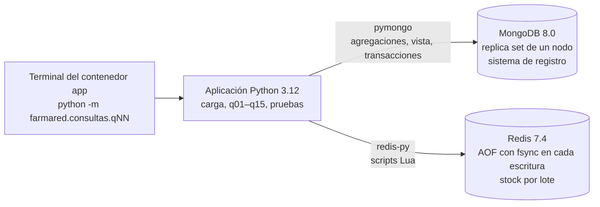
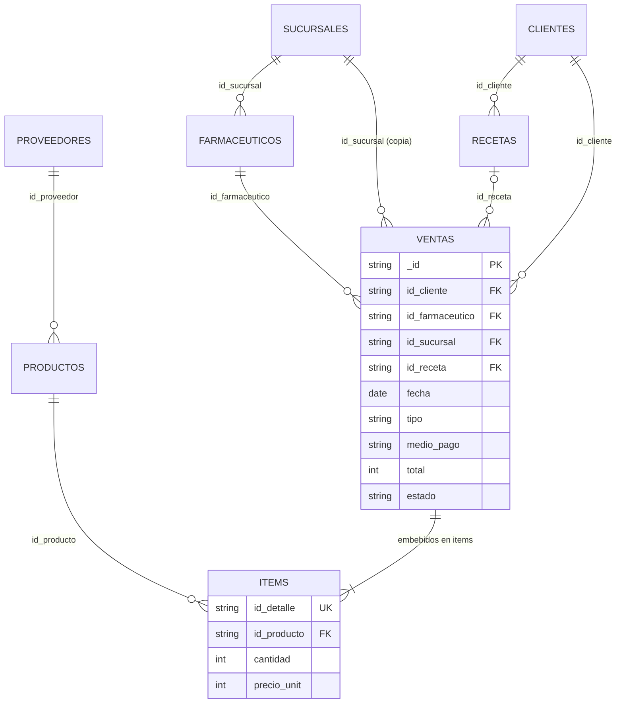
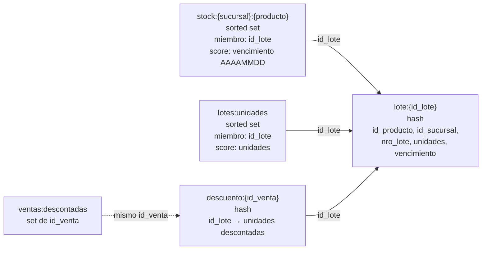
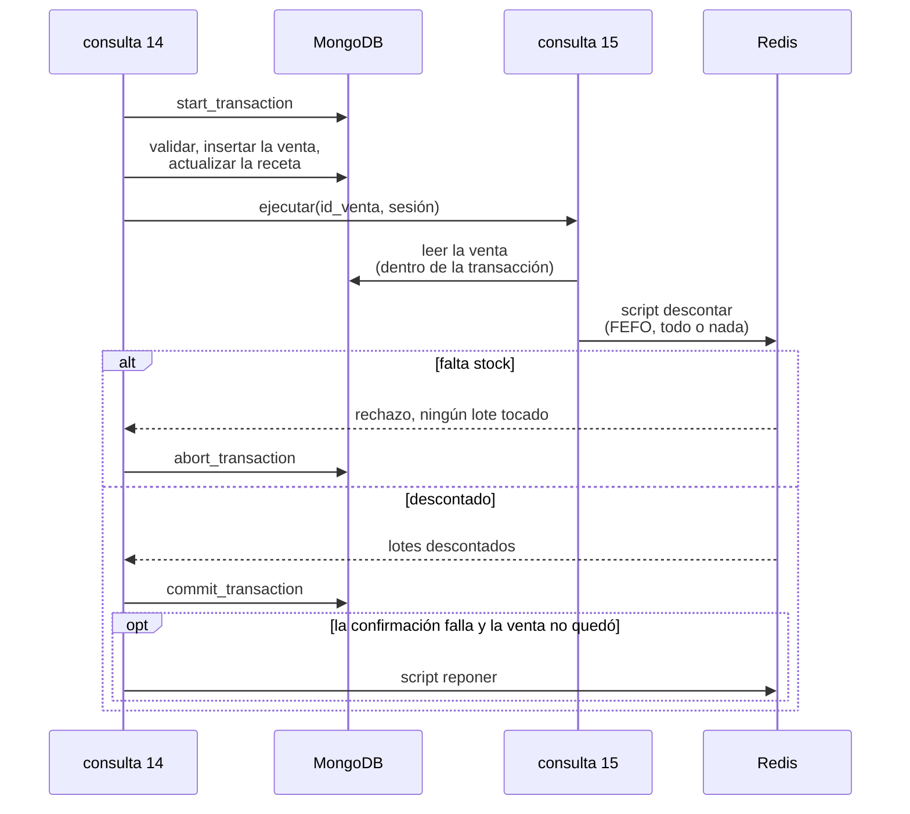

<div class="caratula" align="center">

<p class="materia"><strong>Base de Datos II</strong></p>
<p class="subtitulo">Trabajo Práctico Obligatorio</p>
<p class="subtitulo">Instituto Tecnológico de Buenos Aires</p>
<p></p>
<p class="subtitulo">FarmaRed: sistema de gestión de una red de farmacias<br>con persistencia políglota</p>
<p>Grupo 9</p>

</div>

<div class="integrantes">

**Integrantes:**

- Branda, Franco (65404)
- Salerno, Román (65145)
- Migliaro, Eugenio (65508)
- Costa, Francisco (65202)

**Repositorio:** <https://github.com/franciscocostaa/TPO-BD2>

2.º cuatrimestre de 2026

</div>

<div class="salto"></div>

## Contenido

- [Resumen](#resumen)
- [1. Arquitectura políglota](#1-arquitectura-políglota)
- [2. Modelo de datos](#2-modelo-de-datos)
- [3. Entorno](#3-entorno)
- [4. Carga de datos](#4-carga-de-datos)
- [5. Consultas y servicios](#5-consultas-y-servicios)
- [6. Consistencia e integridad](#6-consistencia-e-integridad)
- [7. Limitaciones, alternativas y conclusiones](#7-limitaciones-alternativas-y-conclusiones)
- [8. Fuentes](#8-fuentes)

## Resumen

FarmaRed guarda sus datos en dos motores NoSQL de paradigmas distintos. **MongoDB**, una base de documentos, es el sistema de registro: clientes, sucursales, farmacéuticos, proveedores, productos, recetas y ventas. **Redis**, una base clave-valor en memoria, guarda solo el stock por lote, que es el dato con más escrituras concurrentes y con la regla más estricta: FEFO y nunca negativo. Una aplicación en Python 3.12 carga los datos y resuelve las 15 consultas y servicios.

El repositorio se levanta en GitHub Codespaces sin pasos manuales. La carga es idempotente, y `python -m farmared.pruebas` reproduce las pruebas de consistencia de este informe. Los comandos de cada consulta están en el README.

Todos los ejemplos son reales: se obtuvieron después de `python -m farmared.carga`, el 15/11/2026. Las consultas que dependen de la fecha se muestran con `--hoy 2026-11-15`, para que den lo mismo cualquier día.

## 1. Arquitectura políglota

### 1.1 Qué necesita cada dato

La consigna describe cada dato por su estructura, su patrón de acceso y la consistencia que requiere (Consigna, §3.2). Esa descripción es la que decide el motor:

| Dato o caso de uso | Lo que lo caracteriza | Lo que necesita del motor |
|---|---|---|
| Ventas y su detalle | Cabecera con ítems de longitud variable; consultas por cliente, farmacéutico y rango de fechas; muchas inserciones. | Guardar la venta entera en una escritura atómica, índices compuestos y agregaciones. |
| Stock por lote | Actualizaciones frecuentes y concurrentes; nunca negativo; prioridad por vencimiento. | Verificar y descontar en una operación indivisible, y recorrer los lotes ordenados por vencimiento. |
| Clientes, recetas, farmacéuticos | ABM con baja lógica; relaciones cliente–receta–venta–producto que recorre el historial. | Documentos con atributos propios, referencias y uniones. |
| Catálogo y proveedores | Pocos cambios, muchas lecturas. | Datos de referencia que se combinan con ventas y lotes. |
| Reportes | Totales por farmacéutico, rankings, conteos por período, una vista. | Agregaciones y vistas en el propio motor. |

### 1.2 Motores elegidos

La clase plantea que la persistencia políglota consiste en usar, para cada necesidad, el motor que mejor se adapta, y enumera los factores de la elección: tipo de base, durabilidad, disponibilidad, consistencia, escalabilidad y seguridad (Clase I, pp. 5–6). Con esos factores, dos motores alcanzan para cubrir la tabla anterior, cada uno con un rol que el otro no cumple bien. Cada motor que se suma agrega integración y operación (complemento: no está en las clases), así que no agregamos un tercero sin un dato que lo necesite.

| Dato | Motor | Por qué |
|---|---|---|
| Ventas con sus ítems | MongoDB | Una venta y sus ítems siempre se leen y se escriben juntos: es la relación "contiene" que la clase recomienda embeber, y así la venta completa se escribe en una sola operación atómica (Clase 13, p. 5). Los accesos que describe la consigna, por cliente, por farmacéutico y por rango de fechas, se cubren con índices (Clase 14, pp. 28–29) sobre `{id_cliente, fecha}` y `{id_farmaceutico, fecha}`. |
| Reportes (consultas 4, 5, 7 y 11) | MongoDB | Se resuelven con el pipeline de agregación (Clase 14, pp. 31–34), y la consulta 11 pide una vista, que MongoDB ofrece (Clase 12, pp. 50–52). |
| Clientes, recetas, farmacéuticos, sucursales | MongoDB | Tienen atributos propios, ABM y baja lógica. Se relacionan por referencias, que se combinan con `$lookup`, un *left outer join* (Clase 13, pp. 16–23). La venta y la receta se actualizan juntas en una transacción de MongoDB (sección 6.3). |
| Catálogo y proveedores | MongoDB | Son datos de referencia que las consultas combinan con ventas y lotes. Separarlos en un tercer motor solo agregaría cruces en la aplicación. |
| Stock por lote | Redis | Es un almacén en memoria (Clase 17, p. 9) que ejecuta cada script Lua de forma atómica, sin atender a otro cliente mientras corre (Clase 17, p. 31). Un script verifica que alcance el stock de todos los ítems y recién entonces descuenta. Los *sorted sets* mantienen los lotes ordenados por vencimiento, así que FEFO es un `ZRANGEBYSCORE` desde hoy (Clase 18, pp. 14–15). |

La clase desaconseja las bases clave-valor para transacciones de varias operaciones y para operaciones que abarcan distintos conjuntos de datos (Clase 17, p. 7). Por eso Redis queda acotado a **un único conjunto de datos**, el stock, y la única operación de varios pasos que se le pide, descontar los lotes de una venta, corre dentro de un script atómico. La transacción entre entidades (venta y receta) la hace MongoDB.

### 1.3 Motores descartados

| Motor | Por qué no |
|---|---|
| Cassandra | No tiene joins ni subconsultas (Clase 15, p. 13), las agregaciones se hacen del lado del cliente y no conviene cuando se requieren transacciones ACID (Clase 15, p. 6). Las consultas 3, 10 y 14 cruzan entidades, y la 14 actualiza venta y receta juntas. |
| DynamoDB | La consistencia es por ítem, sin operaciones atómicas entre ítems (Clase 20, p. 6); es un servicio pago de la nube y el modelo tiene que ajustarse a su particionamiento (Clase 20, pp. 32–33). |
| Neo4j | Fue la alternativa más fuerte. Se compara en detalle en la sección 7.2. |

### 1.4 Vista general



| Motor | Consultas |
|---|---|
| Solo MongoDB | 1, 2, 3, 4, 5, 6, 7, 9, 10, 11, 12 y 13 |
| MongoDB + Redis | 8 (lotes en Redis, con producto, sucursal y proveedor de MongoDB), 14 y 15 |

## 2. Modelo de datos

### 2.1 Convenciones

- **Identificadores:** el `_id` de cada documento es el id del CSV (`C001`, `V001`…). Los registros propios siguen la misma serie.
- **Fechas:** `Date` de MongoDB a las 00:00 UTC del día del CSV. "Hoy" es la fecha del sistema en hora argentina (el contenedor corre con `TZ=America/Argentina/Buenos_Aires`) y se convierte de la misma forma antes de comparar. Las consultas que dependen de la fecha aceptan `--hoy` para reproducir resultados.
- **Importes:** enteros, en pesos.
- **Vacíos:** `null` explícito. Todos los documentos de una colección tienen los mismos campos.
- **Bajas:** lógicas (`activo: false`). Nada se borra: ni clientes, ni productos, ni lotes en cero.

### 2.2 MongoDB

Base `farmared`, con siete colecciones de datos, una de contadores y una vista.



El diagrama detalla los campos de la venta y de sus ítems, que es donde está el embebido. Las demás colecciones tienen los campos de su CSV, con el id como `_id`.

| Colección | Embebido o referencia | Índices |
|---|---|---|
| `ventas` | Los ítems van **embebidos** en `items`: no existen fuera de su venta, siempre se leen con ella y así la venta entera se escribe de forma atómica (Clase 13, p. 5). El cliente, el farmacéutico y la receta son **referencias**, porque tienen vida propia. `id_sucursal` es una copia de la sucursal del farmacéutico al momento de la venta: el stock se descuenta en esa sucursal. | `{id_cliente, fecha}`, `{id_farmaceutico, fecha}`, `{fecha}`, `{estado}`, único en `items.id_detalle` |
| `recetas` | Colección propia que **referencia** al cliente. Embeberlas en el cliente crearía un arreglo que crece sin límite, que es lo que la clase recomienda evitar (Clase 13, pp. 18–20). | `{id_cliente}`, `{tipo, estado, proxima_dispensa}` |
| `productos` | **Referencia** al proveedor: un proveedor abastece muchos productos, y embeberlo repetiría sus datos en cada uno (Clase 13, pp. 16–18). | — |
| `clientes`, `farmaceuticos`, `sucursales`, `proveedores` | Documentos independientes con baja lógica. | Único en `clientes.dni` y en `farmaceuticos.matricula`; `farmaceuticos.id_sucursal` |
| `contadores` | Último número usado de ventas y de ítems, para los ids nuevos de la consulta 14. | — |
| `ingresos_farmaceutico_mes` | Vista de la consulta 11 (sección 5, consulta 11). | — |

Una venta con receta y dos ítems:

```js
{
  _id: "V006", id_cliente: "C006", id_farmaceutico: "F002", id_sucursal: "S001",
  id_receta: "RC003", fecha: ISODate("2026-08-01"), tipo: "Con receta",
  medio_pago: "Obra social", total: 22100, estado: "Completada",
  items: [
    { id_detalle: "D007", id_producto: "PRD005", cantidad: 3, precio_unit: 5400 },
    { id_detalle: "D008", id_producto: "PRD009", cantidad: 1, precio_unit: 5900 }
  ]
}
```

El documento de una venta no crece después de registrarse, así que el límite de 16 MB por documento no es una restricción (Clase 13, p. 6).

### 2.3 Redis

Base 0. Cada lote es un hash, y dos *sorted sets* lo indexan: uno por sucursal y producto con el vencimiento como score, para FEFO, y otro con todos los lotes y las unidades como score, para el stock bajo. Dos claves más registran qué ventas ya descontaron stock y de qué lotes.



| Clave | Tipo | Uso |
|---|---|---|
| `lote:{id_lote}` | Hash | Datos y unidades del lote. |
| `stock:{id_sucursal}:{id_producto}` | Sorted set, score = vencimiento como entero `AAAAMMDD` | FEFO (consulta 15): los lotes vigentes, del que vence antes al que vence después. |
| `lotes:unidades` | Sorted set, score = unidades | Lotes por debajo de un umbral (consulta 8). |
| `ventas:descontadas` | Set | Ventas cuyo stock ya se descontó, para no descontarlas dos veces. |
| `descuento:{id_venta}` | Hash | Cuántas unidades se tomaron de cada lote para la venta, para poder devolverlas. |

```text
HSET lote:L005 id_producto PRD003 id_sucursal S001 nro_lote L-2506A unidades 40 vencimiento 2026-11-30
ZADD stock:S001:PRD003 20261120 L033 20261130 L005 20270630 L015
ZADD lotes:unidades 40 L005

ZRANGEBYSCORE stock:S001:PRD003 20261115 +inf    # lotes vigentes de PRD003 en S001, FEFO
ZRANGEBYSCORE lotes:unidades -inf (50              # lotes con menos de 50 unidades
```

Invariantes que mantiene el código:

- Las unidades solo cambian dentro de los scripts Lua `descontar` y `reponer`, que actualizan el hash y `lotes:unidades` en la misma operación atómica.
- Las unidades nunca quedan negativas: `descontar` escribe solo si alcanzan todos los productos de la venta.
- Un lote con 0 unidades no se borra: queda en los índices y el script lo saltea.
- Una venta figura en `ventas:descontadas` si y solo si tiene su `descuento:{id_venta}`, salvo las ventas históricas de los CSV, cuyo stock ya está reflejado en los lotes (sección 4.1).

### 2.4 Relaciones entre motores

| Desde Redis | Hacia MongoDB | Cómo se resuelve |
|---|---|---|
| `lote.id_producto` | `productos._id` | En la aplicación: la consulta 8 lee los lotes en Redis y trae los productos y sus proveedores con un `$in`. |
| `lote.id_sucursal` y la clave `stock:{sucursal}:…` | `sucursales._id` | En la aplicación: la consulta 8 trae las sucursales; la 15 arma la clave con la sucursal de la venta. |
| `ventas:descontadas`, `descuento:{id_venta}` | `ventas._id` | La consulta 15 parte de una venta de MongoDB y registra su id en Redis. |

La carga valida que cada lote apunte a un producto y a una sucursal existentes.

## 3. Entorno

`docker-compose.yml` y `.devcontainer/` levantan todo en GitHub Codespaces o en VS Code con Dev Containers, sin pasos manuales:

| Servicio | Imagen y configuración | Por qué |
|---|---|---|
| `app` | Python 3.12 con `mongosh` y `redis-cli`; `TZ=America/Argentina/Buenos_Aires`. Al crearse instala `pymongo` y `redis`. | Es donde se trabaja. La zona horaria define "hoy". |
| `mongo` | `mongo:8.0` como replica set de un nodo (`rs0`). Su healthcheck inicia el replica set la primera vez y queda sano cuando el nodo es primario. | Las transacciones de varios documentos de MongoDB requieren un replica set (complemento: manual de MongoDB, *Transactions*). La clase muestra cómo se arma un replica set (Clase 14, pp. 40–43). |
| `redis` | `redis:7.4` con AOF y `appendfsync always`. | El stock vive solo en Redis. La clase presenta las políticas de fsync del AOF (Clase 17, p. 21): con "por segundo" se puede perder hasta un segundo de escrituras. Con `always`, Redis responde a cada escritura recién después de pasarla a disco (complemento: documentación de Redis, *Persistence*), así que un descuento ya informado no se pierde. El costo es un fsync por escritura, que la clase advierte que hace más lento al AOF (Clase 17, p. 23). Con el volumen de escrituras de una red de farmacias es aceptable. |

Los datos persisten en volúmenes de Docker. `python -m farmared.verificar` comprueba lo que necesitan la carga y las consultas:

```text
$ python -m farmared.verificar
✔ MongoDB: conexión: responde
✔ MongoDB: replica set: rs0, primario mongo:27017
✔ MongoDB: transacciones: abort deshace el insert
✔ Redis: conexión: responde
✔ Redis: persistencia AOF: appendonly = yes, appendfsync = always
✔ Redis: scripts Lua: EVAL ejecuta scripts
```

## 4. Carga de datos

`python -m farmared.carga` parte de los CSV de la cátedra (`datos/provistos/`) y de los registros propios (`datos/adicionales/`), que tienen los mismos nombres de archivo y encabezados. La carga concatena ambos orígenes y procesa todo igual.

### 4.1 Pasos

1. **Lectura y conversión** según las convenciones de la consigna (§2): vacío → `null`, `True`/`False` → booleano, fechas ISO → `Date`, importes → enteros.
2. **Validación** de los datos combinados, antes de escribir nada (sección 4.2). Si hay errores, los lista todos y termina sin tocar ninguna base.
3. **Transformación:** embebe los ítems en su venta, copia en cada venta la sucursal del farmacéutico y calcula los contadores de ids.
4. **MongoDB:** crea los índices y, **en una única transacción**, vacía cada colección con `delete_many` y la vuelve a llenar con `insert_many`. Después crea o actualiza la vista de la consulta 11.
5. **Redis:** en un único `MULTI`, borra las claves de stock anteriores, escribe cada lote en sus tres claves y marca como descontadas las ventas "Completada" de los CSV. Los lotes ya reflejan esas ventas: sin la marca, la consulta 15 volvería a descontarlas.

```text
$ python -m farmared.carga
✔ clientes: 8 provistos + 12 adicionales → MongoDB clientes
✔ sucursales: 5 provistos + 10 adicionales → MongoDB sucursales
✔ farmaceuticos: 7 provistos + 12 adicionales → MongoDB farmaceuticos
✔ proveedores: 5 provistos + 10 adicionales → MongoDB proveedores
✔ productos: 13 provistos + 12 adicionales → MongoDB productos
✔ recetas: 9 provistos + 15 adicionales → MongoDB recetas
✔ ventas: 16 provistos + 13 adicionales → MongoDB ventas
✔ detalle_ventas: 22 provistos + 17 adicionales → MongoDB ventas.items
✔ stock_lotes: 18 provistos + 16 adicionales → Redis
✔ vista ingresos_farmaceutico_mes → MongoDB
```

### 4.2 Validaciones

Las validaciones corren por etapas, y cada una supone que la anterior pasó:

1. **Formato:** encabezados iguales en ambos orígenes, cantidad de columnas, enteros, fechas y booleanos válidos.
2. **Vacíos, valores y unicidad:** solo pueden estar vacíos `nro_afiliado`, `proxima_dispensa` e `id_receta`; los campos categóricos tienen que tener uno de los valores de la consigna (obra social, tipo de sucursal, cargo, condición de venta, tipo y estado de receta, tipo, medio de pago y estado de venta); no hay ids repetidos, tampoco entre provistos y adicionales, ni DNI ni matrículas repetidos.
3. **Referencias:** cada una de las diez relaciones de la consigna (§2.10) apunta a un id existente.
4. **Reglas de negocio:**
   - cada venta tiene al menos un ítem y su total es la suma de los ítems;
   - la receta de una venta es del mismo cliente, y la venta es "Con receta" si y solo si tiene receta;
   - ningún lote tiene unidades negativas;
   - una receta simple o archivada autoriza una dispensa, y una de tratamiento prolongado, hasta tres;
   - las dispensas realizadas no superan las autorizadas, y la receta está "Completada" si y solo si las agotó;
   - `proxima_dispensa` está presente si y solo si la receta es de tratamiento prolongado, está vigente y ya tuvo una dispensa;
   - las dispensas realizadas coinciden con las ventas "Completada" que usan la receta;
   - un cliente "Sin cobertura" no tiene número de afiliado, y uno con obra social sí lo tiene.

Estas reglas detectaron un error en nuestros propios datos: dos recetas de tratamiento prolongado tenían 6 dispensas autorizadas, y la consigna permite hasta 3 (§2.7). Las corregimos. Así se ve una carga rechazada, con filas modificadas a propósito:

```text
$ python -m farmared.carga
✘ Carga abortada; no se modificó ninguna base:
  - ventas V018: tipo Con receta con id_receta vacío
  - recetas RC015: un tratamiento prolongado permite hasta 3 dispensas, no 6
```

La carga **no** aplica las validaciones de alta de la consulta 14 a los datos históricos. V001 la registró F004, que hoy está dado de baja, y V014 incluye PRD012, hoy discontinuado: eran válidas cuando se registraron.

### 4.3 Idempotencia y reproducibilidad

Cada ejecución deja exactamente el estado de los CSV y descarta lo que hayan hecho los servicios de escritura: altas de clientes, ventas, descuentos de stock y hasta una definición alterada de la vista. Lo comprobamos calculando un hash de todo el contenido de ambas bases después de una carga, de escrituras de las consultas 13 y 14 y de una segunda carga: el hash de la primera y de la segunda carga es idéntico.

La transacción garantiza que en MongoDB no quede una carga a medias. Entre los dos motores, si Redis fallara después de que MongoDB confirmó, alcanza con volver a correr la carga.

### 4.4 Registros adicionales

La consigna pide al menos 10 registros propios por colección, elegidos para ejercitar las consultas (Consigna, §3.3). Agregamos:

| Archivo | Ids | Casos que cubren |
|---|---|---|
| Clientes (12) | C009–C020 | Clientes sin ninguna compra (C011, C012, C014, C016, C018 y C019) y uno cuya única venta es de hace más de un año (C020), para la consulta 12. Dos dados de baja (C016 y C020), dos sin cobertura (C012 y C015) y un DNI de 7 dígitos (C011). Todas las obras sociales y las tres provincias de la red. |
| Sucursales (10) | S006–S015 | Farmacias sin ventas, para las consultas 5 y 10. Una farmacia no habilitada (S014), para el rechazo de la consulta 14. |
| Farmacéuticos (12) | F008–F019 | Siete activos sin ventas, que la consulta 5 lista con cero. Un segundo farmacéutico en S003 (F017). Uno dado de baja (F016). Uno activo en la farmacia no habilitada (F019). |
| Proveedores (10) | PRV006–PRV015 | Laboratorios y droguerías de otras provincias. Dos dados de baja: PRV013 todavía provee un producto activo, que la consulta 1 muestra con `proveedor.activo: false`. |
| Productos (12) | PRD014–PRD025 | Las tres condiciones de venta. Un producto "Bajo receta archivada" activo (PRD017) y otro discontinuado (PRD024), y un producto bajo receta discontinuado (PRD025). |
| Lotes (16) | L019–L034 | FEFO con un lote vencido en el medio: PRD001 en S001 tiene L019 (vencido), L020 y L001. FEFO con tres lotes vigentes: PRD003 en S001 tiene L033, L005 y L015. Un producto con solo stock vencido: PRD017 en S001, con L022. Un lote en 0 (L021). Lotes próximos a vencer (L033, L026, L028) y vencidos (L019, L022, L034). Los bordes del umbral de la consulta 8: L030 con 49 unidades y L031 con 50. Stock central en la droguería (L032). |
| Recetas (15) | RC010–RC024 | Vigentes de cada tipo, sin dispensas. Vencidas (RC013, RC017, RC024). Casos de rechazo de la consulta 14: una receta simple para un producto que exige archivada (RC016), una de un cliente dado de baja (RC019) y una de un cliente sin cobertura (RC018). Recetas con dispensas respaldadas por ventas (RC020, RC021, RC023) y una con la venta pendiente (RC022). |
| Ventas (13) e ítems (17) | V017–V029, D023–D039 | Ventas de noviembre de 2026 para la consulta 11 y de los últimos 60 días para la 5. Una pendiente (V022) y una anulada (V023). Una de octubre (V026), que entra en la ventana de 60 días pero no en el mes actual. Una de hace un año y medio (V028), para las consultas 9 y 12. Un empate en el corte del top 5 de la consulta 7 (PRD004 y PRD022). |

### 4.5 La fecha de referencia

Los datos provistos se describen respecto del 13/10/2026 (Consigna, §2), pero las consultas tienen que usar la fecha del sistema (§3.3). Con solo los datos provistos, la consulta 11 (mes actual) daría vacía desde noviembre y la 5 (últimos 60 días) se iría vaciando. Por eso las ventas adicionales están fechadas en noviembre de 2026.

Esas fechas son fijas. Fecharlas relativas al momento de la carga ("hoy menos tres días") rompería la idempotencia, porque dos cargas en días distintos dejarían estados distintos. El costo es que, ejecutadas en un mes posterior, la consulta 11 vuelve a dar vacía y la 5 se vacía de a poco. Las consultas 5, 6, 8, 11, 12, 14 y 15 aceptan `--hoy` para reproducir cualquier resultado de este informe.

## 5. Consultas y servicios

Cada consulta es un módulo `farmared/consultas/qNN.py` con una función `ejecutar(...)` y un docstring con propósito, parámetros, retorno y motor. Se ejecuta con `python -m farmared.consultas.qNN [argumentos]`, y `--help` muestra los argumentos. Los parámetros de 3, 10, 13, 14 y 15 son argumentos de la función, nunca constantes.

Algunos operadores de agregación que usamos no aparecen en las clases: `$unionWith`, `$setWindowFields` con `$rank`, `$dateDiff`, `$dateFromParts` y `$lookup` con `pipeline`. Son complemento y están documentados en el manual de MongoDB, *Aggregation Stages* y *Aggregation Operators*.

| # | Motor | Cómo se resuelve la relación |
|---|---|---|
| 1 | MongoDB | `$lookup` producto → proveedor |
| 2 | MongoDB | `$lookup` venta → farmacéutico → sucursal |
| 3 | MongoDB | ventas `$unionWith` recetas; `$lookup` ítem → producto |
| 4 | MongoDB | `$group` en recetas y después `$lookup` → cliente |
| 5 | MongoDB | farmacéuticos `$lookup` ventas (*left outer join*: quedan los ceros) |
| 6 | MongoDB | `$lookup` receta → cliente |
| 7 | MongoDB | ítems embebidos: `$unwind`, `$group`, `$rank`; `$lookup` → producto |
| 8 | Redis + MongoDB | Redis da los lotes; MongoDB, producto, proveedor y sucursal; se combinan en la aplicación |
| 9 | MongoDB | una colección: los ítems ya están embebidos |
| 10 | MongoDB | farmacéuticos de la sucursal `$lookup` ventas, agrupadas por cliente |
| 11 | MongoDB | vista sobre `ventas` con `$group` y `$lookup` → farmacéutico |
| 12 | MongoDB | clientes `$lookup` ventas de la ventana: anti-unión |
| 13 | MongoDB | un documento por cliente; índice único de DNI |
| 14 | MongoDB + Redis | transacción de MongoDB que llama a la 15 antes de confirmar |
| 15 | MongoDB + Redis | lee la venta en MongoDB; script Lua en Redis |

### Consulta 1 — Productos activos con su proveedor

**Enunciado:** productos activos con todos los datos de su proveedor.

**Relación:** el producto referencia al proveedor (`id_proveedor`), y un `$lookup` trae el documento completo. Primero se filtran los activos, así el `$lookup` corre solo sobre ellos. Se muestran también los productos activos cuyo proveedor está dado de baja: el producto sigue a la venta, y `proveedor.activo` lo indica.

```python
db.productos.aggregate([
    {"$match": {"activo": True}},
    {"$lookup": {"from": "proveedores", "localField": "id_proveedor",
                 "foreignField": "_id", "as": "proveedor"}},
    {"$set": {"proveedor": {"$ifNull": [{"$first": "$proveedor"}, None]}}},
    {"$unset": "id_proveedor"},
    {"$sort": {"_id": 1}},
])
```

**Ejemplo:** `python -m farmared.consultas.q01` devuelve 21 productos: PRD001–PRD011 y PRD014–PRD023. Quedan afuera los discontinuados PRD012, PRD013, PRD024 y PRD025. El último es el caso del proveedor dado de baja:

```json
{
  "_id": "PRD023",
  "nombre": "Clotrimazol crema 1% 20g",
  "principio_activo": "Clotrimazol",
  "categoria": "Antimicótico",
  "presentacion": "Crema 20 g",
  "condicion_venta": "Venta libre",
  "precio_unit": 2900,
  "activo": true,
  "proveedor": {
    "_id": "PRV013",
    "razon_social": "Droguería Jacarandá S.R.L.",
    "cuit": "30-70645981-9",
    "tipo": "Droguería",
    "ciudad": "Morón",
    "provincia": "Buenos Aires",
    "telefono": "1144214400",
    "activo": false
  }
}
```

### Consulta 2 — Ventas pendientes con su farmacéutico

**Enunciado:** ventas en estado "Pendiente" con el farmacéutico asignado (nombre, matrícula y sucursal) y el total.

**Relación:** dos `$lookup` encadenados: venta → farmacéutico, y farmacéutico → sucursal. La sucursal es la del farmacéutico, como dice el enunciado.

```python
db.ventas.aggregate([
    {"$match": {"estado": "Pendiente"}},
    {"$lookup": {"from": "farmaceuticos", "localField": "id_farmaceutico",
                 "foreignField": "_id", "as": "farmaceutico"}},
    {"$set": {"farmaceutico": {"$first": "$farmaceutico"}}},
    {"$lookup": {"from": "sucursales", "localField": "farmaceutico.id_sucursal",
                 "foreignField": "_id", "as": "sucursal"}},
    {"$project": {"fecha": 1, "id_cliente": 1, "total": 1, "farmaceutico": {
        "_id": "$farmaceutico._id", "nombre": "$farmaceutico.nombre",
        "apellido": "$farmaceutico.apellido", "matricula": "$farmaceutico.matricula",
        "sucursal": ...}}},   # _id, nombre, ciudad y provincia de la sucursal
    {"$sort": {"fecha": 1, "_id": 1}},
])
```

**Ejemplo:** `python -m farmared.consultas.q02`

| Venta | Fecha | Cliente | Total | Farmacéutico | Matrícula | Sucursal |
|---|---|---|---|---|---|---|
| V012 | 2026-10-11 | C002 | $9.200 | Natalia Giménez | MN-18289 | Farmacia Rosario Centro |
| V011 | 2026-10-12 | C007 | $4.800 | Matías Sandoval | MN-18340 | Farmacia Nueva Córdoba |
| V022 | 2026-11-13 | C010 | $8.700 | Martina Correa | MN-18533 | Farmacia La Plata |

```json
{
  "_id": "V022",
  "id_cliente": "C010",
  "fecha": "2026-11-13",
  "total": 8700,
  "farmaceutico": {
    "_id": "F010",
    "nombre": "Martina",
    "apellido": "Correa",
    "matricula": "MN-18533",
    "sucursal": {"_id": "S008", "nombre": "Farmacia La Plata", "ciudad": "La Plata", "provincia": "Buenos Aires"}
  }
}
```

### Consulta 3 — Historial de un cliente

**Enunciado:** historial completo de un cliente (dado su id): ventas y recetas ordenadas cronológicamente por fecha.

**Relación:** ventas y recetas referencian al cliente. Un único pipeline parte de las ventas del cliente y les suma sus recetas con `$unionWith`, que funciona como un `UNION ALL`; la base ordena todo junto. El historial recorre cliente → receta → venta → producto: cada venta trae su `id_receta`, y un `$lookup` agrega a cada ítem el nombre y la condición de venta del producto.

```python
db.ventas.aggregate([
    {"$match": {"id_cliente": id_cliente}},
    {"$lookup": {"from": "productos", "localField": "items.id_producto", "foreignField": "_id",
                 "as": "productos", "pipeline": [{"$project": {"nombre": 1, "condicion_venta": 1}}]}},
    {"$set": {"registro": "venta",
              "items": ...}},          # a cada ítem, el nombre y la condición de su producto
    {"$unset": "productos"},
    {"$unionWith": {"coll": "recetas", "pipeline": [
        {"$match": {"id_cliente": id_cliente}},
        {"$set": {"registro": "receta", "fecha": "$fecha_emision"}},
        {"$unset": "fecha_emision"}]}},
    {"$unset": "id_cliente"},
    {"$sort": {"fecha": 1, "registro": 1, "_id": 1}},   # el mismo día, la receta antes que la venta
])
```

**Ejemplo:** `python -m farmared.consultas.q03 C001` devuelve el cliente y siete registros:

| Fecha | Registro | Id | Estado | Detalle |
|---|---|---|---|---|
| 2026-09-10 | receta | RC001 | Completada | Simple, 1 de 1 dispensas |
| 2026-09-10 | venta | V003 | Completada | RC001: Amoxicilina 500mg x21 × 1 |
| 2026-09-25 | venta | V015 | Anulada | Ibuprofeno 400mg x20 × 1 |
| 2026-10-02 | venta | V013 | Completada | Loratadina 10mg x10 × 2 |
| 2026-10-08 | receta | RC008 | Completada | Simple, 1 de 1 dispensas |
| 2026-10-08 | venta | V010 | Completada | RC008: Salbutamol aerosol 100mcg × 1 |
| 2026-11-02 | venta | V025 | Completada | Paracetamol 500mg x30 × 2, Vitamina C 1g x30 × 1 |

```json
{
  "_id": "V025",
  "id_farmaceutico": "F003",
  "id_sucursal": "S002",
  "id_receta": null,
  "fecha": "2026-11-02",
  "tipo": "Venta libre",
  "medio_pago": "Efectivo",
  "total": 8700,
  "estado": "Completada",
  "items": [
    {"id_detalle": "D033", "id_producto": "PRD001", "cantidad": 2, "precio_unit": 2800,
     "producto": "Paracetamol 500mg x30", "condicion_venta": "Venta libre"},
    {"id_detalle": "D034", "id_producto": "PRD022", "cantidad": 1, "precio_unit": 3100,
     "producto": "Vitamina C 1g x30", "condicion_venta": "Venta libre"}
  ],
  "registro": "venta"
}
```

El historial incluye ventas en cualquier estado y recetas en cualquier estado: es el historial completo. Funciona igual con un cliente dado de baja. Un cliente inexistente se rechaza (`✘ no existe el cliente C099`).

### Consulta 4 — Clientes con más de una receta

**Enunciado:** clientes con más de una receta registrada, indicando la cantidad.

**Relación:** la receta referencia al cliente. El pipeline agrupa las recetas **antes** de unir con los clientes, así el `$lookup` corre una vez por cliente que cumple y no una vez por receta.

```python
db.recetas.aggregate([
    {"$group": {"_id": "$id_cliente", "cantidad_recetas": {"$sum": 1}}},
    {"$match": {"cantidad_recetas": {"$gte": 2}}},
    {"$lookup": {"from": "clientes", "localField": "_id", "foreignField": "_id", "as": "cliente"}},
    {"$set": {"cliente": {"$ifNull": [{"$first": "$cliente"}, None]}}},
    {"$sort": {"cantidad_recetas": -1, "_id": 1}},
])
```

**Ejemplo:** `python -m farmared.consultas.q04`

| Cliente | Nombre | Recetas |
|---|---|---|
| C003 | Carla Ruiz | 3 |
| C001 | Lucía Fernández | 2 |
| C002 | Martín Gómez | 2 |
| C006 | Ricardo Paz | 2 |
| C009 | Valentina Ríos | 2 |
| C010 | Diego Ferreyra | 2 |
| C013 | Agustina Molina | 2 |

Cuentan las recetas en cualquier estado, porque la consulta pide recetas *registradas*. C003 tiene dos vigentes y una vencida (RC024). Cada elemento trae el documento completo del cliente en `cliente`. Con `--minimo 3` queda solo C003.

### Consulta 5 — Ventas de los últimos 60 días por farmacéutico

**Enunciado:** farmacéuticos activos y cantidad de ventas registradas en los últimos 60 días (excluyendo anuladas). Deben aparecer también los que tienen cero.

**Relación:** el pipeline arranca en `farmaceuticos`, no en `ventas`. Agrupar las ventas por farmacéutico solo devolvería a los que vendieron algo. El `$lookup` es un *left outer join* (Clase 13, p. 23): el farmacéutico sin ventas queda con un arreglo vacío, y `$size` le da 0. El `$lookup` lleva su propio `pipeline`, que filtra por fecha y estado del lado de las ventas y usa el índice `{id_farmaceutico, fecha}`.

```python
desde, hasta = a_mongo(hoy - timedelta(days=60)), a_mongo(hoy)
db.farmaceuticos.aggregate([
    {"$match": {"activo": True}},
    {"$lookup": {"from": "ventas", "localField": "_id", "foreignField": "id_farmaceutico",
                 "as": "recientes", "pipeline": [
        {"$match": {"estado": {"$ne": "Anulada"}, "fecha": {"$gte": desde, "$lte": hasta}}},
        {"$project": {"_id": 1}}]}},
    {"$set": {"ventas": {"$size": "$recientes"}}},
    {"$unset": "recientes"},
    {"$sort": {"ventas": -1, "_id": 1}},
])
```

**Ejemplo:** `python -m farmared.consultas.q05 --hoy 2026-11-15` (ventana del 16/09 al 15/11) devuelve los 17 farmacéuticos activos. Quedan afuera F004 y F016, dados de baja.

| Farmacéutico | Nombre | Sucursal | Ventas |
|---|---|---|---|
| F001 | Mariana Quiroga | S001 | 3 |
| F005 | Natalia Giménez | S003 | 3 |
| F008 | Lucas Moreno | S006 | 3 |
| F002 | Sebastián Ledesma | S001 | 2 |
| F003 | Carolina Benítez | S002 | 2 |
| F010 | Martina Correa | S008 | 2 |
| F013 | Ignacio Luna | S011 | 2 |
| F006 | Matías Sandoval | S004 | 1 |
| F017 | Bruno Peralta | S003 | 1 |
| F007, F009, F011, F012, F014, F015, F018, F019 | | | 0 |

- **Ocho farmacéuticos con cero**, entre ellos F007, director técnico de la droguería, que no registra ventas.
- F002 cuenta 2 (V008 y V016) y no 3, porque V015 está anulada.
- F005 cuenta 3 con V012, que está "Pendiente": la consulta excluye solo las anuladas.
- F001 no cuenta V003, del 10/09, que queda fuera de la ventana.

### Consulta 6 — Recetas prolongadas con la dispensa atrasada

**Enunciado:** recetas de tratamiento prolongado en estado "Vigente" cuya próxima dispensa es anterior a hoy, con los datos del cliente.

**Relación:** `$lookup` receta → cliente. El filtro usa el índice `{tipo, estado, proxima_dispensa}`. "Hoy" sale de la fecha del sistema y se pasa al pipeline; `$dateDiff` calcula los días de atraso.

```python
hoy_mongo = a_mongo(hoy)
db.recetas.aggregate([
    {"$match": {"tipo": "Tratamiento prolongado", "estado": "Vigente",
                "proxima_dispensa": {"$lt": hoy_mongo}}},
    {"$lookup": {"from": "clientes", "localField": "id_cliente", "foreignField": "_id", "as": "cliente"}},
    {"$set": {"cliente": {"$ifNull": [{"$first": "$cliente"}, None]},
              "dias_de_atraso": {"$dateDiff": {"startDate": "$proxima_dispensa",
                                               "endDate": hoy_mongo, "unit": "day"}}}},
    {"$unset": "id_cliente"},
    {"$sort": {"proxima_dispensa": 1, "_id": 1}},
])
```

**Ejemplo:** `python -m farmared.consultas.q06 --hoy 2026-11-15`

| Receta | Dispensas | Próxima dispensa | Días de atraso | Cliente |
|---|---|---|---|---|
| RC002 | 2 de 3 | 2026-09-15 | 61 | C003 Carla Ruiz |
| RC003 | 2 de 3 | 2026-10-01 | 45 | C006 Ricardo Paz |
| RC004 | 1 de 3 | 2026-10-20 | 26 | C006 Ricardo Paz |

No aparecen RC021 ni RC023, prolongadas y vigentes pero con la próxima dispensa en diciembre, ni RC012 y RC015, que todavía no tuvieron su primera dispensa. Una próxima dispensa igual a hoy no está atrasada: con `--hoy 2026-10-20`, RC004 no aparece.

### Consulta 7 — Top 5 de productos más vendidos

**Enunciado:** top 5 de productos más vendidos (unidades), considerando solo ventas "Completada".

**Relación:** los ítems están embebidos en la venta, así que las unidades salen de la misma colección: `$unwind` abre un documento por ítem y `$group` suma por producto. El `$lookup` con `productos` va **después** del corte, para unir solo los productos del ranking.

El puesto se calcula con `$rank`, como `RANK()` en SQL: los productos con las mismas unidades comparten puesto. Se devuelven los que tienen puesto 5 o mejor, así que **un empate en el corte entra completo**. Cortar en cinco exactos obligaría a dejar afuera a uno de los empatados con un criterio arbitrario.

```python
db.ventas.aggregate([
    {"$match": {"estado": "Completada"}},
    {"$unwind": "$items"},
    {"$group": {"_id": "$items.id_producto", "unidades": {"$sum": "$items.cantidad"},
                "ventas": {"$addToSet": "$_id"}}},
    {"$set": {"ventas": {"$size": "$ventas"}}},
    {"$setWindowFields": {"sortBy": {"unidades": -1}, "output": {"puesto": {"$rank": {}}}}},
    {"$match": {"puesto": {"$lte": 5}}},
    {"$sort": {"puesto": 1, "_id": 1}},
    {"$lookup": {"from": "productos", "localField": "_id", "foreignField": "_id", "as": "producto"}},
    {"$set": {"producto": {"$ifNull": [{"$first": "$producto"}, None]}}},
])
```

**Ejemplo:** `python -m farmared.consultas.q07`

| Puesto | Producto | Nombre | Unidades | Ventas |
|---|---|---|---|---|
| 1 | PRD001 | Paracetamol 500mg x30 | 10 | 6 |
| 1 | PRD011 | Loratadina 10mg x10 | 10 | 5 |
| 3 | PRD005 | Metformina 850mg x60 | 8 | 3 |
| 4 | PRD015 | Cetirizina 10mg x10 | 5 | 2 |
| 5 | PRD004 | Losartán 50mg x30 | 3 | 2 |
| 5 | PRD022 | Vitamina C 1g x30 | 3 | 2 |

Los dos empates muestran el criterio: PRD001 y PRD011 comparten el puesto 1, y PRD004 y PRD022 el 5, así que el top 5 trae seis productos. `ventas` cuenta en cuántas ventas distintas apareció cada producto. Cada elemento trae el documento del producto en `producto`.

### Consulta 8 — Lotes con stock bajo

**Enunciado:** lotes con menos de 50 unidades, indicando producto, sucursal y proveedor.

**Relación:** es la única lectura que cruza motores, y la combinación se hace en la aplicación:

1. **Redis:** `ZRANGEBYSCORE lotes:unidades -inf (50` devuelve los ids de los lotes con menos de 50 unidades sin recorrer todos (Clase 18, pp. 14–15). Sus hashes se leen en un pipeline de redis-py (Clase 18, p. 19).
2. **MongoDB:** un `$lookup` trae los productos con su proveedor, y un `find` trae las sucursales, cada uno con un `$in` sobre los ids que aparecieron.
3. **Aplicación:** combina por id y calcula `vencido = vencimiento < hoy`.

```python
ids = r.zrangebyscore("lotes:unidades", "-inf", "(50")
with r.pipeline(transaction=False) as pipe:
    for id_lote in ids:
        pipe.hgetall(f"lote:{id_lote}")
    lotes = pipe.execute()

productos = db.productos.aggregate([
    {"$match": {"_id": {"$in": ids_de_productos}}},
    {"$lookup": {"from": "proveedores", "localField": "id_proveedor", "foreignField": "_id", "as": "proveedor"}},
    {"$project": {"nombre": 1, "presentacion": 1, "proveedor": ...}}])  # _id, razón social, CUIT, teléfono
sucursales = db.sucursales.find({"_id": {"$in": ids_de_sucursales}}, {"nombre": 1, "tipo": 1, "ciudad": 1})
```

**Ejemplo:** `python -m farmared.consultas.q08 --hoy 2026-11-15` devuelve 20 lotes, ordenados por unidades:

| Lote | Unidades | Vence | Vencido | Producto | Sucursal | Proveedor |
|---|---|---|---|---|---|---|
| L021 | 0 | 2027-05-31 | | Loratadina 10mg x10 | Farmacia Belgrano | Laboratorios Andinos S.A. |
| L028 | 8 | 2026-12-05 | | Insulina glargina 100 UI/ml | Farmacia La Plata | Tala Salud S.R.L. |
| L026 | 10 | 2026-11-25 | | Azitromicina 500mg x3 | Farmacia Rosario Centro | Laboratorios Ñandubay S.A. |
| L010 | 12 | 2027-01-31 | | Alprazolam 0,5mg x30 | Farmacia Rosario Centro | Distribuidora Sur Salud S.A. |
| L034 | 12 | 2026-07-31 | sí | Diazepam 10mg x20 | Farmacia Nueva Córdoba | Algarrobo Biofarma S.A. |
| L018 | 15 | 2026-09-30 | sí | Alcohol en gel 250ml | Farmacia Belgrano | DroguMed S.R.L. |
| L033 | 15 | 2026-11-20 | | Amoxicilina 500mg x21 | Farmacia Palermo | FarmaLitoral S.A. |
| L003 | 18 | 2026-12-15 | | Paracetamol 500mg x30 | Farmacia Rosario Centro | Laboratorios Andinos S.A. |
| L022 | 20 | 2026-10-15 | sí | Clonazepam 2mg x30 | Farmacia Palermo | Laboratorio Quebracho S.A. |
| L007 | 22 | 2027-02-28 | | Losartán 50mg x30 | Farmacia Nueva Córdoba | DroguMed S.R.L. |
| L019 | 25 | 2026-08-31 | sí | Paracetamol 500mg x30 | Farmacia Palermo | Laboratorios Andinos S.A. |
| L012 | 30 | 2026-10-31 | sí | Salbutamol aerosol 100mcg | Farmacia Belgrano | Laboratorios Andinos S.A. |
| L020 | 30 | 2026-12-20 | | Paracetamol 500mg x30 | Farmacia Palermo | Laboratorios Andinos S.A. |
| L002 | 35 | 2027-08-31 | | Paracetamol 500mg x30 | Farmacia Belgrano | Laboratorios Andinos S.A. |
| L027 | 35 | 2027-01-31 | | Protector solar FPS50 200ml | Farmacia Caballito | Droguería Médanos S.A. |
| L005 | 40 | 2026-11-30 | | Amoxicilina 500mg x21 | Farmacia Palermo | FarmaLitoral S.A. |
| L014 | 45 | 2027-04-30 | | Omeprazol 20mg x28 | Farmacia Nueva Córdoba | Distribuidora Sur Salud S.A. |
| L024 | 45 | 2027-03-31 | | Cetirizina 10mg x10 | Farmacia Belgrano | Ceibo Farma S.A. |
| L011 | 48 | 2027-10-31 | | Levotiroxina 100mcg x50 | Farmacia Belgrano | FarmaLitoral S.A. |
| L030 | 49 | 2027-04-30 | | Clotrimazol crema 1% 20g | Farmacia Cerro de las Rosas | Droguería Jacarandá S.R.L. |

```json
{
  "_id": "L021",
  "nro_lote": "L-2512H",
  "unidades": 0,
  "vencimiento": "2027-05-31",
  "vencido": false,
  "producto": {"_id": "PRD011", "nombre": "Loratadina 10mg x10", "presentacion": "Comprimidos x10"},
  "sucursal": {"_id": "S002", "nombre": "Farmacia Belgrano", "tipo": "Farmacia", "ciudad": "Buenos Aires"},
  "proveedor": {"_id": "PRV001", "razon_social": "Laboratorios Andinos S.A.", "cuit": "30-71234567-1", "telefono": "1143001100"}
}
```

Se listan también los lotes vencidos y los que están en 0: la consulta pide todos los lotes con menos de 50 unidades, y un lote vencido también es un faltante a reponer. `vencido` indica cuáles ya no se pueden dispensar. El umbral es estricto: L030 (49) entra y L031 (50) no.

### Consulta 9 — Ventas libres de menos de $5.000

**Enunciado:** ventas de tipo "Venta libre" con total menor a $5.000, excluyendo anuladas.

**Relación:** ninguna: es un filtro sobre una colección, y cada venta ya trae sus ítems embebidos.

```python
db.ventas.find({"tipo": "Venta libre", "total": {"$lt": 5000}, "estado": {"$ne": "Anulada"}}) \
         .sort([("fecha", 1), ("_id", 1)])
```

**Ejemplo:** `python -m farmared.consultas.q09`

| Venta | Fecha | Cliente | Total | Estado |
|---|---|---|---|---|
| V028 | 2025-05-20 | C020 | $2.800 | Completada |
| V013 | 2026-10-02 | C001 | $4.400 | Completada |
| V014 | 2026-10-05 | C005 | $4.600 | Completada |

V015 y V023 ($3.500 cada una) quedan afuera porque están anuladas, y V002 ($5.750) porque supera el tope. Una venta "Pendiente" sí entraría: la consulta excluye solo las anuladas.

### Consulta 10 — Clientes atendidos en una sucursal

**Enunciado:** todos los clientes atendidos en una sucursal determinada, a través del farmacéutico que registró la venta, esté activo o no.

**Relación:** el recorrido sigue el camino que pide la consulta: sucursal → farmacéuticos de la sucursal, activos o no → sus ventas (`$lookup`) → clientes, agrupados para que cada uno aparezca una vez. No usa `ventas.id_sucursal`.

```python
db.farmaceuticos.aggregate([
    {"$match": {"id_sucursal": id_sucursal}},           # activos o no
    {"$lookup": {"from": "ventas", "localField": "_id", "foreignField": "id_farmaceutico",
                 "as": "ventas", "pipeline": [{"$project": {"id_cliente": 1, "fecha": 1}}]}},
    {"$unwind": "$ventas"},
    {"$group": {"_id": "$ventas.id_cliente", "ventas": {"$sum": 1},
                "ultima_compra": {"$max": "$ventas.fecha"}, "farmaceuticos": {"$addToSet": "$_id"}}},
    {"$set": {"farmaceuticos": {"$sortArray": {"input": "$farmaceuticos", "sortBy": 1}}}},
    {"$lookup": {"from": "clientes", "localField": "_id", "foreignField": "_id", "as": "cliente"}},
    {"$set": {"cliente": {"$ifNull": [{"$first": "$cliente"}, None]}}},
    {"$sort": {"_id": 1}},
])
```

**Ejemplo:** `python -m farmared.consultas.q10 S002` muestra el caso del farmacéutico dado de baja:

| Cliente | Nombre | Ventas | Última compra | Atendido por |
|---|---|---|---|---|
| C001 | Lucía Fernández | 2 | 2026-11-02 | F003 |
| C004 | Federico Navarro | 1 | 2025-09-18 | F004 |
| C020 | Ramiro Ortiz | 1 | 2025-05-20 | F003 |

C004 llega por F004, que está dado de baja. Si el `$match` filtrara por `activo`, C004 desaparecería. En S001, C001 y C006 los atendieron F001 y F002, y aparecen una vez cada uno con las ventas sumadas. La droguería (S005) devuelve la sucursal con la lista vacía, y una sucursal inexistente se rechaza (`✘ no existe la sucursal S099`).

Ir por el farmacéutico y no por `ventas.id_sucursal` da lo mismo mientras ningún farmacéutico cambie de sucursal. Si uno cambiara, este recorrido le atribuiría sus ventas anteriores a la sucursal nueva, porque el modelo de la consigna guarda una sola sucursal por farmacéutico.

### Consulta 11 — Vista de ingresos por farmacéutico en el mes actual

**Enunciado:** vista agregada con los ingresos totales por farmacéutico en el mes actual (solo ventas "Completada").

**Relación:** la vista es un pipeline guardado sobre `ventas`: agrupa por `id_farmaceutico` y trae el farmacéutico con `$lookup`. No guarda datos y se recalcula en cada lectura (Clase 12, pp. 50–52), que es lo que hace falta, porque el mes actual cambia solo.

Una vista no recibe parámetros, así que el mes se calcula adentro, con `$$NOW`. `$$NOW` es un instante en UTC y las fechas se guardan a las 00:00 UTC del día argentino: la vista toma el año y el mes de `$$NOW` en hora argentina y arma el día 1 a las 00:00 UTC. Si truncara `$$NOW` en UTC, el mes cambiaría a las 21:00 del último día.

```python
ahora = {"date": "$$NOW", "timezone": "America/Argentina/Buenos_Aires"}
inicio = {"$dateFromParts": {"year": {"$year": ahora}, "month": {"$month": ahora}, "day": 1}}
siguiente = {"$dateAdd": {"startDate": inicio, "unit": "month", "amount": 1}}
db.create_collection("ingresos_farmaceutico_mes", viewOn="ventas", pipeline=[
    {"$match": {"estado": "Completada",
                "$expr": {"$and": [{"$gte": ["$fecha", inicio]}, {"$lt": ["$fecha", siguiente]}]}}},
    {"$group": {"_id": "$id_farmaceutico", "ingresos": {"$sum": "$total"}, "ventas": {"$sum": 1}}},
    {"$lookup": {"from": "farmaceuticos", "localField": "_id", "foreignField": "_id", "as": "farmaceutico"}},
    {"$set": {"farmaceutico": {"$ifNull": [{"$first": "$farmaceutico"}, None]}}},
    {"$sort": {"ingresos": -1, "_id": 1}},
])
```

La carga crea o actualiza la vista, así que existe en cuanto se cargan los datos. La consulta la lee con `db.ingresos_farmaceutico_mes.find()`. Con `--hoy`, en cambio, corre el mismo pipeline con el mes fijo, sin usar la vista, para reproducir otros meses.

**Ejemplo:** `python -m farmared.consultas.q11`, en noviembre de 2026:

| Farmacéutico | Nombre | Ingresos | Ventas |
|---|---|---|---|
| F013 | Ignacio Luna | $40.400 | 2 |
| F008 | Lucas Moreno | $32.700 | 3 |
| F010 | Martina Correa | $18.700 | 1 |
| F001 | Mariana Quiroga | $12.800 | 1 |
| F017 | Bruno Peralta | $10.800 | 1 |
| F003 | Carolina Benítez | $8.700 | 1 |

```json
{
  "_id": "F013",
  "ingresos": 40400,
  "ventas": 2,
  "farmaceutico": {"_id": "F013", "nombre": "Ignacio", "apellido": "Luna", "matricula": "MN-18664",
                   "cargo": "Director Técnico", "id_sucursal": "S011", "activo": true}
}
```

De las ventas de noviembre quedan afuera V022 ("Pendiente") y V023 ("Anulada"). V026, del 28/10, entra en la ventana de la consulta 5 pero no en el mes actual. Con `--hoy 2026-10-31`, el mismo cálculo sobre octubre da F001 $11.000, F002 $7.800, F003 $7.100 y F005 $4.600.

### Consulta 12 — Clientes sin ventas en el último año

**Enunciado:** clientes sin ventas registradas en el último año.

**Relación:** es una **anti-unión**. El pipeline arranca en `clientes` y busca con `$lookup` alguna venta de la ventana; se queda con los que quedaron con el arreglo vacío. Arrancar en `ventas` no serviría, porque una agregación sobre las ventas nunca devuelve a un cliente que no compró. El `$lookup` corta en `$limit: 1`, porque alcanza con saber si existe una venta. Un segundo `$lookup`, solo sobre los que cumplen, trae la fecha de su última venta de cualquier época.

```python
desde, hasta = a_mongo(hoy - timedelta(days=365)), a_mongo(hoy)
db.clientes.aggregate([
    {"$lookup": {"from": "ventas", "localField": "_id", "foreignField": "id_cliente", "as": "del_anio",
                 "pipeline": [{"$match": {"fecha": {"$gte": desde, "$lte": hasta}}},
                              {"$limit": 1}, {"$project": {"_id": 1}}]}},
    {"$match": {"del_anio": {"$size": 0}}},
    {"$unset": "del_anio"},
    {"$lookup": {"from": "ventas", "localField": "_id", "foreignField": "id_cliente", "as": "ultima",
                 "pipeline": [{"$sort": {"fecha": -1}}, {"$limit": 1}, {"$project": {"fecha": 1}}]}},
    {"$set": {"ultima_venta": {"$ifNull": [{"$first": "$ultima.fecha"}, None]}}},
    {"$unset": "ultima"},
    {"$sort": {"_id": 1}},
])
```

**Ejemplo:** `python -m farmared.consultas.q12 --hoy 2026-11-15` devuelve 9 clientes:

| Cliente | Nombre | Activo | Última venta |
|---|---|---|---|
| C004 | Federico Navarro | sí | 2025-09-18 |
| C008 | Hugo Mansilla | no | — |
| C011 | Elena Sosa | sí | — |
| C012 | Tomás Aguirre | sí | — |
| C014 | Gabriel Herrera | sí | — |
| C016 | Jorge Castro | no | — |
| C018 | Nicolás Vega | sí | — |
| C019 | Lorena Medina | sí | — |
| C020 | Ramiro Ortiz | no | 2025-05-20 |

Aparecen los dos casos: clientes que compraron hace más de un año (C004 y C020) y clientes que nunca compraron (`ultima_venta: null`). Se listan también los dados de baja, porque la consulta no los excluye y sus datos siguen en la base.

Cuentan las ventas **en cualquier estado**. El enunciado de la consulta 5 habla de "ventas registradas en los últimos 60 días (excluyendo anuladas)": si para la consigna una venta anulada no fuera una venta registrada, esa aclaración sobraría. Con el otro criterio aparecería también C015, cuya única venta del año está anulada.

### Consulta 13 — ABM de clientes

**Enunciado:** ABM completo de clientes: alta (validando DNI único), modificación de datos de contacto y cobertura, y baja lógica.

**Motor:** MongoDB, colección `clientes`. Funciones `alta(...)`, `modificar(id_cliente, **cambios)` y `baja(id_cliente)`. Cada una devuelve el documento como quedó, o lanza `ErrorDeValidacion` sin modificar nada.

| Operación | Reglas | Sentencia |
|---|---|---|
| Alta | DNI de 7 u 8 dígitos y único: lo garantiza el índice único, aun con altas simultáneas. Email con formato válido, teléfono numérico, obra social de la lista de la consigna, número de afiliado si y solo si tiene cobertura. Id siguiente de la serie (C021…). | `insert_one`; si el índice único rechaza el DNI, ver la fila siguiente. |
| Alta con el DNI de un cliente dado de baja | Es la misma persona que vuelve: se **reactiva** con los datos nuevos, conservando su id y su historial. Para no reactivar a otra persona por un DNI mal tipeado, el nombre y el apellido tienen que coincidir. | `find_one_and_update({"_id": id, "activo": False}, {"$set": {...datos nuevos, "activo": True}})` |
| Modificación | Solo email, teléfono, ciudad, provincia, obra social y número de afiliado de un cliente activo. La combinación obra social/número de afiliado se valida con el resultado final. | `find_one_and_update({"_id": id, "activo": True, "obra_social": <leída>, "nro_afiliado": <leído>}, {"$set": cambios})`. Si otra modificación cambió la cobertura en el medio, no escribe y vuelve a validar. |
| Baja | Lógica; un cliente ya dado de baja se rechaza. | `find_one_and_update({"_id": id, "activo": True}, {"$set": {"activo": False}})` |

**Antes:** no hay ningún cliente con DNI 40111222 y el último id es C020.

```text
$ python -m farmared.consultas.q13 alta --nombre Ana --apellido Paz --dni 40111222 \
    --email ana.paz@example.com --telefono 1140001111 --ciudad "Buenos Aires" \
    --provincia "Buenos Aires" --obra-social OSDE --nro-afiliado OS-500100
{"_id": "C021", "nombre": "Ana", "apellido": "Paz", "dni": "40111222", "email": "ana.paz@example.com",
 "telefono": "1140001111", "ciudad": "Buenos Aires", "provincia": "Buenos Aires",
 "obra_social": "OSDE", "nro_afiliado": "OS-500100", "activo": true}

$ python -m farmared.consultas.q13 modificar C021 --telefono 1140002222 \
    --obra-social "Sin cobertura" --nro-afiliado ""
{"_id": "C021", ..., "telefono": "1140002222", ..., "obra_social": "Sin cobertura",
 "nro_afiliado": null, "activo": true}

$ python -m farmared.consultas.q13 baja C021
{"_id": "C021", ..., "activo": false}

$ python -m farmared.consultas.q13 alta --nombre Ana --apellido Paz --dni 40111222 \
    --email ana.paz@example.com --telefono 1140003333 --ciudad Rosario \
    --provincia "Santa Fe" --obra-social PAMI --nro-afiliado PA-880011
{"_id": "C021", "nombre": "Ana", "apellido": "Paz", "dni": "40111222", "email": "ana.paz@example.com",
 "telefono": "1140003333", "ciudad": "Rosario", "provincia": "Santa Fe",
 "obra_social": "PAMI", "nro_afiliado": "PA-880011", "activo": true}
```

**Después:** C021 existe, activa y con los datos de la última alta. La baja la dejó en la colección con `activo: false`, y la segunda alta la reactivó con el mismo id en lugar de crear C022.

**Rechazos.** En ninguno cambia la base:

```text
$ python -m farmared.consultas.q13 alta --nombre Otra --apellido Persona --dni 31245678 ...
✘ Rechazado: el DNI 31245678 ya está registrado (C001, activo)

$ python -m farmared.consultas.q13 alta --nombre Otra --apellido Persona --dni 25678901 ...
✘ Rechazado: el DNI 25678901 es de C008 (Hugo Mansilla, dado de baja) y el nombre no coincide

$ python -m farmared.consultas.q13 alta ... --dni 123 ...
✘ Rechazado: el DNI debe tener 7 u 8 dígitos: '123'

$ python -m farmared.consultas.q13 alta ... --obra-social Medicus --nro-afiliado X
✘ Rechazado: obra social inválida: 'Medicus'; opciones: Galeno, IOMA, OSDE, PAMI, Sin cobertura, Swiss Medical

$ python -m farmared.consultas.q13 modificar C002 --obra-social "Sin cobertura"
✘ Rechazado: un cliente sin cobertura no lleva número de afiliado

$ python -m farmared.consultas.q13 modificar C012 --obra-social Galeno
✘ Rechazado: falta el número de afiliado de Galeno

$ python -m farmared.consultas.q13 modificar C001 --email lucia-sin-arroba
✘ Rechazado: email inválido: 'lucia-sin-arroba'

$ python -m farmared.consultas.q13 baja C008
✘ Rechazado: el cliente C008 está dado de baja

$ python -m farmared.consultas.q13 modificar C008 --telefono 1140003333
✘ Rechazado: el cliente C008 está dado de baja

$ python -m farmared.consultas.q13 modificar C099 --telefono 1140003333
✘ Rechazado: no existe el cliente C099
```

Desde Python, un campo que no es de contacto ni de cobertura también se rechaza: `q13.modificar("C001", dni="1")` lanza `ErrorDeValidacion: no se pueden modificar: dni`.

### Consulta 14 — Registro de una venta "Completada"

**Enunciado:** registro de una nueva venta "Completada" (cabecera e ítems) con validación de: cliente existente y activo; farmacéutico existente, activo y de una sucursal tipo "Farmacia"; productos existentes y activos; y, para productos bajo receta, receta existente, vigente y del mismo cliente. El total se calcula a partir de los ítems y se actualiza la receta según las reglas de negocio.

**Motor:** MongoDB (validaciones, venta y receta, en una transacción) + Redis (stock, a través de la consulta 15). `ejecutar(id_cliente, id_farmaceutico, items, medio_pago, id_receta=None, hoy=None)`, con `items` como lista de `(id_producto, cantidad)`.

**Relaciones:** cliente, farmacéutico, sucursal, productos y receta se leen por referencia dentro de la transacción. La venta guarda las referencias y embebe los ítems. La sucursal de la venta es la del farmacéutico.

**Validaciones:**

- **Las de la consigna:** cliente existente y activo; farmacéutico existente y activo; su sucursal, de tipo "Farmacia" y **habilitada** (`activo`); productos existentes y activos; si algún producto es "Bajo receta" o "Bajo receta archivada", una receta existente, "Vigente", del mismo cliente y con dispensas disponibles.
- **Supuestos nuestros** (sección 6.6): un producto "Bajo receta archivada" exige una receta de tipo "Archivada"; no se acepta una receta que ningún producto necesita; la cantidad es un entero positivo; el medio de pago es uno de los de la consigna, y "Obra social" solo para clientes con cobertura.

**Cálculos:** cada ítem toma el precio de lista vigente, y el total es la suma de los ítems. La venta es "Con receta" si algún producto la exige. La receta suma una dispensa: si llega a las autorizadas, pasa a "Completada" con `proxima_dispensa` vacía; si no, la próxima dispensa queda 30 días después de la venta. Los ids de la venta y de los ítems salen de `contadores`.

```python
with client.start_session() as sesion:
    sesion.start_transaction()
    # validaciones: find_one de cliente, farmacéutico, sucursal, productos y receta, con session=sesion
    db.ventas.insert_one(venta, session=sesion)
    db.recetas.find_one_and_update(
        {"_id": id_receta, "estado": "Vigente", "dispensas_realizadas": n},   # la que se validó
        {"$set": {"dispensas_realizadas": n + 1, "proxima_dispensa": hoy + 30 días}},  # o "Completada"
        session=sesion)
    q15.ejecutar(id_venta, hoy, sesion)   # Redis: descuenta todo o rechaza sin tocar nada
    sesion.commit_transaction()           # si falla y la venta no quedó: stock.reponer(id_venta)
```

La sección 6.3 explica por qué este orden hace que la venta y el stock sean todo o nada.

**Ejemplo exitoso: FEFO, un lote vencido y una receta prolongada.** Una venta en S001 de 20 unidades de PRD003 (bajo receta) y 35 de PRD001 (venta libre), con la primera dispensa de RC012.

*Antes* (lotes como `id: vencimiento → unidades`):

```text
stock:S001:PRD003   L033: 2026-11-20 → 15   L005: 2026-11-30 → 40   L015: 2027-06-30 → 100
stock:S001:PRD001   L019: 2026-08-31 → 25 (vencido)   L020: 2026-12-20 → 30   L001: 2027-08-31 → 120
RC012 (C011)        Tratamiento prolongado, 0 de 3 dispensas, proxima_dispensa: null, Vigente
ventas: 29 (V001–V029)
```

```text
$ python -m farmared.consultas.q14 --cliente C011 --farmaceutico F001 \
    --item PRD003:20 --item PRD001:35 --medio-pago "Obra social" --receta RC012 --hoy 2026-11-15
```

*Después* (salida de la consulta, abreviada):

```json
{
  "venta": {
    "_id": "V030", "id_cliente": "C011", "id_farmaceutico": "F001", "id_sucursal": "S001",
    "id_receta": "RC012", "fecha": "2026-11-15", "tipo": "Con receta", "medio_pago": "Obra social",
    "total": 294000, "estado": "Completada",
    "items": [
      {"id_detalle": "D040", "id_producto": "PRD003", "cantidad": 20, "precio_unit": 9800},
      {"id_detalle": "D041", "id_producto": "PRD001", "cantidad": 35, "precio_unit": 2800}
    ]
  },
  "receta": {
    "antes":   {"_id": "RC012", "dispensas_realizadas": 0, "proxima_dispensa": null, "estado": "Vigente", "...": "..."},
    "despues": {"_id": "RC012", "dispensas_realizadas": 1, "proxima_dispensa": "2026-12-15", "estado": "Vigente", "...": "..."}
  },
  "stock": {
    "id_venta": "V030", "id_sucursal": "S001",
    "lotes": [
      {"_id": "L033", "id_producto": "PRD003", "vencimiento": "2026-11-20", "antes": 15,  "descontadas": 15, "despues": 0},
      {"_id": "L005", "id_producto": "PRD003", "vencimiento": "2026-11-30", "antes": 40,  "descontadas": 5,  "despues": 35},
      {"_id": "L020", "id_producto": "PRD001", "vencimiento": "2026-12-20", "antes": 30,  "descontadas": 30, "despues": 0},
      {"_id": "L001", "id_producto": "PRD001", "vencimiento": "2027-08-31", "antes": 120, "descontadas": 5,  "despues": 115}
    ]
  }
}
```

- El total es 20 × $9.800 + 35 × $2.800 = $294.000, con los precios de lista.
- PRD003 consume primero L033, que vence antes, y completa con L005; L015 no se toca.
- PRD001 saltea L019, que está vencido, y consume L020 y después L001.
- RC012 suma una dispensa, y la próxima queda a 30 días de la venta.

**La última dispensa completa la receta.** RC002 (C003) tiene 2 de 3 dispensas:

```text
$ python -m farmared.consultas.q14 --cliente C003 --farmaceutico F006 \
    --item PRD004:2 --medio-pago "Obra social" --receta RC002 --hoy 2026-11-15
```

Registra V031 por $12.400. RC002 pasa de 2 a 3 dispensas, con `proxima_dispensa: null` y estado "Completada", y L007 pasa de 22 a 20 unidades.

**Rechazos por validación.** Ejecutados después de las dos ventas anteriores. En ninguno cambia nada: la transacción se aborta antes de llegar a Redis, y siguen siendo 31 ventas.

```text
--cliente C003 --farmaceutico F006 --item PRD004:2 --medio-pago Efectivo --receta RC002
✘ Rechazado: la receta RC002 no está vigente (Completada)
--cliente C016 --farmaceutico F001 --item PRD003:1 --medio-pago Efectivo --receta RC019
✘ Rechazado: el cliente C016 está dado de baja
--cliente C099 --farmaceutico F001 --item PRD001:1 --medio-pago Efectivo
✘ Rechazado: no existe el cliente C099
--cliente C014 --farmaceutico F004 --item PRD001:1 --medio-pago Efectivo
✘ Rechazado: el farmacéutico F004 está dado de baja
--cliente C014 --farmaceutico F007 --item PRD001:1 --medio-pago Efectivo
✘ Rechazado: S005 (Droguería Central) es Droguería: solo se vende en farmacias
--cliente C014 --farmaceutico F019 --item PRD001:1 --medio-pago Efectivo
✘ Rechazado: S014 (Farmacia Quilmes) no está habilitada: no puede registrar ventas
--cliente C014 --farmaceutico F001 --item PRD012:1 --medio-pago Efectivo
✘ Rechazado: producto discontinuado: PRD012
--cliente C014 --farmaceutico F001 --item PRD999:1 --medio-pago Efectivo
✘ Rechazado: no existe el producto PRD999
--cliente C014 --farmaceutico F001 --item PRD003:1 --medio-pago Efectivo
✘ Rechazado: PRD003 requiere receta
--cliente C009 --farmaceutico F001 --item PRD003:1 --medio-pago Efectivo --receta RC014
✘ Rechazado: la receta RC014 es de otro cliente (C014)
--cliente C013 --farmaceutico F001 --item PRD003:1 --medio-pago Efectivo --receta RC013
✘ Rechazado: la receta RC013 no está vigente (Vencida)
--cliente C018 --farmaceutico F001 --item PRD017:1 --medio-pago Efectivo --receta RC016
✘ Rechazado: PRD017 requiere receta archivada; RC016 es Simple
--cliente C014 --farmaceutico F001 --item PRD001:1 --medio-pago Efectivo --receta RC014
✘ Rechazado: ningún producto de la venta requiere receta; no se informa RC014
--cliente C012 --farmaceutico F001 --item PRD003:1 --medio-pago "Obra social" --receta RC018
✘ Rechazado: el cliente C012 no tiene cobertura: no puede pagar con obra social
--cliente C014 --farmaceutico F001 --item PRD001:0 --medio-pago Efectivo
✘ Rechazado: cantidad inválida para PRD001: 0; tiene que ser un entero mayor a 0
--cliente C014 --farmaceutico F001 --item PRD001:1 --medio-pago Bitcoin
✘ Rechazado: medio de pago inválido: 'Bitcoin'; opciones: Crédito, Débito, Efectivo, Obra social, Transferencia
```

Los rechazos por falta de stock se muestran en la consulta 15.

### Consulta 15 — Descuento de stock FEFO de una venta

**Enunciado:** actualización masiva del stock: dada una venta registrada, decrementar las unidades de cada producto del detalle en los lotes de la sucursal del farmacéutico, aplicando FEFO y omitiendo lotes vencidos. Si el stock vigente no alcanza para algún ítem, la operación completa se rechaza sin modificar ningún lote.

**Motor:** MongoDB (lee la venta) + Redis (descuenta con un script Lua). `ejecutar(id_venta, hoy=None, sesion=None)`: con la sesión de la consulta 14, lee la venta dentro de su transacción, donde ya está insertada aunque todavía no confirmada.

**Relación:** la venta de MongoDB da la sucursal (`id_sucursal`) y los productos de sus ítems. Con eso se arma una clave `stock:{sucursal}:{producto}` por producto de Redis. La aplicación suma las cantidades por producto, por si un producto aparece en más de un ítem.

El script trabaja en dos pasadas. En la primera arma el plan FEFO de **todos** los productos sin escribir nada: `ZRANGEBYSCORE` desde hoy devuelve solo los lotes vigentes, ya ordenados por vencimiento. Si algún producto no alcanza, devuelve los faltantes sin tocar ningún lote. Si alcanzan todos, la segunda pasada aplica el plan y registra la venta como descontada. Como Redis no atiende a otro cliente mientras corre un script (Clase 17, p. 31), nadie puede consumir el mismo stock entre la verificación y el descuento.

```lua
-- KEYS: ventas:descontadas, descuento:{id_venta}, lotes:unidades, stock:{sucursal}:{producto}...
-- ARGV: id_venta, hoy (AAAAMMDD), cantidad de cada producto, en el orden de KEYS[4..]
local descontadas, descuento, por_unidades = KEYS[1], KEYS[2], KEYS[3]
local id_venta, hoy = ARGV[1], ARGV[2]
if redis.call('SISMEMBER', descontadas, id_venta) == 1 then
  return cjson.encode({estado = 'ya_descontada'})
end

local plan, faltantes = {}, {}                        -- primera pasada: plan FEFO, sin escribir
for i = 4, #KEYS do
  local pedido = tonumber(ARGV[i - 1])
  local restante = pedido
  for _, id_lote in ipairs(redis.call('ZRANGEBYSCORE', KEYS[i], hoy, '+inf')) do
    if restante == 0 then break end
    local lote = redis.call('HMGET', 'lote:' .. id_lote, 'unidades', 'id_producto', 'vencimiento')
    local toma = math.min(tonumber(lote[1]), restante)
    if toma > 0 then
      table.insert(plan, {id_lote = id_lote, id_producto = lote[2], vencimiento = lote[3],
                          antes = tonumber(lote[1]), descontadas = toma})
      restante = restante - toma
    end
  end
  if restante > 0 then
    table.insert(faltantes, {stock = KEYS[i], pedido = pedido, disponible = pedido - restante})
  end
end
if #faltantes > 0 then return cjson.encode({estado = 'insuficiente', faltantes = faltantes}) end

for _, paso in ipairs(plan) do                        -- segunda pasada: aplica el plan
  paso.despues = redis.call('HINCRBY', 'lote:' .. paso.id_lote, 'unidades', -paso.descontadas)
  redis.call('ZADD', por_unidades, paso.despues, paso.id_lote)
  redis.call('HSET', descuento, paso.id_lote, paso.descontadas)
end
redis.call('SADD', descontadas, id_venta)
return cjson.encode({estado = 'ok', lotes = plan})
```

Un segundo script, `reponer`, recorre `descuento:{id_venta}`, devuelve a cada lote lo que se le tomó, actualiza `lotes:unidades` y borra la marca, también de forma atómica. Es la compensación de la consulta 14.

**Rechazos por stock: no se toca ningún lote.** Ejecutados a continuación de las ventas V030 y V031 de la consulta 14.

*Antes:* 31 ventas. En S001, el único lote de PRD017 es L022, con 20 unidades pero vencido el 15/10/2026. PRD006 tiene 60 unidades en L009. Los lotes de PRD003 están en L033 → 0, L005 → 35 y L015 → 100. RC011 (C010, archivada) y RC014 (C014, simple) tienen 0 dispensas y están vigentes.

```text
$ python -m farmared.consultas.q14 --cliente C010 --farmaceutico F001 \
    --item PRD017:1 --medio-pago Transferencia --receta RC011 --hoy 2026-11-15
✘ Rechazado: stock vigente insuficiente en S001 (PRD017: pide 1, hay 0)

$ python -m farmared.consultas.q14 --cliente C014 --farmaceutico F001 \
    --item PRD003:5 --item PRD006:500 --medio-pago "Obra social" --receta RC014 --hoy 2026-11-15
✘ Rechazado: stock vigente insuficiente en S001 (PRD006: pide 500, hay 60)
```

*Después:* siguen siendo 31 ventas. RC011 y RC014 siguen con 0 dispensas y vigentes. L022 sigue con 20, L009 con 60 y los lotes de PRD003 sin cambios, y no hay ningún `descuento:*` nuevo. En el segundo caso PRD003 sí alcanzaba, pero como PRD006 no, el script no descontó ninguno de los dos.

**La consulta 15 sola:**

```text
$ python -m farmared.consultas.q15 V030        # ya descontada por la consulta 14
✘ Rechazado: el stock de la venta V030 ya se descontó

$ python -m farmared.consultas.q15 V003        # venta de los CSV: su stock ya está en los lotes
✘ Rechazado: el stock de la venta V003 ya se descontó

$ python -m farmared.consultas.q15 V011
✘ Rechazado: la venta V011 está Pendiente: solo una venta Completada descuenta stock

$ python -m farmared.consultas.q15 V999
✘ Rechazado: no existe la venta V999
```

Con los datos cargados, todas las ventas "Completada" ya tienen su stock descontado: las de los CSV, por la carga, y las nuevas, por la consulta 14. Por eso la consulta 15 se ejercita con éxito a través de la 14, que es como la consigna pide que funcionen (integradas).

## 6. Consistencia e integridad

### 6.1 Integridad referencial

Ni MongoDB ni Redis garantizan integridad referencial (Consigna, §3.3). La resolvemos en tres frentes:

- **En la carga**, para los datos de los CSV: las validaciones de la sección 4.2, sobre todo las referencias y las reglas de negocio, antes de escribir nada.
- **En los servicios de escritura** (consultas 13, 14 y 15), para los datos nuevos: cada servicio valida que existan y estén activas las entidades que referencia, dentro de la misma transacción en la que escribe.
- **En el modelo:**
  - el embebido elimina la referencia venta–ítem: un ítem no puede existir sin su venta;
  - los índices únicos garantizan DNI, matrícula e id de ítem únicos aun con escrituras simultáneas;
  - las bajas son lógicas, así que ninguna referencia queda apuntando a un documento borrado.

### 6.2 Garantías de cada motor

| Motor | Garantía | Dónde la usamos |
|---|---|---|
| MongoDB | Una escritura sobre un documento es atómica (Clase 13, p. 5). | La venta con sus ítems; cada operación de la consulta 13. |
| MongoDB | Transacciones de varios documentos sobre un replica set (complemento: manual de MongoDB, *Transactions*). | La carga; venta + receta en la consulta 14. |
| MongoDB | Índices únicos (Clase 14, pp. 28–29). | DNI, matrícula, id de ítem. |
| Redis | Un script Lua se ejecuta de forma atómica, sin atender a otro cliente en el medio (Clase 17, p. 31). | Descontar y reponer stock. |
| Redis | `MULTI` ejecuta los comandos juntos pero no tiene rollback (Clase 17, p. 12; Clase 18, pp. 7, 24). | Solo en la carga, donde no hay que decidir según lo leído. |
| Redis | AOF con fsync en cada escritura (Clase 17, p. 21; sección 3). | Durabilidad del stock. |

**No existe una transacción que abarque los dos motores.**

### 6.3 Consultas 14 y 15: todo o nada entre dos motores

La consigna pide que, si el descuento de stock falla, no quede ni la venta ni la receta modificada, y que el informe explique la estrategia según las garantías de cada motor. Como no hay una transacción común, el todo o nada sale del **orden de las operaciones**, con una compensación para la única falla que puede ocurrir después de descontar:



| Dónde falla | Venta y receta | Stock |
|---|---|---|
| Una validación | Transacción abortada | Sin tocar: el script no llegó a correr |
| Falta stock | Transacción abortada | Sin tocar: el script verifica todos los productos antes de escribir |
| Un error después del script, antes de confirmar | Transacción abortada | Repuesto con `reponer` |
| La confirmación es rechazada | No quedan | Repuesto con `reponer` |
| La confirmación se aplica pero se pierde la respuesta | Registradas | Descontado, que es lo correcto |

Si la confirmación falla, la consulta 14 primero se fija si la venta quedó registrada, porque una confirmación con resultado incierto puede haberse aplicado. Solo compensa si no quedó; si quedó, responde con la venta.

**Por qué Redis va segundo.** El rechazo más frecuente es la falta de stock, y con este orden se resuelve abortando la transacción de MongoDB, sin compensar. Si Redis fuera primero, cada rechazo de una validación de MongoDB obligaría a devolver stock.

**Por qué un script Lua y no `MULTI`.** `MULTI` encola comandos sin poder decidir según lo que lee, así que no puede comprobar que alcance el stock antes de descontar, y no tiene rollback (Clase 17, p. 12). El script verifica y descuenta en una sola operación atómica.

**Por qué no `with_transaction` de pymongo.** Ante un error transitorio vuelve a ejecutar la función entera, y con ella el descuento en Redis. La consulta 14 maneja la transacción a mano y reintenta solo la parte de MongoDB, que es anterior al script.

**Por qué la consulta 15 recibe el id de la venta.** La consigna la presenta como un servicio que parte de "una venta registrada". La consulta 15 lee la venta de MongoDB, y con la sesión de la 14 la ve antes de que se confirme.

### 6.4 Una venta no se descuenta dos veces

En la misma operación atómica en que descuenta, el script agrega la venta a `ventas:descontadas` y guarda en `descuento:{id_venta}` cuánto tomó de cada lote. Con eso:

- un reintento o una llamada manual a la consulta 15 se rechaza (`ya se descontó`);
- la compensación sabe exactamente qué devolver a cada lote;
- la marca y el descuento se escriben juntos, así que no puede quedar uno sin el otro.

La carga marca también las ventas "Completada" de los CSV, cuyo stock ya está reflejado en los lotes.

### 6.5 Concurrencia

| Recurso | Riesgo | Cómo se resuelve |
|---|---|---|
| Stock | Dos ventas descuentan las mismas unidades o dejan un lote negativo. | El script es atómico: la segunda venta ve el stock que dejó la primera. |
| Receta | Dos ventas usan la última dispensa. | La actualización de la receta filtra por estado "Vigente" y por las dispensas leídas. MongoDB aborta una de las dos transacciones por conflicto de escritura, y la consulta 14 la reintenta desde cero: al volver a validar, la receta ya está "Completada". |
| Ids de venta e ítem | Dos ventas toman el mismo id. | Los ids salen de `contadores` con un `$inc` atómico, fuera de la transacción, así que nunca compiten. Una venta rechazada deja su número sin usar, como una secuencia de una base relacional. |
| DNI | Dos altas con el mismo DNI. | El índice único rechaza la segunda. |
| Cobertura del cliente | Dos modificaciones simultáneas dejan "Sin cobertura" con número de afiliado. | La escritura exige que la cobertura siga siendo la que se validó; si cambió, vuelve a validar. |

### 6.6 Pruebas

Las fallas de infraestructura no se pueden provocar desde la terminal, así que `python -m farmared.pruebas` las simula reemplazando por un momento una función: la confirmación de la transacción, o la consulta 15 dentro de la 14. Cada escenario parte de una carga limpia y compara el estado completo de las dos bases antes y después: clientes, recetas y ventas, todos los lotes, `lotes:unidades`, `ventas:descontadas` y `descuento:*`.

```text
$ python -m farmared.pruebas
✔ Stock insuficiente en uno de dos ítems: rechazada (stock vigente insuficiente en S001 (PRD006: pide 500, hay 60)); PRD003 alcanzaba y tampoco se descontó: sin cambios en ninguna base
✔ Falla la confirmación en MongoDB después del descuento: el script ya había descontado; sin venta, RC012 sin cambios y el stock repuesto
✔ La confirmación se aplica pero la respuesta se pierde: V030 registrada, RC012 con 1 dispensa y el stock descontado: no se compensa y q14 responde con la venta
✔ Error entre el script y la confirmación: transacción abortada y stock repuesto: sin cambios
✔ 8 ventas simultáneas sobre la última dispensa de RC002: 1 registrada, 7 rechazadas (la receta RC002 no está vigente (Completada)); RC002 3/3 y L007 descontó 1 unidad
✔ 25 ventas simultáneas de 10 unidades de PRD001 en S001: 15 registradas y 10 rechazadas con 150 unidades vigentes; L020 y L001 en 0, L019 (vencido) intacto, ids únicos
✔ 8 altas simultáneas de q13: mismo DNI: 1 alta y 7 rechazos; DNI distintos: 8 altas con ids distintos
✔ q15 sobre una venta ya descontada: q15 sobre V030, recién registrada por q14: rechazada (el stock de la venta V030 ya se descontó)
```

Las corrimos varias veces seguidas con el mismo resultado. Al terminar, las pruebas vuelven a cargar los datos.

### 6.7 Reglas de negocio y supuestos

| Tema | Decisión | Fundamento |
|---|---|---|
| Producto "Bajo receta archivada" | Exige una receta de tipo "Archivada". | La consigna no lo dice explícitamente, pero los datos son coherentes: V009 vende PRD008 (archivado) con RC005, de tipo "Archivada". |
| Productos de una receta | La receta no indica qué productos cubre, así que se valida cliente, estado, dispensas disponibles y tipo. | El CSV de recetas no tiene esa relación, y no la inventamos. |
| Venta con productos libres y bajo receta | Se permite. La venta es "Con receta" si algún producto la exige: el tipo se deriva, no se recibe. | La receta cubre a los productos que la necesitan. |
| Receta informada sin producto que la exija | Se rechaza. | Consumiría una dispensa sin motivo. |
| Unidad de dispensa | Una venta es una dispensa, aunque tenga varios productos bajo receta. | Así vienen los datos: las dispensas realizadas coinciden con las ventas "Completada" de cada receta, y la carga lo valida. |
| Próxima dispensa | Fecha de la venta + 30 días. | Regla de la consigna (§2.11). RC002 no la cumple en los datos provistos (31 días); se carga como viene. |
| Dispensa adelantada | No se bloquea una receta prolongada cuya próxima dispensa todavía no llegó. | La consigna enumera las validaciones de la consulta 14, y esta no está; la próxima dispensa es una "fecha estimada" (§2.7). |
| Estado "Vencida" de una receta | Es un dato almacenado; no se calcula por fecha. | La consigna no da un plazo de validez. |
| Precio | El de lista vigente al vender; no se recibe como parámetro. | Regla de precios (§2.11). |
| Sucursal de la venta | La del farmacéutico, copiada en la venta al registrarla. | Consigna, consulta 15. |
| Sucursal no habilitada | Una farmacia con `activo: false` no registra ventas. | El campo indica si la sucursal está habilitada (§2.2). |
| "Ventas registradas" (consulta 12) | Cualquier estado. | El enunciado de la consulta 5 (sección 5, consulta 12). |
| Lote que vence hoy | Se puede dispensar: está vencido si `vencimiento < hoy`. | La consigna no define el borde; la consulta 8 usa el mismo criterio. |
| Datos históricos | La carga no les aplica las validaciones de alta de la consulta 14. | Eran válidos cuando se registraron. |

## 7. Limitaciones, alternativas y conclusiones

### 7.1 Limitaciones

- **Caída del proceso entre el script y la confirmación.** Si el proceso de la consulta 14 muere justo en ese punto, MongoDB descarta la transacción, pero el stock queda descontado sin venta. El descuento queda registrado en `descuento:{id_venta}`, así que se detecta comparando `ventas:descontadas` con las ventas de MongoDB y se devuelve con `stock.reponer(id_venta)`. No lo automatizamos.
- **Un solo nodo por motor.** El replica set de un nodo habilita las transacciones, pero no da alta disponibilidad, y Redis no tiene réplica. Con `appendfsync always`, una caída de Redis no pierde escrituras confirmadas, pero la pérdida del disco sí perdería el stock.
- **Redis Cluster.** El script lee los hashes `lote:{id}` sin declararlos como claves. Funciona en un Redis de un nodo; en un cluster, las claves de una misma sucursal tendrían que ubicarse en el mismo nodo con *hash tags* (complemento: documentación de Redis, *Cluster specification*).
- **Validaciones solo en la aplicación.** Una escritura directa con `mongosh` o `redis-cli` saltea las reglas. MongoDB permite agregar un validador `$jsonSchema` por colección (complemento: manual de MongoDB, *Schema Validation*), que no implementamos.
- **Fecha de referencia.** Los registros adicionales tienen fechas fijas de noviembre de 2026: ejecutadas en meses posteriores, la consulta 11 da vacía y la 5 se vacía de a poco (sección 4.5). `--hoy` reproduce los resultados de este informe.
- **Reglas que la consigna no define.** No validamos qué productos cubre una receta, ni que una receta prolongada respete su próxima dispensa, y no modelamos descuentos de obra social: el precio de cada ítem es el de lista.
- **La consulta 10 depende de la sucursal actual del farmacéutico**, como pide el enunciado. Si un farmacéutico cambiara de sucursal, sus ventas anteriores pasarían a la nueva.

### 7.2 Alternativas evaluadas

**Neo4j como núcleo y MongoDB para el catálogo.** Fue la alternativa más fuerte. La clase cita un caso real de persistencia políglota con MongoDB y Neo4j (Clase I, p. 6).

- **Diseño:** clientes, recetas, farmacéuticos, sucursales, ventas y lotes como un grafo en Neo4j, y productos y proveedores en MongoDB.
- **A favor:** Neo4j es transaccional y ACID (Clase 16, pp. 15–16), así que 14 + 15 serían una sola transacción, sin compensación. Los recorridos del historial y de la consulta 10 son naturales en un grafo, y recorrer una relación cuesta lo mismo sin importar el tamaño del grafo (Clase 16, p. 39).
- **En contra:**
  - las ventas, jerárquicas y de alto volumen, quedarían en un motor que replica el grafo completo pero no lo particiona (Clase 16, p. 40);
  - MongoDB quedaría solo con el catálogo, un rol difícil de justificar;
  - la consulta 11 pide una vista, que Neo4j no tiene (complemento);
  - los productos se cruzarían entre motores en casi todas las consultas.

**Stock también en MongoDB**, con toda la consulta 14 + 15 en una transacción. Evita la compensación, pero deja a Redis sin un rol que justifique el segundo motor. Además, el stock es justamente el dato con escrituras concurrentes y orden por vencimiento, y Redis resuelve las dos cosas de forma nativa, en memoria.

**Cassandra para las ventas.** Escala bien en inserciones, pero sin joins ni agregaciones en el motor (Clase 15, pp. 6, 13): la venta y la receta no se podrían actualizar juntas, y los reportes 4, 5, 7 y 11 se calcularían en la aplicación.

**Redis como caché del catálogo**, que se lee mucho y cambia poco. A esta escala no hace falta, y obligaría a invalidar la caché en cada cambio de producto o proveedor.

**Alternativas de implementación de 14 + 15:**

| Alternativa | Por qué no |
|---|---|
| Descontar en Redis primero y después escribir en MongoDB | Cada rechazo de una validación de MongoDB obligaría a compensar. |
| `MULTI`/`WATCH` en lugar de un script Lua | `MULTI` no puede decidir según lo leído y no tiene rollback; con `WATCH`, cada cambio en los lotes obliga a reintentar. |
| La consulta 15 recibe los ítems en lugar del id de la venta | Más simple, pero deja de partir de "una venta registrada". |
| Ids calculados como máximo + 1 dentro de la transacción | Las ventas simultáneas eligen el mismo id y chocan entre sí. |

### 7.3 Conclusiones

La persistencia políglota funcionó porque cada motor quedó con un rol que el otro no cumple bien. MongoDB guarda las entidades y las ventas como documentos y resuelve las 12 consultas de lectura y agregación con su pipeline, incluida la vista. Redis guarda solo el stock y lo descuenta con una operación atómica que respeta FEFO y nunca deja un lote negativo. Mantener el segundo motor acotado a un único conjunto de datos fue lo que hizo manejable su integración.

El costo de usar dos motores apareció donde la consigna lo anticipa: la venta con descuento de stock. Sin una transacción común, la consistencia sale del diseño: qué se hace primero, qué operación es indivisible en cada motor y qué se compensa cuando algo falla después. Elegir el orden según la falla más frecuente, la falta de stock, dejó una sola compensación, para una falla poco probable, y las pruebas con fallas simuladas y concurrencia confirman ese comportamiento.

Las decisiones de modelado salieron de los patrones de acceso de la consigna: embeber lo que siempre se lee junto, referenciar lo que tiene vida propia o crecería sin límite, e indexar por las consultas que se hacen. Las reglas que la consigna deja abiertas las resolvimos con criterios explícitos, apoyados en los datos provistos, y las validamos en la carga, que así encontró errores en nuestros propios registros.

Con más tiempo, los siguientes pasos serían: automatizar la reconciliación del stock ante una caída entre el script y la confirmación, agregar réplicas a los dos motores y sumar validadores de esquema en MongoDB como segunda línea de integridad.

## 8. Fuentes

| Cita | Material |
|---|---|
| Consigna | Cátedra de Base de Datos II, *Trabajo Práctico Obligatorio: Sistema de Gestión de Red de Farmacias*, 2.º cuatrimestre de 2026. |
| Clase I | *BDD II - Clase I*: persistencia políglota y Docker. |
| Clase 12 | *BD2 Clase 12 - Introducción a NoSQL*. |
| Clase 13 | *BD2 Clase 13 - NoSQL: embebidos vs. normalizado*. |
| Clase 14 | *BD2 Clase 14 - MongoDB Features*. |
| Clase 15 | *BD2 Clase 15 - Introducción a Cassandra*. |
| Clase 16 | *BD2 Clase 16 - Neo4j*. |
| Clase 17 | *BD2 Clase 17 - Bases de clave-valor (generalidades)*. |
| Clase 18 | *BD2 Clase 18 - Bases de clave-valor (hands-on)*. |
| Clase 20 | *BD2 Clase 20 - Amazon DynamoDB*. |

Lo marcado como **complemento** no está en el material de la cátedra y remite a la documentación oficial de cada motor: el manual de MongoDB (*Transactions*, *Aggregation Stages*, *Aggregation Operators*, *Schema Validation*) y la documentación de Redis (*Persistence*, *Cluster specification*).
